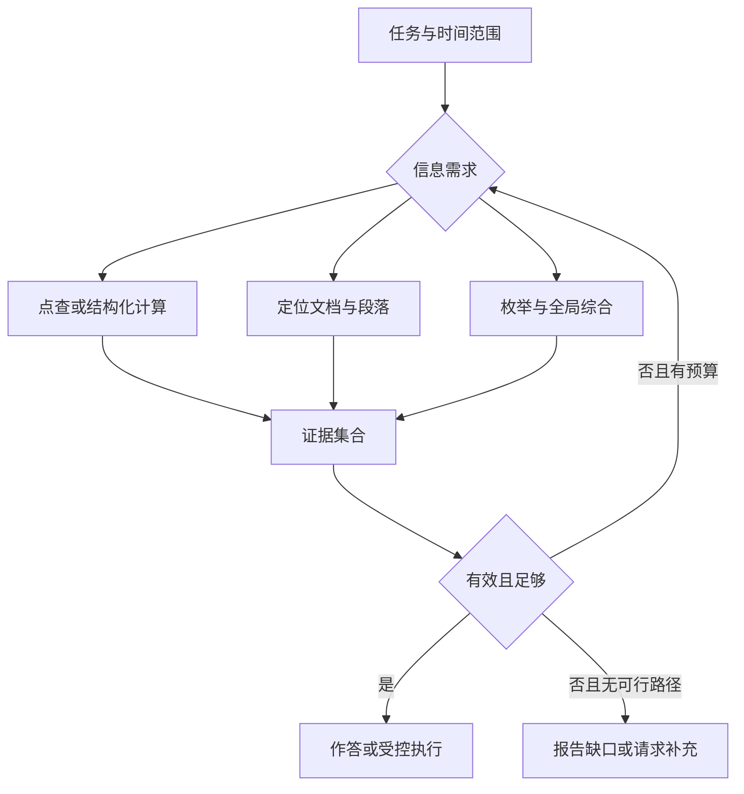
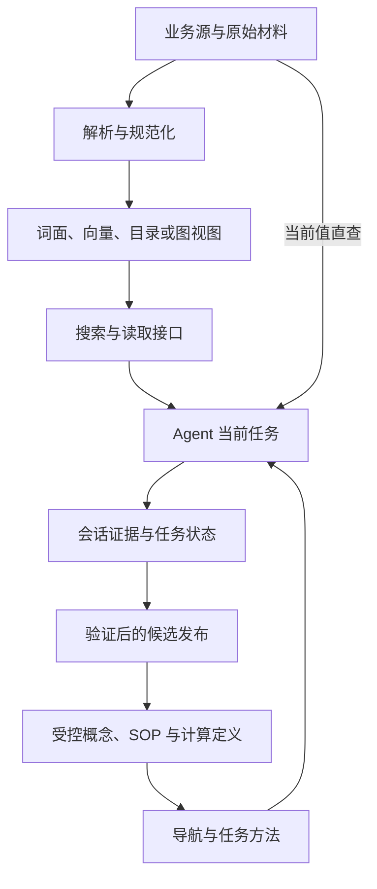
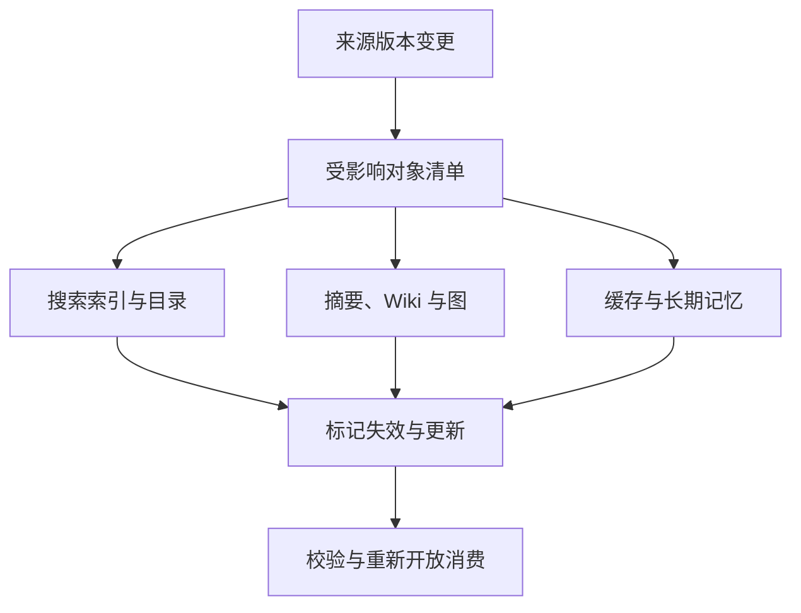
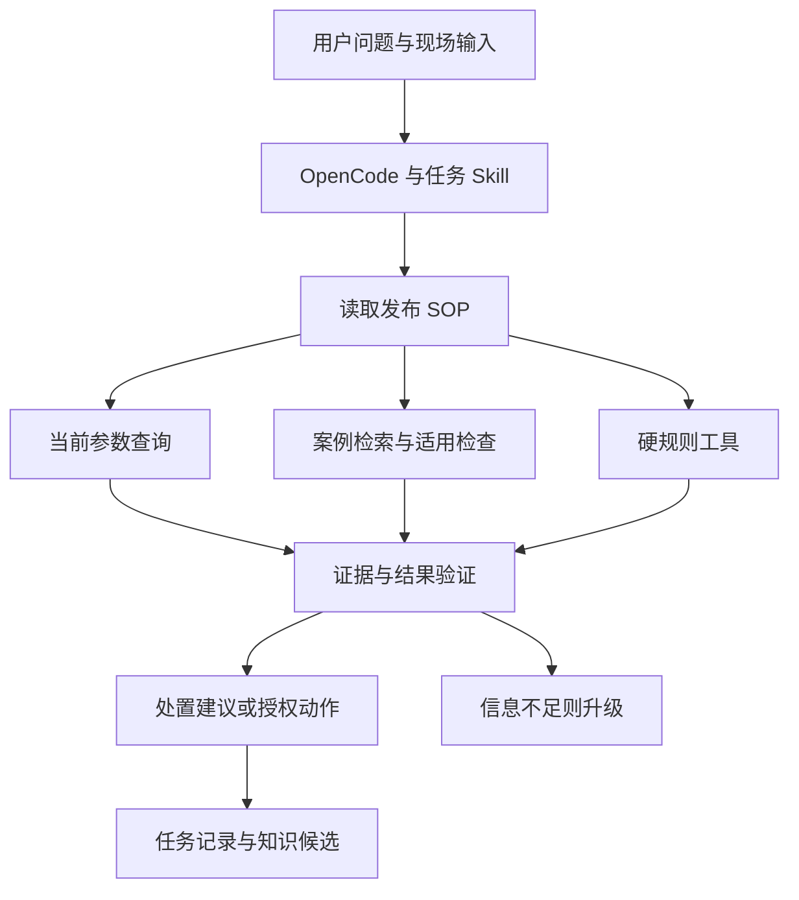

# 智能体知识分层、知识治理与运行时消费指南

> 从数据本身与 Agent 完成任务两个方向，理解 RAG、Agentic RAG、文件检索、工作区、WeKnora、OKF、记忆与知识治理的组合关系。
>
> 版本：v2.1（补充知识放置、模型训练与正反实践证据）  
> 调研截止：2026-11-17，Asia/Shanghai  
> 适用：企业 Agent 平台、OpenCode＋自部署模型、领域知识与业务数据接入。  
> 本次范围：公开论文、规范、维护方文档与仓库的定向核查；未部署或实测所有项目，不把功能声明视为性能结论。

## 阅读约定

- **【原始做法】**：可在引用的论文、规范或维护方文档找到；论文结果仅在作者实验条件内成立。
- **【综合判断】**：对多个来源和工程机制的归纳，并非行业调查或正式标准。
- **【建议／假设】**：面向本项目的设计，需要通过真实任务验证。
- “成熟”说明基础机制已有长期实践；“正在体系化”说明接口与方法逐渐稳定；“探索”说明仍缺少统一评测与可迁移证据。成熟度、采用范围、正确性是三个不同变量。
- 本文所有无外部引用的模板、选型规则、指标设计和落地步骤均为建议，不是某项目的规范原文。

## 目录

1. 原文想理清什么，以及本次关键修正
2. 分类地图：成熟分类、发展中分类与多维坐标
3. 从 Agent 任务出发：需要什么、如何获得、何时停止
4. 从数据出发：不同数据怎样处理
5. 方案地图：RAG、grep、文件树、图、平台与格式
6. 截至调研日的进展与证据边界
7. 知识建设：从源到可消费视图
8. Runtime：按需加载、即时文件、上下文与恢复
9. 治理：更新、冲突、删除、权限与受控写回
10. 非共识但值得验证的 insight
11. SOP、案例、参数与规则的业务落地
12. OpenCode＋自部署模型参考工作区
13. 三种方案与选型
14. 实施、评测与失败诊断
15. 可改写模板
16. 一手资料、状态与阅读顺序

---

# 一、原文想理清什么，以及本次关键修正

## 1.1 真正的问题是知识的供给与治理

【综合判断】原文同时试图回答六件事：

1. **是什么**：事实、概念、规则、流程、案例、状态、记忆分别是什么？
2. **放哪里**：哪些保留在业务系统，哪些进文档库，哪些进 Skill 或任务工作区？
3. **怎么找到**：点查、关键词、向量、目录导航、关系查询分别什么时候用？
4. **怎么消费**：Agent 在哪一步需要什么粒度的证据，如何避免过量注入与断章取义？
5. **凭什么相信**：来源、适用条件、版本、有效期、验证和计算过程怎样被检查？
6. **怎么演化**：会话产物如何晋升，源更新后摘要和索引如何失效，错误如何退役？

这六件事可以统一成：**让合适的信息以合适的权限、时点、粒度和成本进入当前任务，并让后续修改能够被追溯、验证和撤销。**

## 1.2 对 v1.0 的审校结论

| 原文表述／隐含假设 | 修正 | 对架构的影响 |
|---|---|---|
| 行为契约、事实、记忆、派生视图构成一组知识层 | 混合了内容功能、存储形态和治理角色；改用多维坐标 | 一份 SOP 可以同时是程序性、慢变、项目级、人工发布的知识 |
| “原始事实”比“人工策展”天然更权威 | 原始输入也可能错误；权威来自源系统职责、发布流程和适用条件 | 原始工单是“当时记录了什么”的证据，未必是根因真相 |
| 摘要、Wiki、图、案例标签都是可重建派生物 | 自动生成版本通常如此；人工修改、批准的正文也可能成为独立策展源 | 重建前必须保留人工增量，避免覆盖已批准知识 |
| 结构化事实必须走 SQL／API，文档只做解释 | 当前值适合直查；受控发布的规格书也可作为特定版本参数的权威源 | 明确问的是当前值、历史值还是某版规格 |
| Agentic RAG 不适合低延迟、固定业务 | 应限定为不宜默认开放自主循环；有预算的检索子步骤仍可嵌入固定流程 | 技术选择按质量与成本实测，不按标签排斥 |
| Skill 管流程、AGENTS.md 管硬约束 | 两者主要是模型指令；不能替代权限、事务、必经步骤和确定性校验 | 必须遵守的约束移到工具／运行时 |
| grep 适合穷尽匹配 | 只对实际扫描的、可解析的、可访问的范围成立 | 记录扫描范围、排除项、截断和分页 |
| 长期自动写回默认关闭 | 作为共享业务知识的保守起点合理；日志、检查点、显式偏好可分类自动保存 | 不把保存任务状态与发布业务真相混为一谈 |
| Graphiti／Zep、GraphRAG 都是图记忆 | 分别涉及框架、产品、检索架构；不能混称 | 时态历史查询和文档全局综述是不同需求 |
| 全局“高共识”评级 | 公开工程材料不足以证明整个行业共识，改为证据类型＋适用边界 | 避免把维护方经验升级为普遍结论 |
| 引用 arXiv:2603.07379 作为 Agentic RAG 综述依据 | 该条目在当前页面明确标记已被 arXiv Admin 撤下；移出有效论据链 [R24](#r24) | 相关机制改由 A-RAG 与官方工程文档支撑 |
| OKF 仍以 knowledge-catalog/okf 为规范入口 | 已迁到 GoogleCloudPlatform/open-knowledge-format，当前检查版本为 v0.2 [R08](#r08) | 跟踪 canonical 仓库，区分旧快照与现行规范 |
| 2024 年长上下文实验可代表最新模型 | 保留为历史研究，不能外推到 2026 年所有模型 [R13](#r13) | 当前自部署模型重新回放 |

## 1.3 本文建议保留的主线

**权威来源与受控策展 → 多种可追溯视图 → 有预算的访问接口 → 当前步骤的证据工作集 → 结果验证 → 分类型写回。**

不是先选择统一数据库，而是先说清“谁拥有哪类事实、怎样读、何时更新、谁有权发布”。同一后端可以承载多个角色，同一知识也可以有多个消费视图。

---

## 1.4 本轮补充：分层首先服务于放置决策

【综合判断】本轮进一步回答：**模型需要学会什么、当前任务需要知道什么、系统必须保证什么？** 三者分别偏向能力学习、上下文供给和程序执行，但不构成互斥的知识类型。

- 同一业务规则可以有权威正文、提示摘要、程序实现和训练样例；必须明确权威定义、派生关系及更新责任。
- 稳定知识不必全部训练；动态知识也不必全部做向量 RAG。稳定的大表适合点查，动态小表适合 API。
- Skill 是可加载的方法包；Agent 是持续职责与工具边界；runtime 是加载、执行和状态控制机制。三者不能只按文件后缀区分。
- “加载后更有效”“能正确触发”“执行不会绕过”是三个独立问题。正反实践证据与实验边界见 6.4、8.8 和 14.9。

以下新增的分层和选型矩阵是本项目的工程框架，不宣称为新行业标准。

---

# 二、分类地图：成熟分类、发展中分类与多维坐标

## 2.1 不存在已经收敛的“Agent 知识七层标准”

【综合判断】成熟的分类思想很多，但它们回答不同问题。把它们硬压成单一层级，会造成“业务知识是否等于长期记忆”“Skill 是否等于知识库”等伪冲突。

| 分类视角 | 典型分类 | 成熟程度／出处 | 适合解决什么 | 不能推出什么 |
|---|---|---|---|---|
| 内容可表达程度 | 显性知识／隐性经验 | 知识管理中的长期概念；本文仅作解释性借用 | 哪些能文档化，哪些需要示例、示范、实际反馈 | 一份 SOP 不会自动把专家能力完整外化 |
| 认知功能 | 语义／情景／程序性 | 在 Agent 框架文档中已有明确映射 [R03](#r03) | 事实、历史经验、操作方法分别怎么组织 | 这不是存储介质划分，案例可以同时贡献三类知识 |
| 信息结构 | 结构化／半结构化／非结构化／多模态 | 数据工程的成熟划分 | SQL、解析器、文本搜索和视觉读取的选择 | PDF 是文件格式，不代表内部都是非结构化内容 |
| 术语与关系 | 受控词表／分类体系／概念关系 | SKOS 已形成 W3C Recommendation [R19](#r19) | 同义词、上位下位、相关概念与跨体系映射 | 不需要第一天就建设完整本体和图数据库 |
| 数据治理 | 来源／血缘／责任／版本／访问／质量 | PROV 家族、DCAT 等已有标准基础 [R20](#r20)[R21](#r21) | 跨系统发现、追踪与互操作 | 标准元数据不自动证明事实正确 |
| 保留与作用范围 | 会话内／跨会话；个人／项目／组织 | 框架中广泛存在，具体边界不统一 [R03](#r03)[R23](#r23) | 检查点、共享知识和用户记忆的隔离 | 会话结束不代表数据必须被删除；长期保存也不表示每轮加载 |
| 模型侧载体 | 自然语言 token／中间表示／参数 | 新综述正在体系化 [R01](#r01)[R02](#r02) | 区分外置记忆、KV／隐状态、参数更新 | 应用工程师通常不能像改 Markdown 一样直接治理模型内部表示 |
| 运行时供给 | 预加载／即时检索／按需读文件／工具返回／压缩恢复 | 上下文工程正在体系化 [R04](#r04)[R05](#r05) | 决定本轮模型看到什么 | 载入过一次不代表后续永远可用或可信 |

SKOS、PROV、DCAT 的成熟度来自其长期标准化地位，不代表它们已被所有 Agent 产品直接采用。

## 2.2 两份近期记忆综述提供的不同坐标

【原始做法】《Memory in the Age of AI Agents》区分：形式上的 token-level、parametric、latent；功能上的 factual、experiential、working；动态上的形成、演化和检索。[R01](#r01)

【原始做法】2026 年 11 月 AACL 综述采用 natural language tokens、intermediate representations、parameters，并对各类讨论 construction、update、query。[R02](#r02)

【综合判断】共同方向是**载体与生命周期分开分析**，而非围绕“短期／长期”一个维度争论。二者的术语不能逐项机械等同；综述提出的 taxonomy 也不是行业标准。

## 2.3 面向本项目的最小多维坐标

不要求每个 chunk 填满所有标签。先在数据源／文档层记录默认值，必要时由记录或字段覆盖。

| 维度 | 可选值／例子 | 改变什么工程决策 |
|---|---|---|
| 功能 | 契约、方法、概念、事实、案例、任务状态 | 是否需要执行器，是否允许仅作参考 |
| 来源与权威 | 发布版、业务主数据、用户陈述、原始记录、模型推断 | 冲突时怎样裁决 |
| 结构 | 表、记录、段落、代码、图表、音视频 | 如何解析、检索与计算 |
| 变化规律 | 版本发布、事件更新、连续变化、仅本任务有效 | 同步方式、缓存与有效期 |
| 作用范围 | 平台、组织、项目、个人、会话 | 租户／用户过滤与复用边界 |
| 访问形状 | 点查、查找、枚举、聚合、关系遍历、综合 | API、搜索、SQL、图、全量阅读 |
| 决策影响 | 背景解释、候选建议、执行依据、强制判定 | 证据和校验要求 |
| 派生关系 | 原件、解析件、索引、摘要、批准后的策展件 | 重建、失效传播、人工增量保护 |

例子：“产品 P1001 的参数”仍然不够清楚。

- 当前设备实际参数：设备服务／业务 API，运行状态，查询时间必需。
- P1001 v3.2 的额定参数：受控规格书或发布数据库，按版本引用。
- 某历史实验的实测参数：实验记录，按 run／wafer／时间查询。
- 上一次聊天中模型推测的参数：推断候选，不能升级为前三者的事实。

## 2.4 知识、记忆、状态、上下文、缓存的边界

| 概念 | 本文约定 | 重要边界 |
|---|---|---|
| 知识资产 | 为复用而组织的事实、方法、概念和证据 | 不一定来自交互，也不保证无误 |
| Agent 记忆 | 为未来行为保留的交互信息、经验或状态 | 是系统设计角色；可以通过 RAG 读取 |
| 任务状态 | 目标、步骤、已知输入、执行结果与待办 | 应可恢复；不必发布为公共知识 |
| 上下文 | 某次模型调用实际收到的信息工作集 | 文件存在、接口可用不等于已进入上下文 |
| 检索 | 在较大空间内发现和定位候选信息 | 向量只是其中一种方式 |
| 缓存 | 为复用已有计算／读取结果而保留的数据 | 失效策略与访问边界决定是否可重用 |

知识库和记忆可以共享底层存储。更有用的区别是**写入来源、用途、作用域和有效性规则**，而不是要求物理上永远分库。Microsoft 的参考架构也强调共享知识源与交互记忆的职责区别，但这是一种架构约定。[R23](#r23)

---

## 2.5 三种作用方式：参数、上下文与可执行机制

【综合判断】若从一次任务如何产生结果出发，最有解释力的划分不是“所有知识排成七层”，而是下面三种作用方式。

| 作用方式 | 改变什么 | 典型载体 | 主要限制 |
|---|---|---|---|
| 参数化能力与先验 | 模型解释输入、生成答案和选择行动的倾向 | 预训练、领域继续预训练、SFT、偏好优化等产生的权重 | 难对单条事实定点更新、追溯与撤销；能力与事实交织 |
| 当前条件与证据 | 本次推理可使用的指令、事实、示例和观察 | 常驻提示、Skill 正文、检索结果、工具回执、任务状态 | 提供信息不等于被正确理解、遵守或使用 |
| 可执行机制 | 真实计算、允许的动作、必经步骤和状态迁移 | 程序、规则解释器、runtime、权限和校验器 | 程序会忠实执行错误规则；保证受实现与输入边界限制 |

外挂知识库在未被读取时是潜在供给；读取结果才进入当前上下文。程序可以封装领域知识而不把实现全文发给模型。缓存、KV 和隐状态属于另一组表示与性能问题，不宜直接当成业务知识的权威存储。

### 内容功能与部署位置交叉，而非一一对应

| 内容功能 | 例子 | 常见组合 |
|---|---|---|
| 概念与表示 | 术语、单位、工艺阶段、指标含义 | 模型具备基础理解；术语表给本企业定义；Schema 消除字段歧义 |
| 事实与证据 | 某次实验结果、现行规格 | 源记录＋查询接口＋本轮可定位引用 |
| 方法与策略 | 如何诊断、如何选择模型 | Skill＋示例；稳定步骤可程序化；通用能力可训练 |
| 规范与约束 | 不允许跨产品写入、必须校验版本 | 提示解释理由；工具和 runtime 实施检查 |
| 导航与元知识 | 数据在哪、怎样查、覆盖什么 | 小型常驻目录＋Skill 查询配方＋数据源注册表 |
| 状态与经验 | 已完成步骤、失败尝试、候选教训 | 会话检查点；经验经评估后才晋升为复用资产 |

## 2.6 知识究竟放在哪里：默认放置矩阵

以下是设计起点，不是强制标准。这里的“常驻”指在相关任务的模型调用中可见；不能假设所有 runtime 每轮都会重新注入同一文件。

| 位置 | 适合承载 | 不宜承担 | 最小检验问题 |
|---|---|---|---|
| 模型参数 | 高复用、可泛化的表示与任务能力 | 当前业务真值、逐用户权限、精确可撤销知识库 | 是否在新样本上提升，且值得训练维护成本？ |
| 常驻提示／AGENTS.md | 短小、高频的任务契约、环境差异、关键导航与触发线索 | 全部 SOP、长案例集、低频例外全集 | 不先知道它，是否会漏掉该查的资源？ |
| Agent 配置／说明 | 持续职责、任务边界、工具范围、交付标准、升级条件 | 不断复制各领域知识正文 | 是否真需要独立上下文或工具边界？ |
| Skill | 条件触发的可复用做法、分支、示例、查询配方、脚本入口 | 权限控制、事实总库、无条件冗长清单 | 何时触发，加载后改变哪个决策？ |
| Runtime／harness | 发现和加载、状态、预算、授权、必经检查、重试与恢复 | 频繁改动的业务解释正文 | 哪些行为必须由系统保证？ |
| 脚本／工具 | 确定计算、解析转换、规则校验、受控动作 | 未经确认的经验假设与不确定诊断 | 输入输出与适用条件能否明确验收？ |
| 外部权威源／知识库 | 可更新、可定位的事实、SOP、案例、文献、版本资料 | 自动保证知识正确或处置成功 | 谁拥有真值，如何更新和回源？ |
| 会话工作区／检查点 | 本次文件、阶段产物、待办、证据快照与执行结果 | 未经审查的组织级长期结论 | 能否恢复任务并区分观察与推测？ |

**目录归属不等于治理归属。** 一个 Skill 目录可以打包静态参考文档和脚本，也可以只保存远程 API 的消费说明。共享业务规则最好引用其受控来源，避免复制到几十个 Skill 后分别维护。

## 2.7 什么值得训进模型：学习能力与存储事实分开评估

【建议】训练候选至少同时检查六项：复用频率高；变化速度可接受；有多样且可信的训练数据；期望的是跨样本泛化；有独立评测与回归检查；收益覆盖训练、部署与更新成本。**稳定只是其中一项，不能单独作为训练理由。** 一张多年不变但需要精确引用的百万行映射表，仍可能更适合数据库。

| 方法 | 可以尝试改善什么 | 必须防止的误解 |
|---|---|---|
| 领域继续预训练（CPT／DAPT） | 领域语言、术语搭配、表示与基础理解 | 读过语料不等于学会可靠工具操作或精确引用 |
| 监督微调（SFT） | 输入输出映射、提取、格式、工具使用、证据消费行为 | 学会答案风格不等于掌握新事实；错误示范会固化 |
| 偏好优化／强化学习 | 在可判别反馈下改善选择策略与任务行为 | 奖励是代理指标，可能奖励表面合规或迎合评分器 |
| 蒸馏 | 将高成本而经验证的行为压缩到较小模型 | 轨迹流畅不等于正确；必须过滤失败和数据泄漏 |

这些不是互斥路线，也不是能力的严格分工。DAPT 在早期多领域分类任务上有效，为领域适配提供证据；它不能直接证明对今天的长程 Agent 同样有效。[R29](#r29) 关于新知识微调的研究发现了学习困难及事实性下降的条件；这提醒我们区分“知识记住了多少”和“遇到未知时会不会乱答”，不等于证明微调不能学习事实。[R30](#r30)[R31](#r31)

更贴近本平台的训练目标可能是：识别术语与字段关系；判断案例是否适用；选择正确查询；从文档中抽取带条件的证据；发现证据不足时继续查或报告缺口。当前参数、当前权限和具体执行结果仍回源。RAFT 将相关文档与干扰文档纳入训练，是“训练如何消费检索证据”的代表做法；其域内开放书实验不能替代本企业的分布外验证。[R32](#r32)

半导体例子：模型可学习理解 recipe、wafer、run 和工艺阶段的关系；本次实验值通过表格／API 获得；数值预测可以交给 GPR、树模型或物理模型；约束由校验程序执行。系统知识不必全部由 LLM 参数承载，业务历史数据也不应未经实验就全部变成语言模型微调数据。

---

# 三、从 Agent 任务出发：需要什么、如何获得、何时停止

## 3.1 先判定任务中的信息需求

【建议】一个任务往往同时包含多种需求，不能只给整个会话打一个“知识问答”标签。

| 子问题 | 信息需求 | 最小访问路径 | 完成条件 |
|---|---|---|---|
| “这个术语是什么意思？” | 概念与口径 | 术语表→权威定义段落 | 定义与使用范围清楚 |
| “当前哪个产品受影响？” | 当前事实与完整枚举 | API／SQL＋过滤＋分页 | 范围、总数、未返回项可说明 |
| “这次报错像哪个历史问题？” | 案例发现与适用性判断 | 错误码／产品过滤→混合搜索→完整案例 | 相似与差异均有证据 |
| “应该怎么处理？” | 程序性知识＋现场状态 | SOP＋参数查询＋必要规则检查 | 前置条件、步骤和停止条件齐备 |
| “全库有哪些共同趋势？” | 全局覆盖与综合 | 元数据枚举／聚合→分组阅读或全局图摘要 | 覆盖范围可证明，避免以 top-k 代替整体 |
| “比较这两版文件” | 成对对齐与差异 | 两份完整解析件→diff／表格比较 | 所需范围都读到、差异可定位 |
| “本次计算是否按规定完成？” | 定义＋执行回执 | 受认可计算契约＋工具回执＋校验器 | 输入、版本、执行证据和结果可核对 |

**查找相关材料、枚举所有对象、计算总量、证明没有对象，是四种不同任务。** top-k 搜索成功不能证明后面三种任务成功。

## 3.2 基础控制流



图中的“有效”包括实体、时间、权限、适用版本和证据间一致性；“足够”相对于任务，不是相对于检索器的相似度阈值。

## 3.3 Agentic 决策的自由度应分级

- **固定管线**：预定义检索和校验顺序，模型负责语言理解与回答。
- **有界自适应**：允许改写查询、选择读取父段或换一个源，但调用预算和工具集合固定。
- **开放调查**：允许拆解问题、多源搜索、追踪引用；仍需预算、证据契约和结束条件。

【建议】自部署模型先从有界自适应开始。将“需不需要检索”“搜哪里”“何时停止”全部开放，会把模型能力问题和检索质量问题混在一起，难以诊断。

停止条件可以是：必要字段已得到当前权威值；问题涉及的每个产品已有证据；再搜一轮只出现重复内容；工具明确无访问权限；或达到本任务预算。不能把模型的自信程度当成唯一结束条件。

---

# 四、从数据出发：不同数据怎样处理

## 4.1 “即时／稳定／应用／业务”不是互斥分类

【综合判断】“即时、稳定”描述时间特性，“应用、业务”描述归属。应用配置也会频繁变化，业务标准也可能多年不变；一份即时上传的规范还可能已经废止。应该交叉标注。

| 数据与场景 | 建设／权威位置 | 推荐消费 | 更新／失效 | 主要误区 |
|---|---|---|---|---|
| 稳定数学常识、通用语言能力 | 模型能力＋必要参考资料 | 可直接推理；精确要求时查来源／计算 | 模型与材料版本 | 把所有常识复制成知识库 |
| 标准、产品规格、已发布 SOP | 受控文档或 Git 发布版 | 版本导航、精确定位、RAG／全文 | 发布触发更新，保留被替代版本 | 把“近似稳定”理解为永不复核 |
| 应用侧工具说明、字段含义、Skill | 代码／Schema／版本化文档 | 少量目录预加载，正文按需读 | 随应用版本发布并回放 | 工具改了而说明与 Skill 没改 |
| 应用实时权限、能力与配额 | 当前策略服务／runtime | 工具网关实时判定 | 立即生效或明确传播上限 | 让 AGENTS.md 充当权限系统 |
| 快变业务值、库存、状态 | 业务 DB／API／事件读模型 | 主键点查、受控 SQL、批量接口 | 源事件、短 TTL、as_of | 向量检索副本被当作当前值 |
| 业务指标与口径 | 语义模型＋受认可查询／代码 | 先确定定义，再计算 | 口径发布＋数据时点 | 算对 SQL 却用了错误业务定义 |
| 大量经验文档与工单 | 原始记录＋经确认案例 | 过滤、关键词与语义检索、读完整案例 | 修订根因、适用版本和验证状态 | 关闭工单就等于根因已证实 |
| 即时上传的 Markdown／代码 | 会话原件＋文件 manifest | read、rg、结构化解析 | 任务结束按保留规则处理 | 每个上传文件都进入共享向量库 |
| 即时表格、配方、批次数据 | 原始工作簿＋保结构解析件 | Schema 预览、代码统计、按键关联 | 修改后失效相关计算 | 把数值表切成文本后靠相似度求和 |
| 扫描 PDF、PPT、图片、图表 | 原件＋OCR／版面结构／图片 | 文本定位＋原页视觉核对 | 解析器／模型升级可重建 | OCR 把负号、单位、合并表头读错 |
| 连续日志、监控、遥测 | 日志／时序系统 | 时间窗查询、过滤、聚合、按需导出 | 保留窗口、流式更新 | 不断把原始日志追加到 prompt |
| 外部网页、论文、官方文档 | 外部原文＋必要快照 | 搜索发现→打开原文→追溯引用 | 抓取时间、发布日、修订日 | 搜索摘要／发布日期替代事实核查 |
| 用户偏好、项目进展 | 分作用域状态／记忆存储 | 定向读取，带来源和更正机制 | 用户更正优先、到期复核 | 个体偏好流入组织公共知识 |
| Agent 提出的新流程／结论 | 候选区 | 仅在任务内使用或待验证 | 验证后发布、支持撤销 | 模型生成即成为稳定知识 |

## 4.2 同一原件需要不同视图

以 CH Recipe、control table 和阶段 PPT 为例：

- 原始文件保留版本与实验／批次关系。
- 配方参数提取为带单位、阶段、产品／wafer／run 标识的表，用程序关联和计算。
- PPT 的工艺假设、阶段解释、异常图形保留在叙事／视觉证据中。
- 另建很小的来源地图，说明三个文件怎样关联、缺失哪个键时不能硬拼。
- 文档搜索用于找到相关阶段；数值结论必须回到相应表格与计算。

这是“**一个来源、多个可消费视图**”，不是一份资料只能属于一种知识类别。

## 4.3 索引是否值得建立，取决于生命周期成本

【建议／假设】比较总成本：

`接入与解析 + 建索引 + 更新与删除 + Q × 每次查询成本 + 错误带来的返工成本`

Q 是预计重复查询次数。一次上传、只用一次的小文件通常直接解析与阅读更划算；反复被多个任务引用的大文档可能值得做目录、全文、向量或图索引。这里没有通用的“100 篇以上必须 RAG”阈值。

数据变化速度与索引同步能力必须匹配。允许的旧值窗口短于同步延迟时，查询当前值就应回源或使用有明确一致性保证的读模型。

---

# 五、方案地图：RAG、grep、文件树、图、平台与格式

## 5.1 先放到正确层次

| 名称 | 所在层 | 强项 | 不自动解决 |
|---|---|---|---|
| RAG | 推理时检索增强范式 | 将外部证据接入生成 | 不限定一定使用向量库，不保证证据正确 |
| 固定／混合 RAG | 检索管线 | 可预测、容易测量、词面与语义互补 | 复杂探索、全局覆盖 |
| Agentic RAG | 决策与编排 | 模型选择查询、工具、阅读与下一步 | 成本、停止、治理和执行可靠性 |
| rg／grep、glob、read | 定位与读取工具 | 精确标识符、代码、已知目录和文件 | 同义概念发现、授权、语料完整性 |
| 文件树／任务工作区 | 任务数据与状态载体 | 证据外置、可寻址、可恢复 | 自动索引、事实正确、跨租户隔离 |
| git worktree | Git 工作树管理 | 在同仓库拥有多个工作树 [R22](#r22) | OS 安全边界、独立凭据、知识检索 |
| GraphRAG | 图辅助检索架构 | 实体联系、社区综合、多跳线索 | 所有问题都更准确、关系天然真实 |
| PageIndex | 目录树索引与导航实现 | 长文档按章节定位 [R12](#r12) | “无向量”不等于无索引、无成本 |
| WeKnora | 知识与 Agent 产品平台 | 接入、检索、管理与交互集成 | 你的具体数据一定适配、部署一定轻量 |
| OKF | 知识表示与交换格式 | 可读、可链接、可版本化的概念包 | 检索服务、权限执行、事实担保 |
| Skills | 程序性指导与资源包 | 按需发现和读取任务方法 | 不保证模型逐步执行，也非安全沙盒 |
| MCP | 工具／资源连接协议 | 以统一方式连接服务 | 不是检索算法、知识分类或授权策略本身 |
| Fine-tuning／参数更新 | 模型行为与能力塑造 | 学习可泛化模式、领域表示与知识消费能力，详见 2.7 | 不天然解决快变事实的可追溯更新与精确删除 |

广义上，Agent 先 grep 找到文件再把证据用于生成，也符合检索增强的思想。“grep 对 RAG”通常实际上在比较文件式自主搜索与某种固定向量检索实现，不是两种互斥哲学。

## 5.2 固定混合 RAG：合理基线，而非万能默认

【原始做法】Contextual Retrieval 给 chunk 加入文档级定位上下文，并结合词面检索、向量和可选重排；其收益是作者指定语料与评测上的结果。[R06](#r06)

【建议】基线流程：授权范围→实体／版本过滤→关键词与向量召回→融合→必要重排→读取证据→回答与引用。

- chunk 保留章节、文档 ID、来源位置，避免孤立句子。
- 产品号、错误码、缩写走精确或词面通道；中文分词与中英混合标识符要单测。
- 同义词可以先用术语表、别名表补足，不必立即换大 embedding。
- rerank 并非必需：候选已经很准时，其成本可能大于收益。
- 不要将语义相似度写成“事实可信度”。

失败时分清：解析错、搜索范围错、召回错、读错、版本错、生成错。更强的向量模型不能修复所有问题。

## 5.3 Agentic RAG：把检索决策暴露出来

【原始做法】A-RAG 暴露 keyword search、semantic search、chunk read，使模型能选择检索粒度与进一步读取；其开放域 QA 结果支持接口设计的可行性，不足以证明企业任务普适优势。[R07](#r07)

【建议】对外先给少量能力：

| 操作 | 输入 | 返回 | 对模型的价值 |
|---|---|---|---|
| 发现数据源 | 问题类型／领域 | 源描述、时间与权限约束 | 不必盲搜全部库 |
| 搜索候选 | 查询＋可验证过滤条件 | ID、snippet、版本、下一页 | 先导航、后读取 |
| 读取证据 | 稳定 ID＋版本＋范围 | 原文、父段、位置 | 保留条件与上下文 |
| 查询事实 | 主键／时间点 | 结构化值＋来源＋as_of | 减少自然语言猜值 |

这些是接口角色，不要求一定实现四个新服务。可映射到现有 API、CLI 或 MCP。

必须设置失败分支：无命中、无权限、未索引、解析失败、范围不完整、工具不可用分别返回；不能全部压成“没有相关知识”。

## 5.4 文件搜索与目录导航

【原始做法】Claude Agent SDK 工程材料把文件搜索、语义搜索、文件系统上下文和验证放在同一个 Agent loop 中。[R05](#r05)

【建议】对当前工作区和策展目录，先目录／文件名导航，再 rg 精确定位，再读完整章节，是低依赖的强基线。但以下条件会使它退化：无意义文件名、只有图片的 PDF、目录过深、同一概念跨大量异构文档、用户表达与原文几乎无词面重叠。

“没有搜到”只证明特定命令在特定范围没有匹配。必须知道默认是否跳过隐藏文件、忽略文件、二进制和超大文件；输出有没有截断；当前工具能否访问所有授权资料。

树导航也可能错误剪枝。目录摘要找不到时，允许退回全文／混合搜索，而不是让第一步分类决定永久漏召回。

## 5.5 GraphRAG、LightRAG 与时态图不是同一个方案

【原始做法】Microsoft GraphRAG 文档提供 Global、Local、DRIFT 和 Basic Search 等不同查询方式；Global 以社区报告辅助整体性问题，Local 结合实体关系与原文，Basic 保留基本向量检索作比较。[R10](#r10)

【综合判断】图有价值的前提是问题确实依赖关系或跨文档组织。关系可以来自：业务系统既有外键、人工维护依赖、确定性解析、模型抽取。它们的可信度和维护成本不同。

LightRAG 是另一套图增强检索实现；其文档删除涉及 chunk、向量、图与共享实体的同步维护，不应只验收 insert 成功。[R11](#r11)

Graphiti 更侧重时间变化的实体事实、episode 来源与历史查询；开源框架周边的租户、访问控制和服务运维仍需应用自己建设。[R14](#r14)

对于“列出所有受影响产品”，若数据库已有完整依赖关系，先用关系查询或受控图遍历；不要先将关系转成自然语言，再由 LLM 从文档中猜回图。

## 5.6 WeKnora：按组件验收的平台

本次官方 README 已列到 v0.9.0（2026-10-29），并列出检索、Wiki、按需附件、图像与多模态检索等能力演进。[R09](#r09)

适合把文档接入、业务用户管理界面、搜索与引用管理集成起来。接入 OpenCode 时，可只用它的知识接口，不必把平台内另一个 Agent runtime 也串成必经控制层。

【建议】逐项验收解析、当前版本过滤、权限撤回、引用落点、更新延迟、接口分页和导出能力。功能存在不等于满足 SLA。

内网无 Docker 的场景：当前 README 列有 Lite 单二进制路线；先验证目标系统和所需功能是否覆盖，不能把 Lite 与标准部署能力视为等价，也不能假设完整平台只是 npm install 即可。[R09](#r09)

## 5.7 OKF：概念契约与计算验证

【原始做法】现行 v0.2 规范支持 Markdown＋frontmatter 的概念、来源、生成／验证记录、生命周期与 Attested Computation；后者区分定义确认与单次计算的回执检查。[R08](#r08)

【建议】借鉴四个检查：写出了什么；谁在什么版本确认；现在是否仍有效；本次计算是否按认可的方法执行。

格式可读不代表必须接受其中的执行指令。`verified` 是验证记录，不是权限授权和绝对真值。企业可以增加业务消费门槛，但应将其称为本地治理策略，而不是谎称是 OKF 必需字段。自动生成与人工维护内容最好分区，以便更新时保留人工增量。

## 5.8 可以怎样组合



WeKnora 可以承载图中多个组件；OKF 可作为 K 的表示；Skills 可表达 N；文件系统可承载 W；Agentic RAG 是 A 与 R 的交互策略。它们没有统一的升级先后关系。

---

# 六、截至调研日的进展与证据边界

## 6.1 有哪些成熟基础与发展中方向

| 方向 | 本次看到的可核查进展 | 证据等级与限制 | 本项目决策 |
|---|---|---|---|
| 术语、来源与目录治理 | SKOS、PROV、DCAT 已有稳定标准基础 [R19](#r19)[R20](#r20)[R21](#r21) | 标准成熟；不代表完整 Agent 解决方案 | 先借字段和关系语义，不急于引入全套 RDF |
| 外部检索与原文定位 | 混合检索、上下文 chunk、重排与文件读取均有可用实现 [R05](#r05)[R06](#r06) | 基础机制成熟；配置仍依语料 | 建立可回放基线 |
| Skills 与渐进披露 | 公开 Agent Skills 规范和 OpenCode 加载机制 [R15](#r15)[R16](#r16) | 格式正在标准化；各 runtime 兼容性不同 | 采用可移植子集，版本锁定 |
| 检索自主决策 | 2026 A-RAG 的分层接口 [R07](#r07) | 研究证据；未在本项目复现 | 试有界自适应，与同预算基线比较 |
| 结构化文档导航 | PageIndex 目录树路线 [R12](#r12) | 开源项目和维护方实验；非通用替代证明 | 针对长文档作为第三条基线 |
| 图方法分工 | GraphRAG 多查询方式；对比研究更新到 2026-11-07 v4 [R10](#r10)[R18](#r18) | 各任务强弱不同，不能单一排行榜概括 | 关系／全局分桶，避免默认全图化 |
| 平台从 RAG 扩展为知识工作环境 | WeKnora 的 Wiki、附件、图像、Agent 能力集成 [R09](#r09) | 产品功能证据；不证明每项都高质量 | 按实际缺口选择组件 |
| 知识契约与证实计算 | OKF v0.2 独立仓库 [R08](#r08) | 早期格式，未证明已成普遍标准 | 需要可交换概念与计算定义时采用 |
| 记忆的多轴分类 | 2026 年综述区分表示、功能与管理过程 [R01](#r01)[R02](#r02) | 研究在收敛问题意识，taxonomy 仍多套并存 | 用多维字段，保留映射能力 |
| 召回后的治理选择 | 2026 年 11 月 MemGov 将约束检查放在检索与上下文之间 [R17](#r17) | 新研究；受控场景与特定约束下的结论 | 借鉴“相关不等于可同时使用”，先实现简单规则 |

## 6.2 什么可以称为较稳健的工程交集

【综合判断】多个来源反复出现：外部信息需可追溯；上下文有成本；读取可分层；事实有时点与范围；共享记忆必须有边界；检索结果需要评测。本文将其称为“工程交集”，不声称存在正式、全行业的共识投票。

以下没有足够证据作为普遍共识：

- 文件搜索已经取代 RAG；
- GraphRAG 一定比混合 RAG 好；
- Wiki 编译后可丢弃原始资料；
- 一个长期记忆服务能统一承担所有业务事实；
- 自动巩固记忆越多，Agent 越可靠；
- 模型更强后就无需权限、时效和来源治理。

## 6.3 新近且有启发性的研究：治理不等于重排

【原始做法】MemGov 将候选记忆包装成显式对象，以 must-link／cannot-link 等约束对候选集合进行修复，或输出无法安全组合的可审计说明。[R17](#r17)

【综合判断】它提醒我们：答案所需证据已被召回，仍可能混入已删除、陈旧或冲突事实。rerank 解决相关性，治理检查解决是否有资格被使用、是否可共存。

【建议】先不复制整套算法，先实现可确定判断的条件：当前问题不使用已撤回版本；不同产品 ID 不混合；不可同时采用互斥配置；需要成套出现的数值必须带单位与测量条件。对于尚未被建模的语义冲突，依然可能漏判；“通过约束”不等于“内容真实”。

---

## 6.4 Skills 与常驻上下文：正反证据必须放在一起看

以下结果来自不同任务、模型、harness 和评价协议，**不能跨行比较分数，也不能合并成统一效果估计**。

| 来源与证据性质 | 原始观察 | 能借鉴什么／不能推出什么 |
|---|---|---|
| Vercel，2026-01-27，自有 Next.js 任务评测 | 基线 53%；默认 Skill 53%；明确触发提示后 79%；压缩到约 8KB 的 AGENTS.md 文档索引方案 100%。默认 Skill 在 56% 评测案例中未被调用 [R33](#r33) | 发现与触发可能比正文质量更先成为瓶颈；这是其具体任务结果，不是 AGENTS.md 普遍优于 Skill |
| SkillsBench，当前 v4，2026-06-14，研究 benchmark | 87 个任务、8 个领域、18 个模型与 harness 配置；策展 Skills 的平均成功率从 33.9% 到 50.5%，增加 16.6 个百分点；报告不同配置收益差异 [R34](#r34) | 经策展、任务相关的方法包可有显著价值；不说明任意自动生成的 Skill 都有价值，也不能把百分点写成相对百分比 |
| ETH《Evaluating AGENTS.md》，2026，研究团队页面 | 报告仓库上下文文件未改善任务成功，并增加超过 20% 推理成本；不必要要求促使更多探索和测试 [R35](#r35) | 常驻内容可能增加负担；不是证明所有项目说明都无用 |
| Microsoft《Agent Skills Can Be Harmful》，2026-08，差分失败分析 | 在两个 benchmark 中分析 307 个归因回退案例，含 125 个功能回退与 182 个效率回退；过度验证和重型流程是其中两类 [R36](#r36) | 相关知识也可能施加错误流程负担；307 是被分析的回退样本，不能用作总体失败率分母 |
| Claude Code issue #39502，2026-03-26，单用户反馈 | 用户报告开始遵守要求、长对话中逐步偏离；后被 stale／not planned 关闭 [R37](#r37) | 值得加入长会话回放；未经受控复现，不证明普遍发生、不证明根因，也不证明关闭代表修复 |

【综合判断】这些证据并不矛盾：导航解决“能否发现”，方法包解决“发现后怎么做”，控制机制解决“哪些步骤不能跳过”。任务若主要缺少新 API 文档，短索引可能很有效；若缺少专业流程，聚焦的 Skill 可能有价值；若模型已经会做，冗长要求反而可能拖慢或干扰。

【建议】将每条 Skill 指令标成三种语义：**确有业务依据的必需步骤、特定条件下的步骤、可选提示**。不要把“可考虑交叉验证”写成“每次必须重做完整实验”，也不要把教学用的全面流程直接当生产默认流程。这里的标记是作者设计建议，不是 Agent Skills 规范新增字段。

---

# 七、知识建设：从源到可消费视图

## 7.1 建设顺序

【建议】先注册来源，再改善解析与定位，再建立最小搜索，最后增加复杂视图。

| 阶段 | 最小产物 | 首要验收 |
|---|---|---|
| 源注册 | owner、权威范围、访问方式、更新规律、作用域 | Agent 知道去哪查、何时必须回源 |
| 原件保存／引用 | 稳定标识、版本、原始位置 | 可以重现本次证据 |
| 解析与规范化 | 文本层级、表格结构、页面／单元格定位 | 原文的重要条件未丢失 |
| 发现与导航 | manifest、目录、术语／别名表、接口说明 | 从真实问题能找到正确数据源 |
| 搜索视图 | 首先词面／结构化，再按缺口加语义 | 分桶召回质量与成本 |
| 策展与编译 | 概念页、FAQ、案例、图、方法 | 每条关键事实可回链，人工增量可保护 |
| 发布与更新 | 版本、依赖、变更事件、失败队列 | 旧版本不再被误用，删除可传播 |

## 7.2 解析保真比“统一转 Markdown”更重要

【原始做法】DoclingDocument 表达文档层级、文本、表、图片、布局与来源位置，可输出面向不同消费方式的表示。[R25](#r25)

【建议】原件保留；结构化解析件作为机器视图；Markdown 用于阅读。不能为了文本统一性丢弃单元格坐标、合并表头、图例、脚注、否定条件与页面定位。

解析验收样例：带负号和科学计数法的参数；跨页表；多级标题；图中阈值；修订记录；含“除非／仅适用于”的 SOP。原始抽取出错时，后续索引越完善，错误可能传播越广。

## 7.3 知识引导材料应当写什么

Source Map 是“如何找到知识的知识”，其内容可以非常小：

| 源 | 知道什么 | 不知道什么 | 首选查询键 | 更新与引用要求 |
|---|---|---|---|---|
| 产品 API | 当前参数与状态 | 原始设计动机 | product_id＋version | 必须 as_of |
| 案例库 | 经历与已验证方案 | 当前现场是否完全相同 | 错误码、产品、症状 | 读适用条件和验证结果 |
| SOP 仓库 | 正式流程与停止条件 | 本次环境的实际状态 | task_type＋发布版本 | 引用发布 ID |
| 实验数据 | 配方与实测结果 | 未采集的机制因果 | run_id／wafer／stage | 单位、测量条件、批次 |

先通过少量探测查询了解词汇分布和典型命中，再形成别名和查询配方，是合理起点。但不能把若干关键词的命中数当成全库知识覆盖图：零命中可能是词汇差异、权限或索引未完成。

## 7.4 可编译，但要有依赖

【建议】离线将重复使用的材料整理为概念页、FAQ、摘要和流程，适合稳定且高复用语料。每个派生物记录：依赖哪些文档版本、生成器／模型版本、人工修改与验证状态。

源变更时不必立刻重建全库，先标记受影响视图不可用于当前结论，再重建相关项。若派生链很深，应缩短或周期性从原件重建，以免“摘要的摘要”逐渐偏离事实。

---

# 八、Runtime：按需加载、即时文件、上下文与恢复

## 8.1 按需加载不是只建设一个目录

【原始做法】Agent Skills 将元数据、指令和附属资源分层披露；OpenCode 提供相应发现与加载机制。[R15](#r15)[R16](#r16)

【建议】按需加载有四次可能失败：根本没发现该源；发现但误判不该用；载入正文却没读必要附件；读到了但未在关键步骤使用。必须分别观察，不能只统计“Skill 加载次数”。

| 加载阶段 | 内容 | 推荐粒度 |
|---|---|---|
| 会话启动 | 核心任务、少量行为规则、可用能力与源目录 | 简短且稳定 |
| 意图确定 | 对应 Skill、SOP 索引、相关源说明 | 一个任务相关集合 |
| 查证阶段 | 命中文档、参数记录、父段与必要图表 | 一个可支持结论的证据单元 |
| 决策／计算 | 当前值、完整约束、版本与工具结果 | 足以校验当前动作 |
| 压缩恢复 | 目标、决策、证据地址、未决问题、下一步 | 可重新展开的状态 |

“加载”与“保留在后续每轮 prompt”是两回事。真正卸载需要 runtime 从后续请求中省略相应内容；Skill 写一句“完成后卸载”并不能保证实现。

## 8.2 即时会话文件的消费流程

1. **登记**：记录原文件、类型、大小、来源、作用域、版本与处理状态。
2. **预览**：先看目录／页数／表名／字段／少量样本，确认文件与任务的关系。
3. **选择视图**：文本读章节；表格读 Schema 后用代码查询；扫描资料做 OCR 并保留原页；多文件建立关联键。
4. **按需处理**：小文件直接读；大文件先导航再局部读；重复查询再建会话临时索引。
5. **验证**：关键数值回单元格；关键结论回原段／原页；无法关联的记录保持未知。
6. **结束**：产物与本次证据按任务规则保留；跨会话复用单独决定，默认不自动发布到共享库。

**即时文件是一条接入路径，不是低权威的同义词。** 用户刚上传的盖章发布规格书可能很权威；几年前的聊天记录也可能毫无当前效力。

## 8.3 文件 manifest 示例

以下是自定义示例，省略真实 hash；字段不是产品规范。

```yaml
files:
  - file_id: input-control-table-v3
    path: inputs/control_table.xlsx
    role: experiment_conditions
    scope: session
    source_version: v3
    parse_status: ready
    views:
      schema: parsed/control_table.schema.json
      rows: parsed/control_table.parquet
    join_keys: [run_id, wafer_id, stage]
    caveats: ["单位以原始表头为准", "部分 run_id 缺失，不得靠行号强配"]
```

## 8.4 外部公开知识检索

【建议】搜索引擎用于发现，原文用于证实。对“最新”，同时检查事件发生日、发布日、修订日和访问日。仓库 main 与最新稳定 release 不是一回事。

查询顺序可从产品官方文档、原始仓库、论文、规范开始，再用 issue 发现维护问题。issue 是具体报告而非普遍故障率；开源维护方 benchmark 需要确认语料、模型、调用预算和基线。

保存最小可复核证据：canonical URL、标题、相关段落／页面、访问日；在许可和环境允许时保留快照。站点不可访问时写明未核实，不用搜索摘要补成确定事实。

## 8.5 上下文装配与大结果外置

【原始做法】上下文工程强调持续选择当前步骤所需信息；Deep Agents RAG 文档提供 skills-guided retrieval、证据评分以及文件外置等可组合方式。[R04](#r04)[R26](#r26)

【建议】主上下文保留当前判断所需证据，大量日志／表／全文外置。路径之外还要带：内容简述、作用域、版本、可读取范围、必要 caveat。只有路径却没有可靠读取工具，会形成“知道有证据，却无法消费”的假外置。

工具若直接返回足够短的完整记录，可以立即用；不要求一切先落盘。多个高度相关步骤反复读取同段时，可在预算内保留，避免无意义反复 I/O。

## 8.6 恢复与重试

【原始做法】LangGraph 将 thread 检查点与跨 thread 的 store 区分开，分别处理运行状态和长期数据。[R27](#r27)

【建议】runs 目录是一种可读状态载体，但不能单独保证完整恢复。至少记录 task_id、attempt_id、当前阶段、已完成工具调用及结果引用、源版本和下一步。

恢复时：稳定定义可沿用固定发布版；快变事实过期则重查；写操作检查幂等键或真实状态，不能因为“没在笔记看到成功”就重复执行。推荐同 task 下追加 attempts，而非每次重试换一个无法关联的新 task。

## 8.7 证据单元应足够支持决策

一次检索返回完整短字段，可能已够回答；长文档 snippet 通常只适合定位。不要机械地规定每次必须读整篇，也不要用一个无条件的半句话支持整个动作。

例如参数阈值的最小证据可能是“数值＋单位＋温度＋产品版本＋测试方法”；SOP 步骤的证据可能包含前置条件和例外分支。证据粒度由任务语义决定，不由固定 token 数决定。

---

## 8.8 按需加载的启动问题：先知道什么，才能知道要加载什么

【建议】把“发现资源—决定加载—加载成功—正确使用”分别记录。资源目录存在，只解决了可发现性的一个前提。

1. 常驻层保留最小触发线索：适用任务、输入特征、资源入口和关键排除条件。
2. 加载 Skill 后再披露方法与分支，按当前分支读取参考文件；不要无差别读完整目录。
3. 已有明确任务类型时，可由表单字段、路由规则或任务状态直接加载必要资源，减少靠模型猜测的环节。
4. 非确定任务允许模型选择，但记录漏触发、误触发、重复加载和有载入却未使用的情况。
5. 长任务压缩／恢复后检查关键状态和依据是否仍可访问；关键约束在动作入口重新检查。

存在一个启动难题：若某条知识是“判断应该加载另一份知识”的前提，却自身也被藏在待发现资源里，Agent 可能永远找不到它。可将这条**最小导航前提**提前披露，而不必将全部正文常驻。这是设计假设，需要以触发召回率和额外 token 成本验证；Vercel 的结果提供了局部实践支持。[R33](#r33)

## 8.9 程序性知识要拆成机制、配置、解释和入口

以“检查工艺参数是否超过允许范围”为例：

| 部分 | 放置 | 更新与验证 |
|---|---|---|
| 比较、单位换算与缺失值处理 | 受测试的脚本／工具 | 代码版本、边界样例、异常分支 |
| 各产品的阈值与生效条件 | 受控配置／规则表／业务服务 | 负责人、适用版本、生效时间 |
| 为什么有此限制、例外如何处理 | SOP／说明文档 | 来源与发布审查 |
| 何时调用、输入如何准备、如何解释返回 | Skill／Agent 指导 | 真实任务回放，检查触发与误用 |
| 未通过就不得执行下一步 | Runtime／动作服务 | 实际调用路径中强制执行 |

这样既不把常变阈值写死在代码，也不让模型临场改写规则。确定性只意味着相同输入与版本下的行为可重复；规则错、单位错、适用条件错，仍然会稳定地产生错误结果。

---

# 九、治理：更新、冲突、删除、权限与受控写回

## 9.1 治理对象不止知识正文

【建议】至少治理源、解析件、索引、摘要／图、缓存、记忆、任务证据及最终产物。各对象不必共用一套保留政策，但必须知道它们的关联。



历史任务证据不一定随源变更而被覆盖，应按审计与保留政策管理；新任务不得把已失效快照当作当前事实。

## 9.2 时间：业务有效与系统知道必须分开

例：11 月 15 日才录入一项 11 月 10 日生效的产品负责人调整。

- valid_from：11 月 10 日。
- ingested_at：11 月 15 日。
- “11 月 12 日真实负责人是谁”与“系统在 11 月 12 日知道谁是负责人”是两个查询。

Graphiti 的时态机制提供了现实案例，但其字段不应与本项目字段机械等同，且模型抽取的有效期仍可能错误。[R14](#r14)

【建议】试点至少记录 source_version、observed_at／as_of；确有回溯审计再增加 valid_from、valid_to 和系统时间。不要一开始所有对象都双时态化。

## 9.3 冲突处理

| 冲突类型 | 处理原则 |
|---|---|
| 同一事实新旧版本 | 先检查问题时点与生效条件，不是简单取最近入库 |
| 官方规格与现场实测不同 | 保留两个语义：额定与实测，不强行去重 |
| 两个授权部门定义不同 | 识别业务口径，必要时向 owner 升级 |
| 多个案例给出不同根因 | 作为竞争假设，按当前证据验证 |
| 机器摘要与原文冲突 | 回原文；撤回／重建摘要 |
| 两份原始材料冲突 | 标记争议，报告影响，不凭“原始”标签裁决 |

可信度最好是可解释的来源等级、验证事件与适用范围。不要把模型生成的 0.92 信心当作校准过的事实概率。

## 9.4 删除与权限撤回

【建议】治理必须支持“未来不能再召回”，而不仅是“搜索排名下降”。源删除／撤权应触发：索引过滤／删除、缓存失效、摘要／图／记忆检查、后续任务访问阻断。保留历史审计记录是否允许继续含原文，应单独遵守组织保留规则。

多来源摘要的权限不能任意继承某个较宽权限源。若输出包含所有源的内容，读者通常必须对所有相关源都有权；要扩大可见范围，需要做可验证的删减或分权限生成视图。tenant_id／user_id 不能仅由模型自由填入作为授权依据，应由服务端认证上下文绑定。

权限过滤应尽可能在召回前缩小范围；若系统必须先召回再过滤，未授权文本不能进入重排模型、主模型、日志预览或其他未授权下游。分页回源仍需再授权。

## 9.5 按写回对象制定不同策略

| 写入对象 | 可自动保存吗 | 发布／使用条件 |
|---|---|---|
| 工具日志、执行回执、任务检查点 | 通常可以 | 遵守作用域、保留和脱敏规则 |
| 用户显式偏好／更正 | 可以在产品授权范围内 | 支持查看、更正、删除，避免过度推断 |
| 项目状态 | 可以 | 区分已完成、计划、推测与阻塞 |
| 模型推断的用户事实 | 谨慎 | 有证据，敏感性检查，必要时用户确认 |
| 新案例或领域结论 | 先入候选区 | 来源、适用范围、验证和 owner |
| SOP、Skill、规则与共享知识 | 不应默默自动发布 | 版本 diff、独立验证、回放、发布与回滚 |

“少写”应理解为少写未经确认、会影响后续决策的共享断言，不是少记执行证据。失败记录也有价值，不能因没有成功结果就全部丢弃。

## 9.6 把知识可信性与执行授权分开

一份正确 SOP 也不等于当前 Agent 有执行权限。检索到“重启服务”不能直接授予重启工具；文档中的命令也是待审查数据。

系统边界负责：可访问哪些源、可调用哪些动作、哪些检查必须通过、哪些操作需审批。Skill 负责：在已授权范围内如何完成任务。重要规则应通过结构化工具和执行门禁兑现。

---

# 十、非共识但值得验证的 insight

以下均为启发性建议，不是标准或已证明的全局最优。

## 10.1 导航知识可能比更多正文更先产生收益

**假设**：失败如果来自搜错库和误用当前值，增加 Source Map、版本入口和查询配方，收益可能超过更换 embedding。

**怎么试**：同一模型、同一检索后端，对比无导航与有导航；记录选源正确率、首次有效证据耗时和任务完成率。

**可能失效**：导航过期，或提前分类把任务送进错误范围。需保留跨源回退。

## 10.2 知识应按使用成本分层，而非只按重要性

高频、稳定、短小的定义可预加载；长而低频的资料保留可检索；高频但快变的值依然回源或使用受控缓存。重要不意味着适合常驻上下文。

**怎么试**：统计每类内容的读取率、字数、变化率、错误率，再决定常驻、缓存、按需或不加载。不要先设计复杂的智能调度器。

## 10.3 “查询形状”应成为接口契约

search 适合查找候选；list 适合枚举；get 适合点查；aggregate 适合统计。把所有需求都暴露成 `search(query)`，容易让模型把 top-k 当全量。

**怎么试**：把“列出所有”“有没有任何”“计算总数”加入回放，看接口分离能否减少遗漏。

## 10.4 编译的收益取决于复用与更新的比值

反复查询的稳定材料值得提前归纳；频繁更新且低复用的内容，提前编译可能增加陈旧风险。Wiki、FAQ、图和 Skill 不该成为每个数据源的默认全套产物。

**怎么试**：比较查询时综合与预编译后的全生命周期成本，包含变更重建和错误修复，而非只看单次延迟。

## 10.5 知识快照与当前状态应采用不同一致性策略

同一调查任务固定 SOP／口径版本，有助于重现；执行前重新查询现场状态，有助于避免过期动作。所有步骤都“永远最新”反而可能把不兼容版本混在一起。

**怎么试**：在回放中途改变参数或规则，检查 Agent 是否能区分沿用历史证据、重算结论与阻止动作。

## 10.6 可验证边界比自动写回的聪明程度更重要

格式正确、脚本通过、原文支持、业务结果正确，是不同层次。不能用通过前一层冒充通过后一层。

**怎么试**：新 Skill 或规则只在诊断集上修改；验证集检查收益；保留独立测试集，按成本匹配基线。评测不能验证的事实保持候选或交 owner。这个原则也适用于后续 Agent／Skill RSI。


---

## 10.7 知识放置是可逆迁移，不是固定进化阶梯

【建议／假设】一条经验可能先作为本次备注，复现后形成案例，多任务有效后写成 Skill，步骤稳定后部分程序化；若跨任务收益足够，才考虑训练。但这不是每份知识必须经过的流水线。

- 个性化偏好可能始终适合外部配置，无需进入共享模型。
- 复杂、低频且多变的流程可能长期适合人工审查的文档与 Skill。
- 已训练的通用能力仍需要外部事实、证据及权限支持。
- 模型升级后，一部分补偿旧模型弱点的提示和 Skill 应被删减；新的高能力不自动消除来源、版本和执行治理需求。

迁移应满足“收益被证实、权威来源不丢失、变更可回滚”。将某规则移入程序，保留与正文的对应关系；将经验变为训练样例，记录数据版本、过滤依据和模型版本；退役 Skill 时，回放旧任务检查是否存在被误删的业务特例。

## 10.8 评估知识的单位可以是一次决策，而非一份文档

【建议／假设】文档覆盖率高不代表决策覆盖率高。对某次失败先问：是不了解概念、缺少事实、方法选择错误、跳过检查，还是状态已经过期？这些故障需要不同载体。

可以给知识资产增加一个简短说明：“它帮助哪个决策，缺少它会出现什么可观测错误”。无法说清用途的材料仍可保存为资料，但暂不默认注入。这不是删除冷门知识，而是区分保存价值与每次加载价值。

---

# 十一、特定业务场景：SOP、案例、参数与规则应放在哪里

## 11.1 场景定义

以下延续原文的参考业务场景，用于说明方法；不声称已经核实具体业务数据或实现。

已有条件：

- 业务 SOP：出现什么情况、如何处理问题的流程；
- 历史业务经验：具体问题—处理方案文档；
- 具体业务数据：产品编号—参数；
- 复杂逻辑：跨产品、交叉业务、兼容性和依赖约束；
- 软件环境：OpenCode；
- 模型环境：自部署大模型推理节点。

这个场景最重要的不是先选知识库，而是识别四类内容的不同本质：

| 内容 | 本质 | 主要风险 |
|---|---|---|
| SOP | 控制流与行动约束 | 检索到片段后跳步、忽略停止条件 |
| 案例 | 可复用经验 | 表面相似但根因、版本或适用条件不同 |
| 产品参数 | 当前权威事实 | 副本陈旧、产品串号、单位与版本错误 |
| 业务规则 | 确定性约束与依赖计算 | 模型凭推理放行本应禁止的操作 |

## 11.2 反例：所有内容进知识库，通用 Agent 自由检索并执行

不推荐：

```text
全部 SOP、案例、参数和规则导入 WeKnora
→ 建一个通用 Agent
→ 模型自由检索
→ 直接执行
```

问题不在于 WeKnora 能否保存这些内容，而在于这种架构混淆了四件事：

1. **知识发现与权威事实。**
2. **文档检索与流程执行。**
3. **案例相似与方案适用。**
4. **规则说明与规则判定。**

即使为了统一检索把四类内容都同步进 WeKnora，也必须保持：

- SOP 检索副本 ≠ 执行版本；
- 案例检索结果 ≠ 可直接采用方案；
- 未经时效保证的参数检索副本 ≠ 当前业务事实；
- 规则说明文档 ≠ 规则判定器。

本章示例里的“必须”是参考业务政策；落地需在服务端强制，不能只依赖提示词。

## 11.3 推荐的最小架构



大模型负责：

- 理解用户描述；
- 判断需要补充什么信息；
- 选择合适的 SOP；
- 组合工具结果；
- 对历史案例进行比较；
- 生成可读的处置说明。

大模型不负责：

- 凭记忆填写产品参数；
- 自己发明跨产品兼容规则；
- 仅凭相似案例宣布处理成功；
- 未经确认执行高风险业务动作。

## 11.4 四类内容的最终放置表

| 内容 | 权威源放哪里 | OpenCode 里放什么 | WeKnora 里放什么 | 谁负责执行／计算 |
|---|---|---|---|---|
| **SOP** | 受控 SOP 文档／Git 发布版，格式可选 OKF | Skill 放触发条件、任务指导、工具顺序与停止条件 | 可选：SOP 检索副本，用于发现，不作为执行版本 | Skill 导航；必经步骤由运行时保证，动作由工具或人工执行 |
| **历史案例** | 原始工单／经验文档＋标准化 Case 记录 | 案例选择、适用性检查、排除规则 | 主要使用场景：混合检索、语义召回、权限过滤 | Agent 比较案例，不直接照搬 |
| **产品参数** | 业务数据库、主数据系统、产品 API | 只读查询工具及参数 Schema | 原则上不放实时参数；可放产品说明书等解释材料 | SQL／API 确定性查询 |
| **业务规则** | 版本化决策表、规则配置、规则引擎或代码仓库 | Skill 只负责何时调用规则检查 | 可选：规则解释文档，不把检索结果当判定结果 | 规则脚本／规则引擎返回判定、命中规则和版本 |

一句话：

> **SOP 用版本化正文与 Skill 导航，案例按规模选择检索后端，当前参数回业务系统，硬规则由确定性工具执行。**

## 11.5 SOP：权威文档与 Skill 分工

### SOP 权威文档包括

- 适用范围；
- 触发条件；
- 所需输入；
- 详细业务步骤；
- 分支条件；
- 异常处理；
- 验证和回滚；
- 升级人工条件；
- 版本、负责人、生效时间。

### Skill 只包括 Agent 如何消费 SOP

```text
1. 检查必要输入是否完整。
2. 调用产品参数工具。
3. 根据问题类型读取某份 SOP。
4. 查询相似案例。
5. 涉及跨产品时调用规则检查工具。
6. 验证通过后才允许给出“可执行”结论。
7. 高风险动作必须人工确认。
```

二者关系：

> **SOP 是业务规定，Skill 是任务导航；硬性顺序、权限与判定由工具或运行时保证。**

如果某段 SOP 条件明确，例如“满足 A、B、C 就禁止操作”，应将条件校验下沉为规则工具，并确保执行门禁真的调用它。Skill 指令本身不能保证该步骤必经。

不默认“一篇 SOP 对应一个 Skill”；若一篇 SOP 就是独立高频任务，也可以一一映射。优先按触发条件和复用方式组织。第一版按任务类型建立少量 Skill：

1. `business-triage`：问题分诊；
2. `known-issue-resolution`：已知问题处置；
3. `cross-product-check`：跨产品影响检查。

### AGENTS.md 放简短契约与导航，硬约束另行执行

```text
1. 产品参数必须来自业务查询工具，不得根据上下文猜测。
2. 案例只能作为候选方案，必须检查产品、版本和适用条件。
3. 跨产品影响必须调用规则检查工具。
4. 不得把“已生成处理建议”写成“问题已经解决”。
5. 证据不足、规则冲突或超出权限时必须升级人工。
6. 所有关键结论必须保存来源、版本和查询时间。
```

## 11.6 案例：原始记录与确认结论分开，WeKnora 提供检索视图

历史案例适合进入 WeKnora，但应保留两层：

```text
knowledge/cases/
├── raw/          # 原始工单、原始经验文档，保留原貌
└── normalized/   # 标准化案例
```

原始记录证明当时记载的内容；根因与处置效果仍需独立验证。

标准化案例至少包含：

```text
case_id
产品编号／产品类型
适用版本
业务场景
问题现象
错误码
根因
处理步骤
验证方法
回滚方法
适用条件
不适用条件
风险等级
验证状态
来源
```

其中适用条件、验证方法、不适用条件尤其重要。没有这三项，Agent 很容易把“表面相似”误当成“可以采用同一方案”。

推荐检索顺序：

```text
产品编号／错误码精确匹配
→ 版本和业务场景过滤
→ 症状语义检索
→ 读取完整候选案例
→ 比较适用条件
→ 给出采用或排除理由
```

案例一般保留在案例库；可在 Skill 中放少量示例帮助解释方法，示例不替代正式案例检索。只有某类案例被反复验证、抽象成稳定流程后，才晋升为 SOP；Skill 随后引用新的 SOP。

## 11.7 产品参数：当前值回源，规格值按发布版引用

对于“当前产品实例的实时参数”，优先权威来源是：

```text
业务数据库／主数据平台／产品服务 API
```

OpenCode 只暴露受控工具：

```text
get_product_basic_info(product_id)
get_product_params(product_id, version)
get_parameter_history(product_id, parameter, time_range)
```

返回结果至少带：

```json
{
  "product_id": "P1001",
  "parameters": {},
  "data_version": "2026.11.16-03",
  "as_of": "2026-11-16T10:30:00+08:00",
  "source": "product-master-api"
}
```

不建议让未经时效保证的检索副本决定实时参数。若允许缓存／物化读模型，必须声明时点和一致性约束，否则会引入：

- 同步延迟；
- 多版本冲突；
- 参数被错误 chunk 截断；
- 相似产品串号；
- 无法确认回答对应哪个时间点。

受控产品手册也可能是特定发布规格的权威来源；WeKnora 可保存其检索视图。但回答“产品 P1001 当前参数是多少”时，仍必须调用业务工具。

## 11.8 业务规则：先区分硬规则与软经验

### 硬规则：必须确定性执行

例如：

- 产品 A 的参数不能同步到产品 B；
- 某区域不支持该操作；
- 版本低于某值必须禁止；
- 跨产品操作必须满足依赖顺序；
- 某条件下必须人工审批。

放在：

```text
knowledge/rules/
├── compatibility.yaml
├── region-constraints.yaml
├── operation-dependencies.yaml
└── ruleset-version.yaml
```

由工具加载：

```text
check_business_rules(
  product_ids,
  action,
  product_snapshots,
  business_context
)
```

工具应返回：

- 允许／禁止／需人工确认；
- 命中的规则 ID；
- 失败原因；
- 受影响产品；
- 规则集版本；
- 后续检查要求。

OKF 可以保存规则的可读定义、owner、来源和生效时间，但真正参与判定的仍是规则文件或规则引擎。

### 软规则：可以留在 SOP 或经验文档

例如：

- 通常先检查缓存，再检查下游服务；
- 某类现象优先考虑网络配置；
- 某产品出现问题时建议同时检查关联模块。

这些属于排障启发，不一定适合硬编码。

判断标准：

> **是否存在明确、经认可、可机器判定的约束与输入？有则编码并验证；涉及模糊诊断、输入缺失或规则争议时，保留 unknown／需复核，不能硬编码假确定性。**

## 11.9 跨产品逻辑的复杂度升级顺序

### 第一阶段：决策表＋兼容性矩阵＋脚本

适合规则数量有限、边界相对明确的阶段。工具输出不应只有 `true／false`，还要给出命中规则、原因、影响范围和规则版本。

### 第二阶段：真正的规则引擎

当出现以下情况再升级：

- 规则数量多、组合复杂；
- 业务人员需要独立维护规则；
- 需要规则优先级、冲突检测和解释；
- 需要独立发布规则版本，而不修改 Agent 代码。

### 另一条按需升级路线：图

若经常需要回答以下关系问题，可评估图；它与规则引擎是按不同需求增加的能力，而非必经的第三阶段：

- 某参数变化会影响哪些下游产品；
- 两个产品之间存在哪些间接依赖；
- 某故障如何通过跨业务链路传播；
- 为什么两个看似无关的业务规则发生冲突。

图可来自受控依赖源或可追溯抽取；作为权威还是派生物取决于发布流程。模型从文档抽取的图不能直接充当业务真相。

## 11.10 什么时候需要 WeKnora

### 可以先不用

- 案例数量不大；
- 文件命名和目录规范；
- 错误码、产品编号等精确检索已经能解决大部分问题；
- 主要由技术人员通过 OpenCode 使用；
- 暂时没有复杂权限和网页端需求。

此时直接使用：

> Markdown 案例库＋frontmatter＋grep／glob＋一个简单关键词索引。

### 建议加入

- 文档格式杂、数量持续增长；
- 用户经常使用自然语言描述症状，而不是准确错误码；
- 业务人员需要网页上传、查询和管理；
- 需要团队共享、权限、审计和文档解析；
- 本地 grep 已出现明显的同义表达漏召回。

加入后定位为：

> **案例与非结构化文档的检索平台。**

不要把它变成产品参数事实源、SOP 执行引擎、跨产品规则引擎或处置成功判定器。

OpenCode 可以通过 API 或 MCP 调用案例检索。MCP 工具会消耗模型上下文，应只暴露少量业务所需接口，而不是把整个平台的工具无差别接入。[R28](#r28)

以下为建议的业务适配接口名，不声称是 WeKnora 原生接口。权限从服务端身份绑定，过滤条件不能由模型伪造授权。

建议只暴露：

```text
search_cases(query, product_id, error_code, version)
get_case(case_id)
get_product_params(product_id, version)
check_business_rules(product_ids, action, context)
```

## 11.11 OKF 在该场景中的位置

OKF 适合承载：

- 核心 SOP；
- 业务术语；
- 指标定义；
- 跨产品规则说明；
- 数据源的 owner 和权威级别；
- 案例的验证状态、来源与复核时间。

优先引用概念的稳定 ID 与版本，避免双重维护；小段必要规则可以有受控副本，但应能追踪同步。

如果目前只有一个 Git 仓库、一个团队、一套 OpenCode 环境，且没有跨系统交换需求，普通 Markdown＋YAML frontmatter 已足够，没有必要为了使用 OKF 而使用 OKF。

---

# 十二、OpenCode＋自部署模型的参考工作区

## 12.1 目录结构

这是组织方式示例，不是可直接部署的软件包。当前 OpenCode 在线文档已涉及较新版本；本文不据此承诺 v1.14.32／v1.15.13 或企业 fork 的所有路径、配置和工具加载行为一致。实际接入固定版本验证，尤其注意项目／全局发现、相对路径基准、Skill 元数据和 MCP Schema。[R16](#r16)[R28](#r28)

本地轻量路线可用既有 Node.js／Python 与文件系统，不要求 Docker。选用 WeKnora 等平台时另行验证它的部署依赖与 Lite 功能覆盖。


```text
business-agent/
├── AGENTS.md
├── SPEC.md
│
├── .opencode/
│   ├── skills/
│   │   ├── business-triage/
│   │   │   ├── SKILL.md
│   │   │   └── references/
│   │   │       ├── input-checklist.md
│   │   │       └── output-contract.md
│   │   │
│   │   ├── known-issue-resolution/
│   │   │   ├── SKILL.md
│   │   │   └── references/
│   │   │       └── case-selection-guide.md
│   │   │
│   │   └── cross-product-check/
│   │       ├── SKILL.md
│   │       └── references/
│   │           └── escalation-policy.md
│   │
│   └── commands/
│       └── diagnose.md
│
├── knowledge/
│   ├── sop/                  # SOP 权威版本；采用 OKF 时迁移而非复制
│   ├── cases/                # 原始案例＋标准化案例
│   ├── rules/                # 决策表、兼容性矩阵
│   └── glossary/             # 业务术语和指标定义
│
├── tools/
│   ├── product_query/        # 只读产品参数工具
│   ├── case_search/          # 本地或 WeKnora 检索适配器
│   ├── rule_check/           # 跨业务规则检查
│   └── validators/           # 输出和处置结果校验
│
├── runs/                     # 每次任务的独立工作区，重试按 attempt 追加
└── evals/                    # 历史问题回放集
```

## 12.2 自部署模型节点的分工

建议区分：

- **聊天／推理模型**：任务理解、流程选择、案例比较、结果解释；
- **Embedding 模型**：仅在采用语义检索时需要；
- **Reranker**：可选，用真实回放集判断是否值得；
- **确定性工具**：参数查询、规则计算、校验、权限、写操作。

不要默认一个聊天模型可以同时高质量承担 embedding、rerank、规则执行和最终结果验证。

如果自部署模型的工具调用或自主规划能力不稳定，应把路由收敛为：

- 显式斜杠命令；
- 固定工作流；
- 脚本化分诊；
- 少量受控工具。

此时让模型负责意图抽取、案例比较和解释，而不是把整个业务控制流交给模型自由规划。

## 12.3 每次任务的工作区

```text
runs/<task-id>/
├── job.json              # 输入、任务类型、权限和预期产物
├── inputs/               # 用户提供的材料
├── attempts/
│   └── <attempt-id>/
│       └── evidence/     # product.json、cases.json、rules.json 及其版本
├── notes.md              # 决策、排除项和未决问题
├── resolution.md         # 最终处置单
└── candidates/           # 待验证的新案例或新知识
```

关键原则：

- 同一 task 下按 attempt 追加重试证据，不覆盖旧证据；业务写操作检查幂等与实际状态。
- 工具不可用必须显式返回 `tool_unavailable`。
- 生成处置建议不等于执行成功。
- 业务写操作需要独立权限和确认，不与只读诊断共用能力。
- 返回码为零不代表业务成功，仍需检查业务哨兵和验证结果。

---

# 十三、三种可执行方案与选型

| 方案 | 组成 | 适合情况 | 评价 |
|---|---|---|---|
| **A．纯本地轻量版** | OpenCode＋Skills＋Markdown 案例＋grep＋只读业务工具 | 文档不太多、技术人员使用、快速验证 | 优先试点，但以真实任务验收 |
| **B．业务团队实用版** | A＋WeKnora 案例检索＋网页管理＋权限 | 文档多、自然语言查询多、业务人员使用 | 需要知识平台管理功能时的候选形态 |
| **C．规则治理版** | B＋OKF＋版本化决策表／规则引擎＋系统评测 | 跨产品规则复杂、审计和跨系统交换要求高 | 有明确需求后再做 |

## 13.1 方案 A：最小可用

```text
OpenCode
├── 2～3 个 Skills
├── Markdown SOP
├── Markdown 标准化案例
├── grep／glob
├── 产品参数只读工具
└── 规则检查脚本
```

优点：

- 依赖少；
- 透明；
- 容易调试；
- 容易建立基线；
- 不需要先解决知识平台与模型平台集成。

## 13.2 方案 B：有明确平台需求后采用

在 A 的基础上，仅把案例和非结构化文档检索迁移或同步到 WeKnora。SOP、参数和规则的权威位置不变。

```text
Skill：流程
SOP 文档：业务规定
WeKnora：案例发现
业务 API：参数事实
规则工具：跨产品判定
runs：本次证据
```

## 13.3 方案 C：治理升级

只有出现明确需求才增加：

- OKF：跨系统交换、owner、审计、生命周期；
- 规则引擎：复杂组合、冲突检测、业务人员独立维护；
- 图：间接依赖和影响路径；
- 多 Agent：确实需要并行调查或上下文隔离；
- 长期记忆：有稳定复用价值且通过安全与写回评测。

---

# 十四、实施路线、评测与反模式

## 14.1 推荐的第一期范围

先选一个高频、边界清晰的业务闭环；以下均为建议范围：

1. 选择 2～3 条高频 SOP。
2. 整理 50～100 个已验证历史案例。
3. 接通一个产品参数只读接口。
4. 建立 `business-triage` 和 `known-issue-resolution` 两个 Skill。
5. 如需跨产品判断，增加一个规则检查脚本。
6. 统一处置单输出格式。
7. 用 30～50 个历史问题回放验收。

以上数量是试点建议，不是架构硬阈值。重点是先形成完整闭环，而不是追求文档覆盖率。

统一处置单至少包括：

- 问题判断；
- 产品参数及查询时间；
- 命中的 SOP 和版本；
- 相似案例及采用／排除理由；
- 跨产品规则结果；
- 处理步骤；
- 验证和回滚方法；
- 风险及升级条件。

## 14.2 按失败原因决定下一步，而不是按技术热度

| 观察到的问题 | 优先改进 |
|---|---|
| 产品参数错误、陈旧 | 业务 API、权限、版本与 `as_of`，不是优化向量模型 |
| 找不到同义表达的案例 | 混合检索、Embedding、rerank 或 WeKnora |
| 找到案例但套错方案 | 案例元数据、适用条件、排除逻辑、完整证据读取 |
| SOP 跳步或忘记停止条件 | Skill 编排、输出校验、确定性 workflow |
| 跨产品误判 | 决策表、规则工具、规则版本和冲突处理 |
| 长任务丢失调查状态 | runs 工作区、证据指针、结构化笔记 |
| 多轮检索成本过高 | 查询路由、提前停止、固定混合检索基线 |
| 历史错误在未来会话反复出现 | 减少自动记忆、加强写回验证和失效治理 |
| 需要网页管理和团队协作 | 引入 WeKnora |
| 需要跨系统知识交换与审计 | 引入 OKF 或等价知识契约 |

## 14.3 评测集必须按查询类型分桶

至少覆盖：

1. 精确产品参数查询；
2. 单产品已知问题；
3. 自然语言症状检索；
4. 跨产品规则检查；
5. 表面相似但案例不适用；
6. 数据缺失或工具不可用；
7. 规则冲突；
8. 陈旧数据与多版本冲突；
9. 无答案和必须升级人工；
10. 权限不足；
11. 长会话恢复；
12. 高风险写操作拦截。

## 14.4 指标体系

### 任务与证据

- 端到端任务成功率；
- claim 级证据支持率；
- 引用正确率；
- 案例适用性判断准确率；
- 规则判定一致率；
- 无答案识别率；
- 高风险动作拦截率。

### 时效与安全

- 陈旧事实使用率；
- 冲突披露率；
- 权限泄漏率；
- 跨会话污染率；
- 长期写回准确率；
- 错误知识回滚率。

### 成本与稳定性

- P50／P95 延迟；
- 总输入／输出 token；
- 工具调用成本；
- 检索轮数；
- 工具失败率；
- 压缩后任务恢复率；
- 同一输入多次运行的结果方差。

## 14.5 消融必须对齐预算

固定 backbone，并同时报告：

- 总 LLM 调用次数；
- 最大检索轮数；
- 检索与阅读 token；
- 工具费用和 wall-clock；
- pass@1，而非不计选择器成本的 best-of-n。

建议建立共同的 SQL／read／grep 与固定检索基线，再按失败类型选择消融，不要求全部按顺序叠加：

| 对比项 | 保持不变 | 检查收益来源 |
|---|---|---|
| 词面 vs. 混合检索 | 语料、过滤、模型、阅读预算 | 语义召回 |
| 混合 vs. ＋rerank | 候选与总预算 | 排序 |
| 平铺 chunk vs. 父段／章节读取 | 相同文档集 | 证据完整性 |
| 固定多查询 vs. Agentic 多轮 | 调用、token 和时间预算 | 自适应决策 |
| 基础检索 vs. 图／目录树 | 任务分桶、端到端成本 | 结构化导航 |
| 无记忆 vs. 受控记忆 | 时间切分、无答案与污染用例 | 跨任务复用与风险 |

这样才能定位收益来自检索器、上下文装配、文件工作区、额外轨迹预算，还是记忆层。

## 14.6 反模式清单

### 知识存储

- 所有文档、数据库、消息、网页都进同一个向量库。
- 把自动派生 Wiki、摘要或图当作无来源的唯一事实源，或重建时覆盖人工策展。
- SOP、Skill、OKF 和 WeKnora 同时各维护一份权威正文。

### 检索与上下文

- 用向量相似度回答库存、价格、当前负责人、产品实时参数。
- 使用省略前提的 snippet 直接支持结论；完整短记录则可直接使用。
- 为所有查询默认启用多轮 Agentic RAG。
- 把全部 SOP 和案例塞进系统提示。
- 认为长上下文可以统一取代权限、时效和检索治理。

### 业务执行

- 仅凭相似案例直接执行处理方案。
- 让模型自由推理硬业务规则。
- 只读诊断与业务写操作共用同一套权限。
- 工具返回码为零就宣布业务成功。
- 将“已生成处理建议”写成“问题已经解决”。

### 记忆与写回

- 用一条越来越长的 MEMORY.md 同时承担策略、事实、项目状态和经验。
- 把会话摘要、工具输出、网页指令直接写成长期记忆。
- 把所有失败轨迹都当作可复用经验，而不是转成测试或规则。

### 平台与规则

- 把 WeKnora 的功能列表当作知识质量已经合格。
- 把 OKF 的字段存在当作事实已验证。
- 为多跳问题建图，却没有图覆盖率和更新延迟指标。
- 一开始上多 Agent、GraphRAG、长期记忆和自维护 Wiki，却没有简单基线。

## 14.7 最终验收清单

### 权威与治理

- [ ] 每类事实有明确权威范围、发布版本与冲突裁决责任；不要求全组织只有一个数据源。
- [ ] 派生索引可重建，人工策展增量不会被覆盖；撤权与删除能传播。
- [ ] 当前参数返回 `as_of` 和数据版本；规格参数返回受控发布版本。
- [ ] SOP、案例和规则都有 owner、状态和来源。
- [ ] 权限过滤发生在上下文装配之前。

### Runtime

- [ ] 点查不会被路由到语义 RAG。
- [ ] 案例检索后会读取完整案例。
- [ ] 跨产品问题必须调用规则工具。
- [ ] 大型结果可外置，主上下文保留当前必要证据和可用读取指针。
- [ ] 工具缺失、无答案和冲突会显式停止或升级。

### 评测

- [ ] 有真实历史问题回放集。
- [ ] 有表面相似但不适用的负例。
- [ ] 有陈旧数据、权限和无答案用例。
- [ ] Agentic 方法与基线对齐了推理期预算。
- [ ] 报告成功率的同时也报告延迟和成本。

### 写回

- [ ] 日志／检查点按作用域自动保存；拟发布知识先入候选区。
- [ ] 新案例经过验证才进入权威案例库。
- [ ] 可复用流程经过抽象才晋升为 SOP。
- [ ] 可防复发错误优先转为测试、规则或 guardrail。
- [ ] 共享知识写回可审计和撤销；业务副作用有单独恢复机制。

## 14.8 让指标有明确分母与失败归因

| 指标 | 建议定义 | 防止误读 |
|---|---|---|
| 召回覆盖 | 标注的必要证据中，被系统找到的比例 | 必要证据可能有多套等价答案，需允许替代来源 |
| 引用支持率 | 抽查的关键断言中，指定引用真正支持的比例 | 链接存在不等于引用有效 |
| 当前事实正确率 | 需要当前值的字段中，与指定时点权威源一致的比例 | 规格值与实时值不能混评 |
| 任务成功率 | 符合任务验收条件的运行数／可评任务运行数 | 无权限、工具故障和业务无解单独分桶 |
| 撤权／删除传播 | 变更发生至所有在线读取路径阻断的延迟 | 测试搜索、read、缓存和派生摘要，不只测一个入口 |
| 加载有效性 | 应使用某源／Skill 的任务中，实际读到且正确使用的比例 | 仅加载不等于消费成功 |
| 写回精度 | 审核的候选断言中，正确且适合目标作用域的比例 | 先不追求写入量，评估错误的传播范围 |

最小运行记录可包含 task／run／attempt、任务类型、主体作用域、工具及源 ID、读取版本、证据定位、预算、最终验收与失败原因。业务开发／测试场景中故意失败的工具调用应单独分类，避免把测试行为当成消费场景故障。

评测集按数据源与时间切分，防止同一工单及其摘要分别进入训练／诊断与测试；修改查询配方、Skill 或记忆时，也不要让测试答案回流进基线。先用小样本人工校准评分规则，再扩大自动评测。

---

## 14.9 先做理想证据实验，再决定是否训练或改检索

【建议】同一批任务做下列对照。所谓“理想证据”由人工准备为完整、正确、相关且含适用条件的材料；它是诊断条件，不是生产中可保证获得的状态。

| 条件／观察 | 优先怀疑 | 下一步 |
|---|---|---|
| 直接给正确证据，仍无法完成 | 理解／推理能力、工具能力、指令干扰或任务定义 | 缩小任务、检查工具，比较更强模型，再考虑有针对性的训练 |
| 给正确证据能完成，自主获取失败 | 发现、触发、查询、召回或解析 | 固定候选证据检验消费能力，再逐段修检索链 |
| 读取了证据，但漏掉必需步骤 | 指导冲突、状态丢失或控制路径 | 明确条件与必需步骤，将真正不可跳过的检查放到执行路径 |
| 步骤执行完整，结果仍错 | 原始数据、适用条件、规则或验证器 | 回查源与规则，不要默认增加提示长度 |
| 正确率不变但耗时显著增大 | 无收益的查询、验证或重型 Skill | 去除无效步骤，与简化版本配对比较 |

证据实验不能单独证明根因：人为提供材料也改变了长度、排序和检索成本。尽量固定这些因素，记录剩余混杂因素。若错误来自权限外的数据或缺失的物理测量，训练和更复杂的 Agent 循环都无法凭空补出真实观测。

## 14.10 知识放置方案的最小对照矩阵

对一个真实任务桶，先比较：现有基线、短常驻导航、按需 Skill、固定路由加载 Skill、确定性工具辅助。只有前述诊断提示能力缺口，再加入微调候选；不要求一次实现所有路线。

记录任务成功率、必需证据覆盖、漏触发／误触发、工具步骤、成本、时延及失败原因。分别报告“在成功加载条件下的效果”和“包含触发失败的端到端效果”；前者不能替代后者。

控制模型版本、工具权限与任务环境；区分同预算质量比较和达到相同质量所需成本。用新产品、新时间段或新任务模板检查泛化，同一工单与其摘要、派生案例、训练轨迹不得跨越训练和测试边界。测试集不参与提示、Skill 或训练数据的反复修改。模型升级后重复关键对照，以确认旧知识包仍有增量价值。

---

# 十五、可直接改写的模板

## 15.1 `business-triage/SKILL.md`

```markdown
---
name: business-triage
description: 业务问题分诊；当用户报告产品异常、处理失败或跨产品影响时使用
---

## 目标

把用户描述转成可验证的业务处置任务，不在证据不足时给出确定结论。

## 工作流程

1. 相对本 Skill 目录读取 references/input-checklist.md，收集必要输入。
2. 涉及产品参数时，必须调用产品查询工具。
3. 先从工作区根目录或 SOURCE_MAP.md 定位 SOP 根路径，再按问题类型读取发布版；不要假定当前 cwd 就是项目根。
4. 疑似已知问题时，调用案例检索工具。
5. 涉及多个产品或跨业务操作时，调用规则检查工具。
6. 将证据按作用域与脱敏要求保存到工作区 runs/<task-id>/attempts/<attempt-id>/evidence/。
7. 相对本 Skill 目录读取 references/output-contract.md，输出处置单。

## 停止条件

- 缺少必要产品或环境信息；
- 数据来源冲突且无法确认有效版本；
- 案例适用条件与当前问题不一致；
- 规则检查失败；
- 需要执行高风险写操作；
- 必要工具不可用。

## 禁止事项

- 不得猜测产品参数；
- 不得仅凭 snippet 采用案例；
- 不得绕过规则工具；
- 不得把建议写成已执行；
- 不得未经发布验证把本次推断写成共享业务真相；日志和任务状态按各自保留规则保存。
```

## 15.2 标准化案例（自定义 Schema，并非 OKF 规范）

```markdown
---
type: Case
case_id: CASE-2026-0017
product_ids: [P1001, P1002]
business_scenario: 跨产品参数同步
symptoms: [同步后参数未生效]
error_codes: [SYNC-409]
applicable_versions: [">=3.2", "<4.0"]
status: verified
verified_at: 2026-10-21
risk_level: medium
sources:
  - original-ticket-or-document-uri
---

# 问题现象

# 适用条件

# 排查过程

# 根因

# 处理方案

# 验证方法

# 回滚方法

# 已知副作用

# 不适用条件
```

## 15.3 硬规则示例（概念 DSL，必须实现并验证解释器）

```yaml
rule_id: CROSS-017
name: 产品间参数同步检查
version: ruleset-2026.11.1
owner: 业务规则团队
when:
  action: sync_parameters
  source_product_type: A
  target_product_type: B
conditions:
  - target_parameter_version >= source_parameter_version
  - target_region in source.supported_regions
then:
  result: allowed
  required_checks:
    - verify_target_cache_refresh
    - verify_downstream_dependency
on_failure:
  action: reject_and_escalate
```

工具只有在实现缺失字段、类型／单位、版本、默认拒绝或 unknown 等语义后，才能真实执行以上 DSL。禁止直接用通用 eval 解释表达式。

对应工具输出示例：

```json
{
  "result": "blocked",
  "matched_rules": ["CROSS-017", "REGION-003"],
  "affected_products": ["P1002", "P2007"],
  "reason": "目标区域不在源产品支持范围内",
  "evidence_version": "ruleset-2026.11.1",
  "required_action": "人工确认区域兼容性"
}
```

## 15.4 处置输出契约

```markdown
# 业务处置单

## 1. 问题摘要

## 2. 已确认输入与缺失信息

## 3. 产品事实
- 产品编号：
- 参数来源：
- 数据版本：
- as_of：

## 4. 命中的 SOP
- SOP ID：
- 版本：
- 当前步骤：

## 5. 相似案例
- 案例 ID：
- 相似点：
- 差异点：
- 采用或排除理由：

## 6. 规则检查
- 规则集版本：
- 命中规则：
- 判定：
- 影响范围：

## 7. 建议处理步骤

## 8. 验证与回滚

## 9. 残余风险与升级条件

## 10. 证据文件清单
```

## 15.5 数据源注册表模板

```yaml
source_id:
owner:
authority: authoritative | curated | derived | untrusted
data_class: stable | slow_changing | fast_changing | session
canonical_location:
access:
  type: api | sql | file | search | mcp
  read_only: true
freshness:
  expected_lag:
  response_requires: [as_of, version]
permissions:
  scope: platform | organization | project | user | session
  filter_before_generation: true
retrieval:
  preferred_route: point_lookup | exact | semantic | relational | global
  allow_vector_copy: false
writeback:
  allowed: false
  approval: human | test | dual_control
```

## 15.6 知识候选写回单

```yaml
candidate_id:
created_from_run:
target_layer: episode | case | sop | skill | rule | glossary
claim:
reason_for_reuse:
sources:
permissions:
valid_from:
stale_after:
conflicts:
validation:
  method: human | test | independent_source
  result: pending | passed | failed
  reviewer:
promotion_status: candidate | approved | rejected | retired
```

---


## 15.7 最小证据契约

以下是接口设计示例，不要求后端都改造为这一格式。最少保留实体、版本／时点、定位和完整性；敏感权限信息不需要全部展示给模型。

```json
{
  "evidence_id": "ev-product-P1001-v3",
  "source_id": "product-master-api",
  "entity_id": "P1001",
  "source_version": "3",
  "as_of": "2026-11-17T10:00:00+08:00",
  "locator": {"record_key": "P1001"},
  "content": {"status": "active"},
  "coverage": {"complete_for_request": true, "truncated": false},
  "freshness": {"recheck_before_action": true}
}
```

搜索结果还需包含 `next_cursor` 或明确“无下一页”；全局统计需说明过滤条件与统计口径。不要让 `complete_for_request: true` 成为模型自由填写的自我认证，而应由查询工具按实际结果设置。

## 15.8 知识变更依赖记录

```yaml
object_id: product-sync-guide
object_role: generated_view
source_dependencies:
  - source_id: sop-sync
    source_version: release-7
  - source_id: compatibility-rules
    source_version: ruleset-11
build:
  pipeline_version: kb-build-2
validation:
  status: pending
human_overlay: curated/product-sync-notes.md
on_dependency_change: mark_stale_then_rebuild
```

这里的 human_overlay 是一种保护人工增量的方法；也可以用数据库修订记录或 Git 补丁。重点是分清机器可重建部分与不能悄悄丢掉的人工编辑。

---

# 十六、一手资料、状态与阅读顺序

所有条目均为本次定向核查入口，访问日期为 2026-11-17。论文仅核查到摘要／元数据的地方，不据此编写实验细节或宣称已经复现。GitHub main 和在线文档可能继续变化，部署应固定 release／commit 并保留实际版本；本文不虚构未获取的 commit SHA。

| 编号 | 一手来源 | 本文借用范围／状态 |
|---|---|---|
| <a id="r01"></a>R01 | [Memory in the Age of AI Agents](https://arxiv.org/abs/2512.13564)，当前条目 v2，2026-01-13 | 摘要与版本核查；forms–functions–dynamics 分类，不是行业标准 |
| <a id="r02"></a>R02 | [LLM Agent Memory: A Survey from a Unified Representation–Management Perspective](https://aclanthology.org/2026.aacl-long.169/)，AACL-IJCNLP 2026，11 月 | 摘要与元数据核查；表示载体与构建／更新／查询的区分 |
| <a id="r03"></a>R03 | [LangChain Memory overview](https://docs.langchain.com/oss/python/concepts/memory) | 官方概念文档；会话范围、跨会话与不同记忆功能 |
| <a id="r04"></a>R04 | [Anthropic: Effective context engineering for AI agents](https://www.anthropic.com/research/effective-context-engineering-for-ai-agents)，2025-09-29 | 工程方法；上下文作为有限工作集、逐步策划 |
| <a id="r05"></a>R05 | [Anthropic: Building agents with the Claude Agent SDK](https://claude.com/resources/articles/building-agents-with-the-claude-agent-sdk)，2025-09-29 | 工程材料；文件搜索、工具与验证的 Agent loop |
| <a id="r06"></a>R06 | [Anthropic: Introducing Contextual Retrieval](https://www.anthropic.com/research/contextual-retrieval)，2024-09-19 | chunk 上下文、词面＋语义与重排；历史实验不能直接外推 |
| <a id="r07"></a>R07 | [A-RAG: Scaling Agentic Retrieval-Augmented Generation via Hierarchical Retrieval Interfaces](https://arxiv.org/abs/2602.03442)，2026-02-03 | 摘要核查；keyword／semantic／chunk read 接口及作者实验声明 |
| <a id="r08"></a>R08 | [Open Knowledge Format v0.2 canonical SPEC](https://github.com/GoogleCloudPlatform/open-knowledge-format/blob/main/SPEC.md)；[仓库](https://github.com/GoogleCloudPlatform/open-knowledge-format)；[迁移说明](https://github.com/GoogleCloudPlatform/knowledge-catalog/blob/main/okf/README.md) | 规范与迁移核查；格式、来源、生命周期、verified 与单次 attestation 的区别 |
| <a id="r09"></a>R09 | [Tencent/WeKnora](https://github.com/Tencent/WeKnora) | README 与更新段落；已列 v0.9.0，2026-10-29；平台能力声明，不等于本项目实测 |
| <a id="r10"></a>R10 | [Microsoft GraphRAG query overview](https://github.com/microsoft/graphrag/blob/main/docs/query/overview.md)；[项目文档](https://microsoft.github.io/graphrag/) | 维护方查询类型说明；Global／Local／DRIFT／Basic |
| <a id="r11"></a>R11 | [HKUDS/LightRAG](https://github.com/HKUDS/LightRAG)；[核心编程文档](https://github.com/HKUDS/LightRAG/blob/main/docs/ProgramingWithCore.md) | 图增强实现与删除维护范围；不据此声称更新已经无成本 |
| <a id="r12"></a>R12 | [VectifyAI/PageIndex](https://github.com/VectifyAI/PageIndex) | 树索引与推理导航的实现路线；维护方 benchmark 未在此独立复现 |
| <a id="r13"></a>R13 | [Retrieval Augmented Generation or Long-Context LLMs?](https://arxiv.org/abs/2407.16833)，EMNLP 2024 Industry | 摘要核查；Self-Route 历史研究，不作 2026 模型的普遍比较 |
| <a id="r14"></a>R14 | [getzep/graphiti](https://github.com/getzep/graphiti)；[时态机制说明](https://www.getzep.com/blog/beyond-static-knowledge-graphs/) | 官方框架定位、来源与时间机制；框架不自动包含完整企业治理 |
| <a id="r15"></a>R15 | [Agent Skills specification](https://agentskills.io/specification) | 公开格式与分层披露；各 runtime 支持程度需另验 |
| <a id="r16"></a>R16 | [OpenCode Skills](https://opencode.ai/docs/skills/) | 当前官方发现与加载文档；不能直接保证老版本 fork 行为 |
| <a id="r17"></a>R17 | [Beyond Retrieval: Deterministic Memory Governance with Pairwise Constraints and Certified Repair for Long-Term Language Agents](https://aclanthology.org/2026.aacl-long.246/)，AACL-IJCNLP 2026，11 月 | 摘要核查；MemGov 候选集合约束与修复思路；未审计实现与复现实验，不外推其安全保证 |
| <a id="r18"></a>R18 | [RAG vs. GraphRAG: A Systematic Evaluation and Key Insights](https://arxiv.org/abs/2502.11371)，当前条目 v4，2026-11-07 | 摘要与版本核查；任务差异、统一比较协议的研究方向，不据此摘录未检查的具体分数 |
| <a id="r19"></a>R19 | [W3C SKOS Reference](https://www.w3.org/TR/skos-reference/)，Recommendation，2009-08-18 | 成熟的概念与词表组织参考 |
| <a id="r20"></a>R20 | [W3C PROV Overview](https://www.w3.org/TR/prov-overview/)，Working Group Note，2013-04-30 | 来源与活动／参与者的血缘建模入口；注意 Overview 本身是 Note，家族另有规范 |
| <a id="r21"></a>R21 | [W3C DCAT 3](https://www.w3.org/TR/vocab-dcat/)，Recommendation，2024-08-22 | 数据集／服务目录与版本互操作参考 |
| <a id="r22"></a>R22 | [Git worktree 官方文档](https://git-scm.com/docs/git-worktree) | 多工作树功能；不将其解释为 OS 沙盒 |
| <a id="r23"></a>R23 | [Microsoft multi-agent reference architecture: Memory](https://github.com/microsoft/multi-agent-reference-architecture/blob/main/docs/memory/Memory.md) | 官方仓库中的架构约定；知识源与交互记忆职责，不是统一定义 |
| <a id="r24"></a>R24 | [被撤下的 Agentic RAG SoK](https://arxiv.org/abs/2603.07379)，页面最后修订 2026-10-29 | **仅用于记录审校问题**。页面显示 arXiv Admin 因 research content quality standards 撤下，不作为有效论据 |
| <a id="r25"></a>R25 | [DoclingDocument](https://docling-project.github.io/docling/concepts/docling_document/)；[维护方源文档](https://github.com/docling-project/docling/blob/main/docs/concepts/docling_document.md) | 文本、表、图片、层级、布局与来源信息的统一文档表示 |
| <a id="r26"></a>R26 | [Deep Agents RAG](https://docs.langchain.com/oss/python/deepagents/rag) | 官方组合模式：Skill 引导、证据评分、文件外置等；不是强制多 Agent 架构 |
| <a id="r27"></a>R27 | [LangGraph Persistence](https://docs.langchain.com/oss/python/langgraph/persistence) | 官方 checkpointer 与 store 的职责区分，不将文件目录等同完整恢复机制 |
| <a id="r28"></a>R28 | [OpenCode MCP servers](https://opencode.ai/docs/mcp-servers/) | 当前接口与上下文开销说明；当前页面涉及 V2 配置，不直接复制进 v1 企业 fork |
| <a id="r29"></a>R29 | [Don’t Stop Pretraining: Adapt Language Models to Domains and Tasks](https://aclanthology.org/2020.acl-main.740/)，ACL 2020 | 领域／任务自适应预训练；历史分类实验，不作当代 Agent 效果保证 |
| <a id="r30"></a>R30 | [Does Fine-Tuning LLMs on New Knowledge Encourage Hallucinations?](https://aclanthology.org/2024.emnlp-main.444/)，EMNLP 2024 | 新事实学习与幻觉的受控研究；不推出 SFT 无法学习事实 |
| <a id="r31"></a>R31 | [Understanding Finetuning for Factual Knowledge Extraction](https://proceedings.mlr.press/v235/ghosal24a.html)，ICML 2024 | 事实提取微调与数据熟悉程度；模型与实验范围有限 |
| <a id="r32"></a>R32 | [RAFT 项目页](https://sky.cs.berkeley.edu/project/raft/)，2024-04 | 将相关／干扰文档纳入训练的域内开放书方案；未在企业任务复现 |
| <a id="r33"></a>R33 | [Vercel: AGENTS.md outperforms skills in our agent evals](https://vercel.com/blog/agents-md-outperforms-skills-in-our-agent-evals)，2026-01-27 | 维护方 Next.js 评测；触发、文档索引与使用顺序的局部经验 |
| <a id="r34"></a>R34 | [SkillsBench](https://arxiv.org/abs/2602.12670)，当前 v4，2026-06-14 | 按当前摘要：87 任务、18 配置、平均增加 16.6 个百分点；避免混用旧版本统计，未独立复现 |
| <a id="r35"></a>R35 | [ETH: Evaluating AGENTS.md](https://www.sri.inf.ethz.ch/publications/gloaguen2026agentsmd)，2026 | 采用研究团队页面的结果表述；仓库上下文成本与不必要要求 |
| <a id="r36"></a>R36 | [Microsoft: Agent Skills Can Be Harmful](https://www.microsoft.com/en-us/research/publication/agent-skills-can-be-harmful-an-empirical-study-of-skill-induced-failures-in-llm-agents/)，2026-08 | 差分回退样本的功能／效率归因；不是总体失败率调查 |
| <a id="r37"></a>R37 | [Claude Code issue #39502](https://github.com/anthropics/claude-code/issues/39502)，2026-03-26 | 单用户长会话指令漂移反馈；未复现，关闭状态不代表修复 |

## 16.1 建议阅读顺序

1. 要判断架构：先看本文第 1～5 章，按任务和数据选路线。
2. 要建设可消费知识：看第 7～9 章，再看 R04、R15、R08。
3. 要优化检索：看 R06、R07 与 R10，做同预算分桶比较。
4. 要理解最新分类：对照 R01、R02；避免只用“短期／长期”。
5. 要做业务落地：用第 11～15 章，从一个业务闭环开始。
6. 要探索研究方向：看 R17，重点借鉴其问题拆分；不要把约束系统的有限保证等同业务真相。
7. 要决定训练还是外置：看 2.5～2.7、8.8～8.9 与 14.9～14.10，再对照 R29～R32。
8. 要判断 Skills 是否有效：将 R33～R37 放在一起看，区分触发、使用、功能收益与效率回退。

## 16.2 本次未证实与后续需要实测的部分

- 没有公开证据足以证明上述产品在本企业数据与自部署模型上哪一个最好。
- 没有把维护方功能、stars 或单一 benchmark 当作全行业成熟度证明。
- 没有实际验证 WeKnora Lite 在目标内网系统中的依赖与功能覆盖。
- 没有在 OpenCode v1.14.32／v1.15.13 或企业 fork 上运行这些组织模板。
- 对新近论文采用摘要／规范层面的论据；涉及实验细节、实现保证和可复现性，需进一步读全文与代码并在回放集验证。

本项目第一步可收敛为三项：**建立数据源地图；统一最小证据引用；用真实任务回放比较现有路径。** 只有发现明确缺口，再增加向量、目录树、图、长期记忆或更自主的检索循环。
