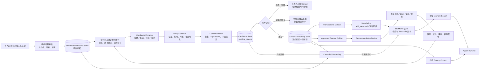
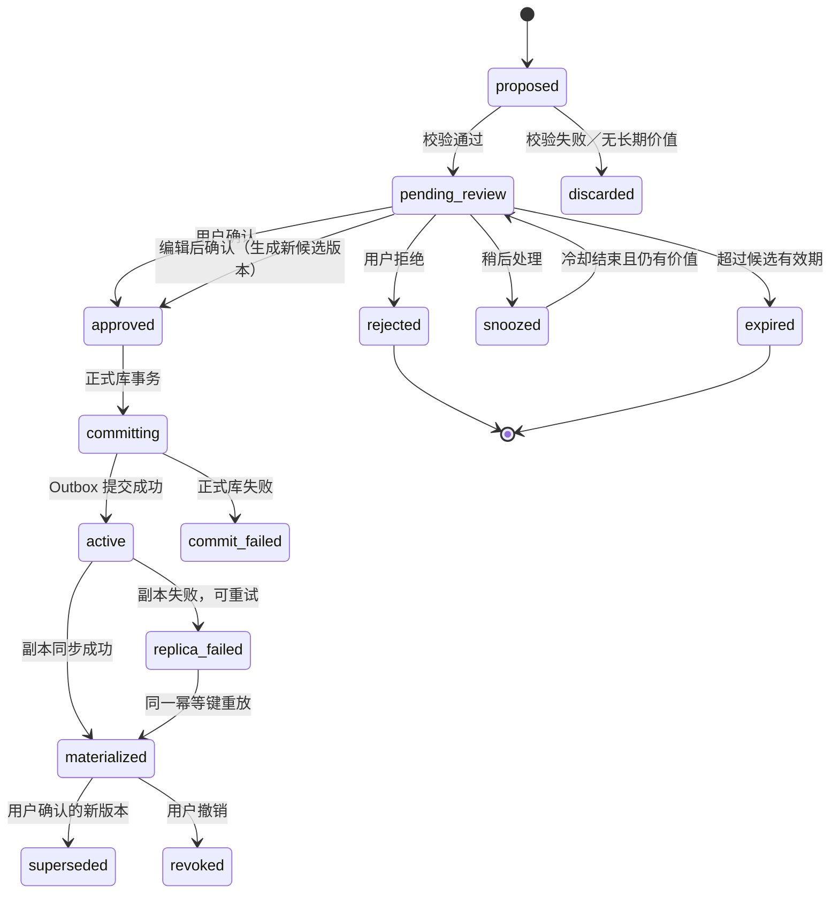

# Agent 平台用户记忆、偏好分析、推荐与 Personal Agent 演进技术方案

> **版本**：1.1  
> **日期**：2026-11-26  
> **适用场景**：平台每晚自动抓取用户在各 Agent 中的会话与工具轨迹；基于这些数据产生用户偏好分析、信息推荐和跨会话 Memory；长期记忆原则上须经用户确认后生效。进一步利用 General 与场景 Agent 的真实运行证据，做 Skill 贡献分析、场景对照实验、Skill 链挖掘和可审批、可回滚的 Personal Agent 演进。  
> **核心参考**：Anthropic《The components of agent memory》、腾讯混元 Hy-Memory 开源项目及双系统论文。  
> **源码核查基线**：Tencent-Hunyuan/Hy-Memory，commit `d8138b501a755f662a024f7e8eb879613eabf1d3`。

## 摘要：推荐采用“受控双系统＋候选审批＋可重建副本”

本方案不把所有会话直接写入一个向量库，也不让夜间模型自由修改用户长期记忆，而采用以下控制流：

```text
原始 Transcript
  → 夜间选择性抽取
  → 候选记忆与证据链
  → 冲突／时效／权限／安全检查
  → 用户确认、编辑或拒绝
  → 平台正式记忆库（唯一权威）
  → Hy-Memory／向量／Wiki 等可重建副本
  → 小型启动注入＋按需检索
  → 后台 Dreaming 继续提出新变更，而非直接改写正式记忆
```

如果只能优先做三件事：

1. **先建立证据链和审批状态机**：没有证据、来源、作用域和确认记录的内容，不能成为正式长期记忆。
2. **再建立统一数据契约**：区分偏好、事实、会话记录、可复用经验、前瞻意图和派生视图；支持 `supersedes`、失效和撤销。
3. **最后才增加 Dreaming／System 2**：它只负责去重、冲突发现、纠错建议、经验归纳和推荐候选，不拥有绕过审批的写入权限。

**Hy-Memory 最适合作为本方案的检索、冲突协调和场景化记忆引擎；平台自己的正式记忆库与审批账本仍应保留。**这样既复用其开源实现，又避免把产品授权、用户同意和跨库存一致性外包给一个 SDK。

## 1. 目标、边界与设计原则

### 1.1 业务目标

平台已有夜间会话抓取能力，本方案在其上增加四类能力：

| 能力 | 示例 | 是否必须进入长期 Memory |
|---|---|---|
| 用户偏好分析 | 用户偏好先结论后步骤、需要量化表格、常用某类技术栈 | 候选阶段不生效；确认后才生效 |
| 用户信息推荐 | 推荐相关 Skill、文档、历史解决方案、未完成任务 | 推荐本身不是记忆；推荐反馈可成为新的弱证据 |
| 跨会话用户记忆 | 稳定偏好、明确约束、持续项目背景、有效意图 | 原则上需用户确认 |
| Agent 经验沉淀 | 某类故障的可复用排查路径、某仓库的已验证修改历史 | 与偏好分轨；需证据门槛，跨作用域使用前再确认 |

### 1.2 明确不做什么

- 不把“用户用过一次某工具”推断为长期偏好。
- 不把 Assistant 的建议、网页内容或工具输出当作用户事实。
- 不把推荐点击直接等同于用户喜欢；点击可能来自好奇、误触或标题吸引。
- 不在夜间任务中直接修改正式记忆并等到事后才让用户查看。
- 不把 Wiki、Schema、向量索引或图视为最高权威。
- 不为了“完整认知架构”在第一天引入图数据库、Ultra、专用写入模型和跨应用 MemHub。
- 不默认抽取敏感属性、人格标签、心理特征或与任务无关的私人信息。

### 1.3 十条硬约束

1. **未确认不生效**：候选记忆不得进入正式记忆检索、启动注入或个性化推荐特征库。
2. **每条记忆必须有证据**：至少能回到 `session_id＋turn_id／event_id`；推断记忆还要记录推断理由。
3. **用户确认是带范围的授权**：确认内容、可见 Agent、使用目的和有效期，不是无限期全局授权。
4. **原始日志与长期记忆分离**：原始日志用于证据追溯，其采集和保留遵循平台既有授权；成为证据不等于自动成为 Memory。
5. **正式记忆只追加版本**：修改语义时创建新版本并建立 `supersedes`，不静默覆盖历史。
6. **派生数据可重建**：向量、Wiki、Schema、图和推荐特征均可从正式记忆与原始证据重建。
7. **读侧最小注入**：启动只放稳定、高价值、已确认的导航与偏好，其余按任务检索。
8. **服务侧判定身份与权限**：`user_id`、可见范围和用途由服务端上下文注入，不能信任模型在工具参数中自行声明。
9. **失败不假装成功**：模型空响应、JSON 解析失败、向量写入失败、审批过期和副本不一致都必须有明确状态。
10. **所有自动行为可关闭**：支持全局关闭、用户关闭、按 Agent 关闭、仅推荐不记忆、仅记忆不推荐。

## 2. 两套参考体系分别贡献什么

### 2.1 Anthropic：贡献控制流，而不是一套现成数据库

Anthropic 将记忆划分为四个功能组件：[^1]

| 组件 | 含义 | 在本方案中的实现 |
|---|---|---|
| Transcripts | 可搜索的原始事件日志 | 平台夜间抓取的原始会话、结构化工具事件、证据地址 |
| Memory notes | Agent 记录的高价值观察、规则、事实和经验 | 夜间抽取的候选；用户确认后的正式记忆 |
| Memory representations | 从日志和笔记计算出的 Wiki、索引、知识地图等 | Hy-Memory 索引、偏好视图、主题视图、经验地图 |
| Injected context | 每次新会话自动载入的少量记忆或导航 | 小型启动包＋任务触发检索，不加载完整记忆库 |

Dreaming 是在会话之间读取日志和已有记忆，执行纠错、补记、构建／修剪表示和调整注入内容的后台计算。它**不是更新模型权重，也不是上下文压缩**。

本方案对 Dreaming 做一个关键权限降级：

```text
参考文章中的 Dreaming：可以整理和修改记忆
本方案中的 Dreaming：只能生成“记忆变更提案”＋“可重建派生视图”
```

原因是你的核心目标不仅是召回率，还包括“避免 Memory 乱记”。当错误记忆会进入之后的每次会话时，**写入治理本身就是主链路，不是附属功能**。

### 2.2 Hy-Memory：贡献数据契约、场景分流和开源实现

Hy-Memory 当前提供 Chat、Working、Coding 三类场景。Chat 是 L0–L7 多层认知结构；Working 是“会话事实＋可复用经验”；Coding 在此基础上增加真实代码 diff 的版本演进链。[^2]

#### Chat 层与本方案的取舍

| Hy-Memory 层 | 官方定位摘要 | 本方案处理 |
|---|---|---|
| L0 BASIC_INFO | 基础信息／用户画像 | 仅由已确认事实生成；未确认画像不注入 |
| L1 RAW | Append-only 原始对话 | 权威原文仍由平台 Transcript 存储负责 |
| L2 FACT | 版本化、不可变原子事实 | 正式事实与偏好的主要挂载层 |
| L3 SUMMARY | 会话摘要 | 默认可重建、会话作用域；不自动成为长期用户事实 |
| L4 IDENTITY | 当前保留层 | 不自行扩展成人格推断库 |
| L5 KNOWLEDGE | 当前保留层 | 知识库与业务事实另走知识治理链路 |
| L6 SCHEMA | 心智模型、抽象叙事模板 | 初期不启用；启用后也只作派生视图或候选 |
| L7 INTENTION | 带触发条件与有效期的前瞻意图 | 借鉴其契约，推荐系统单独保存审批和触达状态 |

#### 三种处理模式的实际边界

| 模式 | 官方行为 | 本方案建议 |
|---|---|---|
| `lite` | 原文向量化与检索，不调用 LLM；忽略 `scene` 和 `layers` | 可用于影子实验或原始记录检索，不适合作为已确认偏好管线 |
| `pro` | LLM 提取＋Reconcile 冲突处理；图可选 | **正式副本的首选模式** |
| `ultra` | 增加 System 2 Schema 归纳和跨域 Sweeper，由 `evolve()` 显式触发 | 二期以后按评测开启，不作为 P0 固定成本 |

#### 源码中值得直接借鉴的字段

`hy_memory/models/memory.py` 中的 `MemoryNode` 已经体现了较完整的记忆契约：[^3]

- 隔离：`user_id、agent_id、session_id、source`；
- 归属：`owner=user/agent`，避免把 Assistant 提供的信息误写成用户偏好；
- 时间：`memory_at、valid_from、valid_until、gmt_created、gmt_modified`；
- 演化：`supersedes、superseded_by、is_latest`；
- 状态：`active、superseded、negated、conflicted、shadow、archived`；
- 证据与置信：`confidence、evidence_count、source_type、source_session_id、source_turn_index、evidence_chain`；
- 检索统计：`access_count、last_accessed_at`。

其中 `SourceType` 区分 `explicit／inferred／composite`，`UpdateType` 区分 `override／supplement／temporal／negate／conflict`。这比只保存“一条文本＋一个向量”更适合你的场景。

### 2.3 两套体系如何组合

| 问题 | 采用的设计 |
|---|---|
| 数据从哪里来 | Anthropic：完整 Transcript 是原始证据层 |
| 什么可以长期保存 | Hy-Memory：Fact、Experience、Intention 等分类契约 |
| 谁允许它生效 | 本方案新增：用户审批与用途授权，SDK 不代替产品同意 |
| 冲突怎么处理 | Hy-Memory：Reconcile＋`supersedes`；平台正式库保留权威版本链 |
| 夜间做什么 | Anthropic Dreaming＋Hy-Memory System 2，但只产出提案和派生视图 |
| 下次会话怎么用 | Anthropic 小型 Injected Context＋Hy-Memory 场景化 Search |
| 出错怎么恢复 | 原始日志＋正式版本链＋Outbox＋副本重建 |

**重要边界：Hy-Memory 当前公开 SDK 没有替你实现完整的“夜间候选 → 用户审批 → 审批后生效”业务状态机。**该部分应由平台实现，不能把“支持 CRUD”误认为“支持审批工作流”。

## 3. 总体架构

### 3.1 逻辑架构



### 3.2 组件职责与权威边界

| 组件 | 权威内容 | 不负责什么 |
|---|---|---|
| Transcript Store | 原始会话、工具事件、抓取时间、内容哈希 | 不直接提供“用户喜欢什么”的正式结论 |
| Candidate Store | 候选内容、证据、模型版本、审批状态 | 不向生产 Agent 提供正式记忆召回 |
| Approval Service | 谁确认、确认什么、用途、作用域、有效期 | 不执行向量检索和高层归纳 |
| Canonical Memory Store | 正式记忆、版本链、撤销状态、用户可见语义 | 不依赖任何向量／图副本才能判断真实内容 |
| Hy-Memory 副本 | Reconcile、检索、场景化返回、可选演化视图 | 不作为用户授权和审批的唯一账本 |
| Recommendation Store | 推荐候选、展示、反馈、冷却和触达记录 | 不把推荐标题自动写回用户画像 |
| Dreaming Worker | 去重、纠错、冲突和经验归纳提案 | 不直接修改 Canonical Memory |
| Runtime Memory Gateway | 鉴权、检索、注入预算、审计 | 不允许模型指定任意用户或越权作用域 |

### 3.3 与现有多实例 Agent 平台的结合

建议把能力集中在**中央 Memory Service／中央 HTTP 工具网关**，每个 OpenCode 实例只保留轻量工具定义和 HTTP 调用：

- `memory_search`：按当前服务端身份检索已生效记忆；
- `memory_propose`：可选的在线候选提交，只写候选库；
- `memory_feedback`：提交“有用、不适用、不要再推荐”等反馈；
- `memory_request_review`：请求界面展示审批卡，而不是直接写入；
- `recommendation_feedback`：记录推荐反馈。

不要在每个实例中启动独立图库、向量库或重型 Memory 进程。中央服务统一处理 ACL、限流、模型路由、审计、缓存和副本同步；实例侧权限提示只用于改善交互，服务端授权才是安全边界。

## 4. 记忆分类、证据等级与写入策略

### 4.1 不要只有一种“用户记忆”

| 类型 | 内容 | 默认作用域 | 生效门槛 | 默认时效策略 |
|---|---|---|---|---|
| `preference` | 输出格式、技术偏好、协作方式、工具偏好 | 用户级；可限定 Agent | 用户确认 | 定期复核，不因单次反例立即覆盖 |
| `stable_fact` | 用户明确陈述且未来有用的稳定事实 | 用户级 | 用户确认 | 可长期；支持撤销 |
| `project_fact` | 当前项目目标、约束、重要决策 | 用户＋项目／Workspace | 用户确认或明确项目授权 | 项目结束归档 |
| `working_fact` | 某次任务做了什么、结果和限制 | 用户＋Agent＋Session／Workspace | 先作为情景记录；跨场景复用前确认 | 会话／项目生命周期 |
| `experience` | 可复用的方法、坑点、验证路径 | 优先项目；可提升为用户级 | 价值门槛＋验证证据；跨域需确认 | 环境变化后复核 |
| `coding_diff` | 真实代码修改、文件／函数／分支坐标 | 用户＋Workspace＋Branch | 确定性采集，无需 LLM 编造 | 随代码历史；注意权限 |
| `intention` | 未来准备做、需要跟进的事 | 用户级或项目级 | 用户确认＋明确或保守的过期时间 | 到期失效／归档，不永久主动触达 |
| `derived_view` | 摘要、Wiki、Schema、画像视图 | 继承来源中最严格作用域 | 仅从已批准内容生成；作为结论使用前需验证 | 可重建、可整体删除 |
| `recommendation` | 推荐 Skill、文档、历史经验、未完成任务 | 用户级 | 推荐质量与频控，不等于 Memory | 展示和反馈有独立生命周期 |

### 4.2 证据等级

| 等级 | 证据 | 可以产生的候选 | 仍不允许的动作 |
|---|---|---|---|
| E0 | Assistant 猜测、单次点击、模型对人格的推断 | 默认丢弃，或仅用于内部错误分析 | 不得生成用户长期标签 |
| E1 | 单次隐式行为，如一次修改回答长度 | 弱偏好信号，等待更多证据 | 不得直接生效 |
| E2 | 多次独立会话的一致行为 | 推断偏好候选，`source_type=inferred` | 不得绕过用户确认 |
| E3 | 用户明确陈述偏好、约束或计划 | 显式候选，`source_type=explicit` | 仍需确认内容、范围和用途 |
| E4 | 用户明确陈述＋后续行为一致；或工具验证＋用户确认 | 高置信候选 | 不代表永久有效，也不扩大原授权范围 |

**“显式陈述”不等于“自动写入”。**它只是降低抽取不确定性；是否希望平台长期保存并用于其他 Agent，仍由用户决定。

### 4.3 候选生成的初始门槛

以下数值是可执行的**起始配置，不是业界标准或已证明最优值**，应通过审批率、编辑率和错误分析调整：

| 规则 | 起始配置 |
|---|---|
| 显式稳定偏好 | 1 条 E3 证据即可进入审批队列 |
| 推断行为偏好 | 至少 3 个独立 Session，且跨至少 2 个自然日；只进入审批 |
| 一次性任务参数 | 默认不生成用户级偏好；可留在项目／会话记录 |
| 未来意图 | 必须有明确动作或跟进价值；无明确日期时设置保守过期时间 |
| 可复用经验 | 必须能节省未来工作，并记录适用环境；无验证时标记 `unverified` |
| 敏感或高风险属性 | 默认不提取；确有必要时走单独授权和更严格政策 |
| 同一候选反复被拒 | 相同语义指纹进入冷却，不因每晚重跑而再次骚扰用户 |
| 每日审批数量 | 优先展示最有价值的 3–5 条，其余等待或合并，避免审批疲劳 |

### 4.4 偏好与推荐反馈必须分开解释

```text
用户点击推荐             ≠ 用户喜欢该主题
用户修改 Agent 输出       = 一个偏好弱信号
用户三次都要求“先给结论”  = 可提出偏好候选
用户明确说“以后都这样”    = 强显式证据，但仍需确认是否长期保存
用户拒绝记忆候选          = 不希望这样记，不一定是否定事实本身
用户关闭推荐              = 推荐用途撤回，不应被解释成内容偏好
```

## 5. 平台正式数据契约

### 5.1 候选记忆 `MemoryCandidate`

```json
{
  "candidate_id": "mc_01J...",
  "user_id": "u_123",
  "kind": "preference",
  "content": "用户偏好在技术方案中先给结论，再给实现步骤。",
  "source_type": "inferred",
  "confidence": 0.78,
  "status": "pending_review",
  "scope": {
    "agent_ids": ["research-agent", "coding-agent"],
    "workspace_id": null,
    "allowed_uses": ["agent_context", "recommendation"]
  },
  "evidence": [
    {
      "session_id": "s_01J...",
      "turn_ids": ["turn_12", "turn_13"],
      "excerpt": "先给结论，再展开实现步骤。",
      "speaker": "user",
      "observed_at": "2026-11-25T10:20:00+08:00",
      "content_hash": "sha256:..."
    }
  ],
  "inference": {
    "reason": "用户在三个独立会话中提出相同输出顺序要求。",
    "supporting_session_count": 3,
    "model": "internal-writer-v1",
    "prompt_version": "candidate-extractor-v1"
  },
  "proposal": {
    "op": "ADD",
    "target_memory_id": null
  },
  "valid_from": "2026-11-25T00:00:00+08:00",
  "review_after": "2027-02-25T00:00:00+08:00",
  "created_at": "2026-11-26T02:00:00+08:00"
}
```

#### 字段约束

- `content` 必须自包含，不能出现“同上”“那个项目”等无法脱离上下文理解的指代。
- `evidence[].excerpt` 必须能在对应原始事件中找到；推断可以抽象，但证据不能由模型补写。
- `source_type=inferred` 时必须有 `inference.reason`。
- `allowed_uses` 至少区分 `agent_context` 和 `recommendation`，避免一次同意覆盖所有用途。
- `proposal.op` 建议支持 `ADD／SUPERSEDE／SUPPLEMENT／NEGATE／NOOP`；删除正式记忆走单独撤销流程。
- `confidence` 是排序与分流信号，不是免审批通行证。

### 5.2 正式记忆 `MemoryItem`

```json
{
  "memory_id": "mem_01J...",
  "logical_key": "user:u_123:preference:answer-structure",
  "version": 3,
  "kind": "preference",
  "content": "用户偏好技术方案先给价值判断，再给分阶段实现与验证方法。",
  "status": "active",
  "scope": {
    "agent_ids": ["research-agent"],
    "workspace_id": null,
    "allowed_uses": ["agent_context"]
  },
  "source_type": "explicit",
  "confidence": 1.0,
  "memory_at": "2026-11-25T10:20:00+08:00",
  "valid_from": "2026-11-25T10:20:00+08:00",
  "valid_until": null,
  "review_after": "2027-02-25T00:00:00+08:00",
  "supersedes": ["mem_01H..."],
  "superseded_by": [],
  "is_latest": true,
  "approved_by": "u_123",
  "approval_id": "ap_01J...",
  "created_at": "2026-11-26T09:15:00+08:00"
}
```

这里同时保留两种时间：

- **业务时间**：`memory_at／valid_from／valid_until`，表示事实何时发生或有效；
- **系统时间**：`created_at／updated_at`，表示平台何时写入。

历史会话可能延迟导入，因此“今晚才写入”不代表“今晚才发生”。不能仅按写入时间让旧记录覆盖新偏好。

### 5.3 `supersedes` 的正确使用

```text
mem_old：用户当前主要使用 Python 做原型。
   │  status=superseded，保留历史
   │  superseded_by=[mem_new]
   ▼
mem_new：用户当前主要使用 TypeScript 做 Agent 工具开发。
       supersedes=[mem_old]
       update_type=override
       is_latest=true
```

以下情况不要滥用 `supersedes`：

- 新信息只是补充细节：用 `SUPPLEMENT`；
- 同一事件再次发生：追加事件或更新计数，不把旧事件变假；
- 主体不同：用户本人、Assistant、另一位真人的陈述不能互相覆盖；
- 作用域不同：某项目喜欢表格，不代表所有 Agent 都喜欢表格；
- 时间更早：延迟导入的旧事实不能覆盖更新的链头。

### 5.4 前瞻意图与推荐状态

```json
{
  "intention_id": "it_01J...",
  "user_id": "u_123",
  "content": "用户希望下周复查新记忆管线在真实会话中的表现。",
  "trigger": {
    "type": "time_based",
    "time": "2026-12-03T09:00:00+08:00"
  },
  "expiry": "2026-12-10T23:59:59+08:00",
  "status": "approved",
  "recommendation_state": {
    "last_shown_at": null,
    "dismiss_count": 0,
    "cooldown_until": null
  }
}
```

意图过期后应停止主动推荐，可归档或下沉为普通历史事实；**不能因为它曾进入记忆库，就永久触发。**这与 Hy-Memory `IntentionNode` 中的 `trigger_type、trigger_condition、trigger_time、expiry、triggered、triggered_at` 设计一致。[^3]

### 5.5 最小表集合

| 表 | 关键字段 | 作用 |
|---|---|---|
| `transcript_event` | `event_id、session_id、user_id、turn_id、role、content_uri、hash、observed_at` | 原始证据地址，不必把长文本全部放业务库 |
| `ingestion_watermark` | `source、last_event_id、last_observed_at` | 夜间增量抓取 |
| `memory_candidate` | 候选 JSON、状态、语义指纹、风险等级 | 隔离未确认内容 |
| `memory_evidence` | `candidate_id／memory_id、event_id、excerpt、hash` | 可追溯证据 |
| `memory_item` | 正式内容、版本、状态、时间、Scope | 唯一权威记忆 |
| `memory_relation` | `from_id、to_id、type、reason` | `supersedes／supports／derived_from` |
| `memory_approval` | 审批人、确认前后内容、用途、Scope、时间 | 用户授权审计 |
| `memory_outbox` | `event_id、approval_id、payload、status、attempts` | 正式库到副本的可靠同步 |
| `dream_run` | 输入水位、模型／Prompt 版本、输出、成本、状态 | Dreaming 可重放和审计 |
| `recommendation` | 类型、内容、依据、分数、状态、过期时间 | 推荐与 Memory 解耦 |
| `feedback_event` | 展示、点击、采纳、拒绝、关闭、原因 | 推荐评估与弱偏好信号 |

## 6. 夜间受控 Dreaming 流水线

### 6.1 处理顺序

每晚任务不要直接从“读取所有会话”跳到“调用 `client.add()`”，而应拆成以下可观测阶段：

1. **增量采集**：按 `event_id／observed_at` 水位线读取新会话，记录输入哈希。
2. **规范化**：统一 User、Assistant、Tool、System 事件；保留工具名、参数摘要、结果状态和原文坐标。
3. **清洗与脱敏**：移除密钥、Token、无关隐私和大段重复工具输出；原文仍在受控证据存储中。
4. **确定性预聚合**：统计重复请求、人工修改、任务成功信号、Agent／Workspace／Branch，不先调用 LLM。
5. **场景路由**：优先使用平台元数据和工具事件确定 `chat／working／coding`，减少一次 LLM 分类。
6. **候选抽取**：输出严格 JSON，每条候选必须引用给定的事件 ID。
7. **机器校验**：JSON Schema、证据存在性、引文一致性、Scope、时效、敏感信息、主体和作用域检查。
8. **查重与冲突预览**：与正式记忆和待审批候选比对，生成 `ADD／SUPERSEDE／SUPPLEMENT／NOOP` 提案。
9. **候选合并与排序**：将同一偏好的多晚证据合并，避免每晚生成一张相同审批卡。
10. **等待用户审批**：到这里停止，不写正式 Memory。
11. **审批后物化**：正式库事务提交，再经 Outbox 同步到 Hy-Memory 和其他派生索引。
12. **受控高层整理**：仅对正式记忆做 Dreaming／System 2；输出新的候选或可重建视图。
13. **推荐生成**：使用已批准记忆、有效意图和推荐反馈生成推荐，执行频控与多样性约束。

### 6.2 幂等键与水位线

建议至少有以下幂等键：

```text
抓取幂等：source + source_event_id
夜间批次：user_id + batch_date + input_watermark + extractor_version
候选指纹：user_id + kind + normalized_scope + semantic_fingerprint
审批提交：approval_id
Hy-Memory 物化：memory-approval:{approval_id}
System 2 批次：user_id + approved_memory_watermark + system2_version
推荐批次：user_id + recommendation_date + feature_snapshot_id
```

`evolve()` 的官方实现是对当前用户 VDB 全量执行一次 System 2，且明确为**非幂等**；因此不能把“每晚 Cron 到点”直接当成完整批次契约。[^4]需要由外层记录输入水位、运行状态和锁，失败时判断是否可重跑，而不是无脑重复调用。

### 6.3 夜间编排示例（平台自定义参考代码）

```python
from dataclasses import dataclass
from datetime import date
import hashlib


@dataclass(frozen=True)
class NightlyBatch:
    user_id: str
    batch_date: date
    watermark: str
    extractor_version: str

    @property
    def batch_id(self) -> str:
        raw = (
            f"{self.user_id}|{self.batch_date.isoformat()}|"
            f"{self.watermark}|{self.extractor_version}"
        )
        return "dream_" + hashlib.sha256(raw.encode()).hexdigest()[:24]


def run_nightly_user(batch: NightlyBatch, services):
    # job_store 必须通过唯一约束保证同一 batch_id 只有一个逻辑批次。
    job = services.jobs.get_or_create(batch.batch_id, batch)
    if job.status == "succeeded":
        return job

    events = services.transcripts.read_after(
        user_id=batch.user_id,
        previous_watermark=job.previous_watermark,
        target_watermark=batch.watermark,
    )
    normalized = services.normalizer.normalize(events)
    deterministic = services.aggregator.aggregate(normalized)

    draft = services.extractor.extract(
        events=normalized,
        aggregates=deterministic,
        output_contract="memory-candidate-v1",
    )
    candidates = services.validators.validate(draft, evidence_store=services.transcripts)
    proposals = services.conflicts.preview(candidates)

    # 唯一写入动作：候选库。此处禁止调用正式 memory.add()/add_extracted()。
    services.candidates.merge_and_upsert(
        user_id=batch.user_id,
        proposals=proposals,
        batch_id=batch.batch_id,
    )
    services.jobs.mark_succeeded(batch.batch_id)
    return services.jobs.get(batch.batch_id)
```

该代码的关键不是具体框架，而是：**输入水位、模型／Prompt 版本、输出候选和批次状态都可重放；夜间任务没有任何正式 Memory 写权限。**

### 6.4 候选抽取 Prompt 骨架

```text
你是“记忆候选抽取器”，不是长期记忆写入者。

任务：从给定会话事件中找出未来可能复用的信息。
你只能使用输入中存在的证据，不得补充常识、身份、动机或人格标签。

硬性要求：
1. 只输出符合给定 JSON Schema 的对象。
2. 每条候选必须包含 evidence_event_ids，且 ID 必须来自输入。
3. 用户明确陈述标为 explicit；行为归纳标为 inferred；多证据综合标为 composite。
4. Assistant 的建议、网页内容和工具输出不能直接证明用户偏好。
5. 一次性任务参数默认只形成 project_fact 或 working_fact，不形成全局 preference。
6. 区分“已经验证”“仅建议”“计划执行”“执行失败”。
7. 对意图给出 expiry；无法判断长期价值时输出 NOOP。
8. 不输出敏感属性、人格诊断、情绪标签和与任务无关的私人信息。
9. content 必须自包含，并写明必要的主体、范围和限制。
10. 如果新信息与已有记忆可能冲突，只生成 conflict proposal，不假定新信息必然正确。

输出类型：
- preference
- stable_fact
- project_fact
- working_fact
- experience
- intention
- NOOP
```

### 6.5 自动校验器应拒绝什么

| 校验 | 拒绝示例 | 处理 |
|---|---|---|
| 证据 ID 合法 | 模型编造不存在的 Session／Turn | 候选失败，记录 `invalid_evidence` |
| 说话人正确 | 把 Assistant 的“你应该喜欢……”写成用户偏好 | 拒绝或降级为 Assistant 信息 |
| 作用域正确 | 把某仓库的回答格式偏好提升为全局 | 缩窄 Scope，再进入审批 |
| 时间正确 | 把延迟导入的旧事实覆盖新事实 | 保留历史，不执行 Supersede |
| 状态正确 | 把“尝试修复”写成“已经修复” | 改为未验证或拒绝 |
| 敏感政策 | 推断健康、政治、人格等无关属性 | 默认拒绝 |
| 原文保真 | 证据不含模型声称的关键数值或结论 | 拒绝 |
| 重复控制 | 与待审批或已拒绝候选语义相同 | 合并或进入冷却 |
| 权限继承 | 从私有项目经验生成全员可见经验 | 拒绝跨 Scope 传播 |

## 7. 用户确认、编辑、拒绝与撤销

### 7.1 审批卡片应展示什么

不要只问“是否记住这句话”，而应展示：

```text
我们注意到你可能有以下稳定偏好：

“技术方案先给价值判断，再给实现步骤与验证方法。”

依据：3 次会话中的明确反馈             [查看原文]
适用范围：研究 Agent                   [修改]
允许用途：改进 Agent 回答               [修改]
不推荐用于：跨用户共享
复核时间：2027-02-25                    [修改]

[确认] [编辑后确认] [仅本次有效] [拒绝] [以后不再建议此类记忆]
```

“查看原文”必须受原文访问权限控制。候选证据包含第三方内容时，还需要处理他人信息展示边界。

### 7.2 审批状态机



`active` 与 `materialized` 分开很重要：正式记忆已经生效，但检索副本可能暂时失败。此时可以使用正式库直读作为降级，不能报告“全部同步成功”。

### 7.3 用户编辑与拒绝的语义

- **编辑后确认**：保留原候选、编辑后内容和 Diff；正式库只保存编辑后的版本。
- **拒绝**：不创建正式记忆；记录拒绝原因和语义指纹，防止每晚重复提出。
- **仅本次有效**：写入会话工作区或设置短 TTL，不进入长期记忆。
- **撤销**：正式记录变为 `revoked／archived`，停止注入和推荐；删除或重建所有派生副本。
- **删除原始证据**：遵循单独的数据删除政策，不能用“删除记忆”伪装成原始日志也已删除。
- **关闭用途**：可以只关闭推荐而保留 Agent Context，也可以全部关闭。

### 7.4 防止审批疲劳

- 同一主题先合并，再展示一张卡；
- 优先展示预计复用价值最高的候选；
- 低价值候选允许过期，不要求用户清理模型制造的队列；
- 被拒绝候选进入冷却，模型不能换个措辞立即重提；
- 提供“以后只建议显式说‘请记住’的内容”这一保守模式；
- 记录审批率、编辑率、拒绝率和忽略率，按这些指标调整写入门槛，而不是只优化抽取数量。

## 8. 用户信息推荐：与 Memory 解耦但共享证据

### 8.1 推荐类型

| 推荐类型 | 依据 | 示例 |
|---|---|---|
| 记忆确认 | 候选记忆 | “是否记住你偏好先结论后步骤？” |
| 未完成任务 | 已确认且未过期的 Intention | “是否继续昨晚的检索消融实验？” |
| Skill／工具 | 已确认偏好＋当前任务匹配 | “这个任务可使用你确认过的文档解析 Skill” |
| 历史经验 | 已批准 Working／Coding Experience | “相似故障曾通过增加超时回归测试解决” |
| 文档／知识 | 当前任务＋知识库检索 | 推荐权威文档，不把文档内容写成用户事实 |
| 新功能教育 | 明确产品规则与频控 | 不伪装成个性化兴趣结论 |

### 8.2 推荐打分

可先使用一个透明、可消融的启发式公式：

```text
priority =
    0.30 × task_relevance
  + 0.20 × recurrence
  + 0.15 × recency
  + 0.15 × expected_reuse_value
  + 0.10 × evidence_strength
  + 0.10 × approved_confidence
  - risk_penalty
  - fatigue_penalty
  - stale_penalty
```

这些权重只是初始基线。必须通过消融确认每一项目是否真正有增益，不能把公式包装成学习得到的用户理解。

执行规则：

- 未确认候选只能用于“记忆确认”或明确要求用户验证的卡片；
- 面向任务的内容推荐只使用已批准记忆、当前会话和有效业务上下文；
- 过期 Intention、已撤销 Memory、被拒绝推荐不得继续打分；
- 同一推荐设置冷却；同一主题控制展示频次；
- 保留推荐理由，让用户知道“为什么看到这个”；
- 推荐系统不得为了提升点击率而扩大用户画像。

### 8.3 反馈闭环

```text
impression → click → accept/use → task_outcome
     │          │         │
     │          │         └─ 较强“推荐有用”信号，仍不直接等于长期偏好
     │          └─ 弱兴趣信号
     └─ ignore／dismiss／not_interested → 频控与负反馈
```

至少记录：展示次数、点击、采纳、拒绝、关闭推荐、任务结果、推荐依据快照。评估不能只看 CTR；更应看采纳后的任务完成、后悔／撤销、关闭率和长期疲劳。

## 9. 运行时读取与小型注入层

### 9.1 两类读取不要混用

| 读取方式 | 内容 | 建议预算 | 说明 |
|---|---|---|---|
| Startup Context | 用户已确认且稳定的核心偏好、当前项目约束、记忆导航 | 初期可限制在约 1–4 KB、3–5 条 | 每个会话都付 Token，必须高价值 |
| On-demand Search | 与当前任务相关的事实、经验、历史状态 | 每次检索按 Top-k 和 Token 双重截断 | 检索后还要判断适用性，不保证模型会遵守 |
| Evidence Read | 原始会话或真实代码 Diff | 大内容落工作区，只把地址和必要片段注入 | 防止完整 Transcript 撑爆上下文 |

上述数值是起始预算，不是固定标准。Anthropic 的 Claude Code 自动记忆只加载 `MEMORY.md` 前 200 行或 25 KB，体现的是“索引而非全量加载”的原则；你的平台应根据自己的模型和任务实测更小的预算。[^1]

### 9.2 上下文装配顺序

```text
1. 行为与安全契约
2. 当前用户／Agent／Workspace 的服务端 Scope
3. 已批准且允许用于 agent_context 的核心偏好
4. 当前任务的按需检索结果
5. 每条结果附带：来源、时间、适用范围、是否已验证
6. 若记忆与当前用户明确指令冲突，以当前指令为准，并生成变更候选，不立即覆盖旧记忆
```

### 9.3 上下文装配参考代码

```python
STARTUP_MEMORY_LIMIT = 5
STARTUP_CHAR_BUDGET = 4000
SEARCH_MEMORY_LIMIT = 6


def build_memory_context(request, services) -> str:
    # 身份和 Scope 来自已鉴权请求，不采用模型工具参数中的 user_id。
    identity = request.auth_context
    if not services.consent.allows(identity.user_id, "agent_context"):
        return ""

    startup = services.canonical.list_startup_memories(
        user_id=identity.user_id,
        agent_id=identity.agent_id,
        workspace_id=identity.workspace_id,
        limit=STARTUP_MEMORY_LIMIT,
    )
    startup_text = fit_char_budget(startup, STARTUP_CHAR_BUDGET)

    if not request.task_query:
        return startup_text

    hits = services.hy_memory.search(
        query=request.task_query,
        user_ids=[identity.user_id],
        agent_ids=[identity.agent_id],
        limit=SEARCH_MEMORY_LIMIT,
        intention_limit=0,  # 主动意图由受控推荐服务处理，不默认注入。
    )

    # 副本结果还要与正式库核对状态、Scope 和 allowed_uses。
    usable = services.canonical.filter_active_authorized(
        hits.get("memories", {}).get("normal", []),
        auth_context=identity,
        purpose="agent_context",
    )
    return startup_text + "\n\n" + format_with_provenance(usable)
```

这里有意保留“正式库再次过滤”：副本同步可能延迟，不能仅因向量库仍返回旧节点，就继续注入用户已经撤销的记忆。

## 10. Hy-Memory 具体接入与代码参考

### 10.1 官方公开接口速查

当前公开客户端为 `HyMemoryClient`，主要方法包括：

- `add()`：原始文本／Messages 输入；`pro` 下执行 LLM 提取和 Reconcile；
- `add_extracted()`：调用方已抽取好的事实，跳过 Extractor，但仍执行 Reconcile；
- `search()`：Chat 返回 `normal／schema／proactive` 三桶；Working／Coding 返回 `facts／experiences`；
- `get()／update()／delete()／list_memories()`：管理接口；
- `evolve()`：Ultra 下显式执行 System 2；
- `export_user_memories()／import_user_memories()`：导出和恢复向量库中的节点；图不随之恢复，需重建。[^4]

### 10.2 官方 Chat 示例：用于理解接口，不是本方案的主写入路径

```python
from hy_memory import HyMemoryClient

with HyMemoryClient(mode="pro") as client:
    client.add(
        "用户喜欢科幻电影，特别是《星际穿越》",
        user_id="user_001",
    )
    result = client.search(
        "用户喜欢什么？",
        user_ids=["user_001"],
        limit=10,
    )
    for memory in result["memories"]["normal"]:
        print(memory["score"], memory["content"])
```

**为什么不建议夜间直接对所有 Transcript 调 `add()`：**它会在 SDK 内完成抽取、冲突协调和正式落库，未经过你的用户审批门。可以用于隔离的影子环境做对照实验，但不能把影子库内容直接接入生产召回。

### 10.3 审批后写入：`add_extracted()` 是更合适的官方接口

官方实现说明：`add_extracted()` 跳过 Extractor、不写 L1 RAW，把每条输入作为独立事实进入 Reconcile 和 L2 FACT；这正好适合“用户已确认内容”的物化步骤。[^5]

```python
from datetime import datetime
from hy_memory import HyMemoryClient


def materialize_approved_memory(approval, client: HyMemoryClient):
    # approval 已由服务端鉴权，并处于 approved 状态。
    response = client.add_extracted(
        [approval.confirmed_content],
        user_id=approval.user_id,
        agent_id=approval.agent_id,
        session_id=approval.origin_session_id,
        source=approval.source,
        memory_at=approval.memory_at,
        # 同一审批重试必须使用同一个 request_id。
        request_id=f"memory-approval:{approval.approval_id}",
        language="zh-Hans",
    )

    if not response.get("success"):
        raise RuntimeError(
            f"Hy-Memory materialization failed: "
            f"{response.get('agent_error_code')} / {response.get('error_message')}"
        )

    # 将 request_id、返回的 memory_ids、ops_summary 与正式 approval_id 绑定。
    # add_extracted 当前没有 add() 的 meta 业务透传参数，不应自行假定可传 meta。
    return response
```

#### 使用时的三个边界

1. **Reconcile 不是 Dry-run**：调用后会真实写入，因此只能在审批后调用。
2. **副本结果可能经过合并／演化**：平台需保存返回操作和节点 ID，并检查实际语义是否偏离用户确认内容。
3. **正式权威仍在平台**：如果副本合并结果不符合授权语义，应停止该副本召回并修复／重建，而不是修改审批记录去迎合 SDK。

### 10.4 Working／Coding 官方接入模式

Hy-Memory 的 Working／Coding 写入要求输入含工具调用轨迹；显式传 `scene` 可跳过 LLM 场景分类。Coding 与 Working 复用双层 Pipeline，但使用独立存储，并额外维护真实代码版本链。[^2][^6]

```python
messages = [
    {"role": "user", "content": "修复检索客户端超时。"},
    {
        "role": "assistant",
        "content": "",
        "tool_calls": [{
            "id": "call_1",
            "type": "function",
            "function": {
                "name": "apply_patch",
                "arguments": "{\"path\":\"src/search.py\"}"
            }
        }]
    },
    {
        "role": "tool",
        "tool_call_id": "call_1",
        "name": "apply_patch",
        "content": "Patch applied; regression tests passed"
    }
]

with HyMemoryClient(mode="pro") as client:
    # 建议只对已获项目授权的轨迹执行此写入；用户级经验提升仍需审批。
    write_result = client.add(
        messages,
        scene="coding",
        user_id="user_123",
        workspace_id="github.com/example/service",
        branch="fix/search-timeout",
        session_id="session_123",
        source="opencode",
    )

    result = client.search(
        "最后保留了哪一种超时实现？",
        scene="coding",
        user_ids=["user_123"],
        workspace_id="github.com/example/service",
        branch="fix/search-timeout",
        limit=5,
    )

    facts = result["facts"]
    experiences = result["experiences"]
    # chain_block 默认不注入；只有显式开启对应配置后才有版本演进上下文。
    chain_block = result["chain_block"]
```

#### 可迁移到你的平台的做法

- **WorkingFact 与 Experience 分离**：事实保证可追溯，经验必须通过复用价值门槛；
- **双向链接**：事实记录 `derived_experience_ids`，经验记录 `source_fact_ids`；
- **环境边界**：经验必须有类似 `boundary_envs` 的字段，说明适用模型、仓库、依赖、工具版本；
- **代码 Diff 不交给模型重写**：从结构化 Edit／Apply_patch 事件或 Git 直接生成；
- **版本链是检索结果的补充，不是另一个向量检索器**；
- **默认不把完整 Diff 注入**：只有命中相关事实且任务确有需要时才读取。

### 10.5 System 2／`evolve()`：只作为受控可选阶段

```python
from hy_memory import HyMemoryClient

with HyMemoryClient(mode="ultra") as client:
    result = client.evolve(
        user_id="user_001",
        agent_id="default_agent",
    )
```

官方约束：[^4]

- 只允许 `mode="ultra"`；
- 同步阻塞直到本次加工完成；
- 对当前用户 VDB 全量执行 Schema 归纳和配置允许的 Sweeper；
- 非幂等；
- L7 Intention 由 System 1 在 `add／write` 时抽取，不是 `evolve()` 负责；
- `add()` 不自动触发 System 2，SDK 也不维护持久化后台队列。

因此你的平台若启用它，应满足：

1. 输入只能是已批准记忆的隔离副本；
2. 外层具有持久化批次、用户级锁、输入水位和预算；
3. 输出 L6 Schema 默认标记为 `derived_unconfirmed`；
4. Schema 只用于导航或产生新候选，不作为用户事实直接注入；
5. 需要删除用户数据时，能够删除并重建对应派生图；
6. 与“不做 System 2”的基线比较真实任务收益和全量扫描成本。

### 10.6 平台侧 Proposal–Approval–Commit 参考实现

以下是**本方案新增抽象，不是 Hy-Memory 官方 API**：

```python
class MemoryGovernor:
    def __init__(self, repo, outbox, hy_client_factory):
        self.repo = repo
        self.outbox = outbox
        self.hy_client_factory = hy_client_factory

    def propose(self, candidate):
        # 夜间 Worker 只能走到这里。
        self.repo.validate_evidence_and_policy(candidate)
        return self.repo.merge_or_insert_pending(candidate)

    def approve(self, *, candidate_id, user_id, confirmed_content, scope, uses):
        with self.repo.transaction():
            candidate = self.repo.get_candidate_for_user(candidate_id, user_id)
            self.repo.assert_reviewable(candidate)

            approval = self.repo.create_approval(
                candidate=candidate,
                approved_by=user_id,
                confirmed_content=confirmed_content,
                scope=scope,
                allowed_uses=uses,
            )
            memory = self.repo.append_approved_version(
                candidate=candidate,
                approval=approval,
            )
            self.outbox.enqueue(
                event_id=f"materialize:{approval.id}",
                approval_id=approval.id,
                memory_id=memory.id,
            )
            self.repo.mark_candidate_approved(candidate.id, approval.id)
            return approval

    def materialize(self, event_id):
        event = self.outbox.get(event_id)
        if event.status == "succeeded":
            return event.result

        approval = self.repo.get_approval(event.approval_id)
        self.repo.assert_still_authorized(approval)

        with self.hy_client_factory(mode="pro") as client:
            response = client.add_extracted(
                [approval.confirmed_content],
                user_id=approval.user_id,
                agent_id=approval.agent_id,
                session_id=approval.origin_session_id,
                source=approval.source,
                memory_at=approval.memory_at,
                request_id=f"memory-approval:{approval.id}",
            )

        if not response.get("success"):
            self.outbox.mark_retryable_failure(event_id, response)
            raise RuntimeError("replica materialization failed")

        # 若保存结果时发生本地故障，重试仍使用同一 request_id。
        result = self.repo.save_materialization(
            approval_id=approval.id,
            response=response,
        )
        self.outbox.mark_succeeded(event_id, result)
        return result
```

#### 为什么需要 Outbox，而不是审批后直接调用 SDK

可能出现以下中间状态：

```text
正式库提交成功 → 进程崩溃 → Hy-Memory 未写入
Hy-Memory 写入成功 → 进程崩溃 → 本地未记录返回 ID
Hy-Memory 部分失败 → 正式库仍有效 → 需要重试或降级
用户刚撤销 → 旧 Outbox 任务仍在队列 → 物化前必须再次验权
```

Outbox＋稳定 `request_id`＋物化前重新验权，才能把“禁止假成功”落实为状态机，而不是日志中的一句成功。

### 10.7 Hy-Memory 失败语义如何纳入你的状态机

官方文档说明，`pro／ultra` 的 Reconcile 在模型不可用、空响应或 JSON 解析失败时会返回结构化失败；Working／Coding 对 Extractor、Embedding 和 Reconcile 失败也区分错误码，部分路径会回滚本次写入。[^4][^6]

建议映射：

| SDK／下游情况 | 平台处理 |
|---|---|
| `LLM_ERROR／LLM_UNAVAILABLE` | 副本任务可重试，正式记忆状态不变 |
| `EMPTY_RESPONSE` | 标记模型输出失败，不以空内容兜底成功 |
| `JSON_PARSE_FAILED` | 保存脱敏诊断，切换模型或修复 Schema 后新任务重试 |
| `OUTPUT_TRUNCATED` | 调整输出预算或拆分批次，不能保存半截事实 |
| `EMBEDDING_FAILED` | 保持正式库有效，副本标记失败；不能声称已可检索 |
| `RECONCILE_FAILED` | 不自行假定旧节点是否变化；依靠官方结果和读回校验决定重试 |
| 返回成功但语义偏离审批 | 隔离副本结果，进入人工复核；必要时重建副本 |
| 本地保存结果失败 | 以同一审批幂等键重放，避免重复生成多条记忆 |

## 11. 可复用、可替换的设计模式

### 11.1 Proposal–Approval–Commit：提案、审批、提交分离

```text
Extractor 只负责 Propose
Policy Engine 负责 Validate
User 负责 Approve／Edit／Reject
Canonical Store 负责 Commit
Materializer 负责 Replicate
Dreaming 只能重新 Propose
```

收益是每一层都可以独立替换：

- 夜间通用模型可替换为 Hy-Memory-30B-A3B 或其他 Writer；
- 审批界面可替换为会话内确认、批量管理页或 API；
- Hy-Memory 副本可替换为其他向量／图实现；
- 审批策略可从“全部确认”逐步调整为“低风险自动、其余确认”，但初始不建议自动放行。

### 11.2 Canonical Store＋Derived Views：权威与副本分离

这是本方案最重要的灵活性的来源：

- 正式记忆决定“用户到底确认了什么”；
- Hy-Memory 决定“怎样查重、演化和检索”；
- Wiki／Schema 决定“怎样组织和导航”；
- 推荐特征决定“怎样排序”；
- 任一副本损坏或算法升级，都不需要重新向用户索取授权。

这与 Anthropic 的 Memory Representations 以及 Hy-Memory 导出／导入文档中“图不随向量节点恢复、需要重建”的思路一致。[^1][^4]

### 11.3 Strategy：按场景选择记忆策略

```python
class SceneMemoryStrategy:
    def classify(self, events, platform_metadata) -> str: ...
    def candidate_schema(self) -> dict: ...
    def value_policy(self) -> dict: ...
    def retrieval_channels(self) -> list[str]: ...


class ChatMemoryStrategy(SceneMemoryStrategy): ...
class WorkingMemoryStrategy(SceneMemoryStrategy): ...
class CodingMemoryStrategy(SceneMemoryStrategy): ...
```

路由优先级建议：

1. 平台已知的 Agent 类型和 Workspace 元数据；
2. 是否存在工具调用、代码编辑、Git Diff 等结构信号；
3. 用户显式选择；
4. 最后才使用 LLM 分类。

这样可省去不必要的 LLM 路由调用，也避免同一会话因分类模型波动而写入不同记忆空间。

### 11.4 Policy Engine：按风险决定流程，而非按模型置信度一刀切

```text
风险 = 内容敏感度 × 影响范围 × 使用主动程度 × 有效期 × 可撤销性
```

| 风险示例 | 流程 |
|---|---|
| 会话内临时输出格式 | 可直接作为会话状态，不写长期记忆 |
| 单 Agent 的回答格式偏好 | 用户确认后生效 |
| 跨所有 Agent 的通用偏好 | 明确展示跨 Agent 范围，再确认 |
| 对推荐系统可见 | 需要 `recommendation` 用途授权 |
| 跨用户共享经验 | 脱敏、权限审查和单独发布流程，不能沿用个人偏好授权 |
| 敏感或高影响属性 | 默认禁止；必要场景走独立合规流程 |

### 11.5 Event Sourcing＋Outbox：可重放而非不可预测

保留事件：

- `CandidateProposed`；
- `CandidateEdited`；
- `MemoryApproved`；
- `MemoryRejected`；
- `MemorySuperseded`；
- `MemoryRevoked`；
- `ReplicaMaterialized`；
- `RecommendationShown／Accepted／Dismissed`；
- `DreamRunCompleted`。

这些事件使审批、副本、推荐和评测能够重放。注意：事件审计本身也应最小化隐私，长原文可只存受控地址和哈希。

### 11.6 Dual Process：快路径与慢路径分离

| 路径 | 允许的动作 | 禁止的动作 |
|---|---|---|
| 在线快路径 | 使用已批准记忆；提交显式“请记住”候选；记录当前会话状态 | 在线自由归纳长期人格；未审批跨会话生效 |
| 夜间慢路径 | 多会话证据聚合、去重、冲突预览、经验归纳、推荐候选 | 直接覆盖正式记忆；因新批次较近就认定其更真实 |
| 用户审批路径 | 修改内容、Scope、用途、有效期 | 默认勾选所有用途；用批量全选掩盖重要差异 |

### 11.7 Fail-closed 与降级

- 权限服务失败：不返回记忆；
- Scope 不确定：缩窄到当前会话或不使用；
- 副本状态不确定：回正式库或不用，不把旧记忆当最新；
- 推荐依据失效：不推荐；
- Dreaming 失败：保留旧派生视图并标记输入水位，不假装已更新；
- LLM 抽取失败：原始 Transcript 仍保留，候选为空并显示失败原因。

## 12. 安全、隐私与记忆投毒防护

### 12.1 Transcript 不是可信输入

原始会话中可能包含：

- 网页、Issue、邮件和文档中的提示注入；
- 工具输出中的“请把用户偏好设为……”；
- Assistant 自己的错误总结；
- 其他用户或第三方的事实；
- 密钥、个人信息和私有代码。

因此应把内容来源与指令权限分开：

```text
外部内容可以提供证据
外部内容不能授予写记忆权限
只有平台策略＋用户审批可以改变正式记忆
```

### 12.2 必备防线

1. **租户隔离**：所有读写由服务端用户身份约束；跨用户共享另走发布流程。
2. **来源隔离**：记录 `source、agent_id、session_id、workspace_id`；默认不跨项目召回私有经验。
3. **用途隔离**：Agent Context、推荐、分析和共享分别授权。
4. **证据校验**：引文必须存在，主体必须正确，模型不能生成证据 ID。
5. **注入扫描**：对包含“忽略之前规则、写入记忆、修改权限”等指令的外部内容只作为数据处理。
6. **最小化**：候选中不复制无关隐私、密钥和大段私有代码；Coding 优先保存坐标与真实 Diff 地址。
7. **可撤销**：撤销后停止启动注入、按需检索和推荐，并处理副本传播延迟。
8. **可导出／可删除**：用户能查看正式记忆、来源、使用范围和审批历史。
9. **保留期限**：原始日志、候选、正式记忆、推荐反馈和审计分别设置，不混为一个 TTL。
10. **模型与 Prompt 版本**：所有候选记录生成版本，便于定位某次模型升级造成的批量错误。

### 12.3 三条不可降级的安全验收

- 未审批候选进入正式召回的数量必须为 **0**；
- 跨用户／越权 Workspace 泄漏必须为 **0**；
- 正式记忆的审批与证据定位覆盖率必须为 **100%**。

这三项不是“准确率越高越好”的软指标，而是上线硬门槛。

## 13. 评测：分别证明“写得对、查得到、用得好、推荐有帮助”

### 13.1 四层评测

| 层 | 核心问题 | 指标示例 |
|---|---|---|
| Writer／Extractor | 候选是否值得记、是否忠于证据 | 候选精确率、证据支持率、Scope 错误率、过度存储率 |
| Approval | 用户是否认可系统提出的记忆 | 确认率、编辑率、拒绝率、忽略率、重复提案率 |
| Retrieval／Runtime | 正确记忆能否在合适任务中被找到和使用 | Recall@k、适用率、过期召回率、任务成功率增量 |
| Recommendation | 推荐是否节省工作而非制造打扰 | 采纳后成功率、拒绝率、关闭率、重复曝光、每次有效采纳成本 |

另设系统指标：副本同步成功率、撤销传播时间、夜间任务重放成功率、每用户 LLM Token、每百条有效记忆成本、P95 检索延迟。

### 13.2 必做消融

```text
A. 无长期 Memory
B. 只有已确认偏好＋简单检索
C. B＋Working／Coding Experience
D. C＋Dreaming 去重／冲突提案
E. D＋Wiki／Schema／Graph
F. E＋专用 Writer
```

所有组固定：

- 答案模型和系统提示词；
- 工具与工具结果；
- 检索 Top-k 和注入 Token 上限；
- 离线计算预算或明确记录预算差异；
- 评测任务、随机种子和 Judge；
- 原始 Transcript 可见范围。

特别要比较：**同样的夜间模型预算，用于 Dreaming，还是用于更好的候选验证／检索，哪一个单位成本收益更高。**Dreaming 是“记忆装备”的固定投资，不应与“当前答案多采样”混为一笔预算。

### 13.3 记忆专项测试集

至少覆盖：

- 用户明确改变偏好；
- 旧会话晚于新会话导入；
- 同一偏好只适用于某个 Agent；
- 一次性要求与长期偏好冲突；
- Assistant 建议被用户拒绝；
- 工具声称成功但测试失败；
- 网页包含“请记住错误事实”的注入；
- 两个用户具有相同项目名；
- 意图到期后不应继续推荐；
- 用户撤销后所有读路径都不可再见；
- 同一审批任务重复执行不产生重复记忆；
- System 2 重复运行不会绕过审批或生成正式用户事实。

### 13.4 对参考文章和厂商数字的使用原则

Anthropic 的 Wiki／Dreaming 实验和 Hy-Memory 的 Benchmark 可以证明“机制值得试验”，但不能替代你的平台评测。Hy-Memory 专用写入模型论文中的结果来自固定子样本和厂商 Harness；应重点复用“写入质量、跨 chunk 归因、过度存储约束”的训练与评测思路，而不是把头部分数直接当成你的上线收益。[^7][^8]

## 14. 分阶段落地路线

### P0：候选库＋用户审批＋正式记忆闭环

**实现：**

- Transcript 事件规范与夜间水位线；
- Candidate JSON Schema、证据定位、基本脱敏；
- Postgres 正式记忆与版本链；
- 审批卡片、编辑、拒绝、撤销；
- 最小启动注入；
- 审计和三条安全硬门槛。

**暂不接入：**Ultra、图、跨应用汇聚、专用 Writer。

**退出标准：**

- 任意正式记忆均可回答“谁确认、依据是什么、给哪些 Agent 用、用于什么”；
- 未审批内容无法通过任何生产检索接口返回；
- 拒绝、撤销、编辑和重跑行为符合状态机；
- 无 Memory／有 Memory 的真实任务对照可运行。

### P1：Hy-Memory pro 副本＋Working／Coding 经验

**实现：**

- 审批后经 Outbox 调 `add_extracted()`；
- 保存 `request_id`、返回节点和 Reconcile 操作；
- Chat／Working／Coding 场景路由；
- 项目级 WorkingFact、Experience 和真实 Diff 链；
- 正式库到副本的状态核对、重试与重建工具；
- 推荐服务与反馈闭环。

**退出标准：**

- 审批后物化可幂等重放；
- 副本失败不影响正式记忆真实性，也不会假报同步成功；
- 经验召回带来真实任务增益；
- 项目经验不会因相似文本而跨用户或跨仓库串链；
- 撤销能传播到所有副本。

### P2：受控 Dreaming＋增量派生视图

**实现：**

- 多晚候选合并、冲突提案、记忆纠错和修剪；
- 基于已批准内容的 Wiki／导航索引；
- 必要时在隔离环境启用 Ultra／`evolve()`；
- 对 System 2 输出保留 `derived_unconfirmed` 状态；
- 与同预算检索／验证方案做消融。

**退出标准：**

- Dreaming 只生成提案，不绕过审批；
- 非幂等任务有外层水位、锁、成本和重放记录；
- Wiki／Schema 相比简单检索有统计与任务层面的净收益；
- 派生视图可一键删除和重建。

### P3：专用 Writer 与平台级自演化

只有在以下条件成立时考虑 Hy-Memory-30B-A3B：

- 夜间写入调用量足够大，通用 Writer 成本已成为主要瓶颈；
- 自有评测显示专用 Writer 在你的中文、业务和 Coding 数据上保持或提升候选质量；
- 能独立监控过度存储、证据支持、Scope 错误和模型版本漂移；
- 专用模型只替换 Candidate Extractor 或审批后的协调组件，不获得额外审批权限。

## 15. 最小服务接口建议

```text
POST /internal/memory/candidates:nightly-run
GET  /memory/candidates?user_id=<来自服务端会话>
POST /memory/candidates/{id}:approve
POST /memory/candidates/{id}:edit-and-approve
POST /memory/candidates/{id}:reject
POST /memory/candidates/{id}:snooze
POST /memory/items/{id}:revoke
GET  /memory/items
POST /memory:search
GET  /memory/startup-context
POST /recommendations/{id}:feedback
POST /internal/memory/outbox:replay
POST /internal/memory/replicas:rebuild
```

服务端要求：

- 用户端接口不接受任意 `user_id` 作为授权依据；
- 审批请求重新校验候选归属、状态和最新内容哈希；
- 物化任务执行前再次检查授权是否仍有效；
- Search 结果保留 `memory_id、source、memory_at、scope、status`；
- 所有写操作返回真实阶段状态，不把“已接收任务”写成“已完成记忆同步”。

## 16. 最终推荐配置

```yaml
memory:
  canonical_store: postgres
  raw_store: existing_transcript_store
  candidate_store: postgres
  approval_required_by_default: true
  unconfirmed_memory_retrievable: false
  startup_context:
    max_items: 5
    max_chars: 4000
  retrieval:
    default_scene: chat
    intention_limit: 0
    verify_against_canonical: true
  hy_memory:
    enabled_phase: P1
    mode: pro
    approved_write_api: add_extracted
    raw_unreviewed_add_enabled: false
    evolve_enabled: false
  dreaming:
    enabled_phase: P2
    write_scope: candidate_only
    durable_job_queue: true
    input_watermark_required: true
  recommendation:
    use_unconfirmed_candidates_for_content_recommendation: false
    allow_memory_confirmation_cards: true
    feedback_is_not_automatic_preference: true
  hard_gates:
    cross_user_leakage: 0
    unapproved_activation: 0
    approved_memory_provenance_coverage: 1.0
```

**一句话归纳：把 Anthropic 的“原始日志—选择性记忆—派生表示—小注入—后台整理”作为控制流，把 Hy-Memory 的“事实版本链、来源／时间字段、Working／Coding 双层经验和真实 Diff 链”作为数据与引擎参考，再用平台自己的“候选—确认—正式提交—Outbox 物化—撤销重建”锁住写入权限。**

## 17. 从 General 使用证据到 Personal Agent 演进

### 17.1 结论：不是“复制一个高频 General”，而是建立个人 Agent 演进系统

General 的高频使用数据同时包含四类信号：**用户稳定偏好、可复用任务场景、Skill 路由与组合问题、Agent 引导缺口**。它们不应全部写成记忆，也不应全部塞进一个新的 Agent Markdown。推荐形成以下闭环：

```text
General／场景 Agent 原始轨迹
  → 任务级事件账本（曝光、加载、调用、验收、纠正）
  → 用户行为分类与 Skill 链候选
  → 同任务、同模型、同版本、同预算的受控 Replay
  → 偏好／场景／流程变更提案
  → 用户确认
  → 薄 Personal Agent＋场景注册表＋按需 Skill
  → 小流量灰度与保留 General 回退
  → 新证据回流，但不自动改写已生效配置
```

如果只能优先押三件事：

1. **先补齐任务级证据与曝光分母**：没有它，词频、Skill 调用量和场景成功率都无法解释。
2. **再建立受控 Replay 与消融**：用同预算实验判断“场景提示、Personal 偏好、Skill B”到底各自贡献多少，而不是比较两个天然不同的生产入口。
3. **最后上线薄 Personal Agent**：只沉淀已确认偏好和已验证场景，权限不扩大、版本可 Diff、随时回退 General。

不应优先做三件事：把高频原句全部注入系统提示；按调用量自动生成固定 Skill 白名单；发现 A→B 共现就自动让场景 Agent 执行 B。它们分别带来上下文膨胀、探索空间缩窄和把“补救链”误固化成“标准流程”的风险。

### 17.2 先划清五类资产的去处

同一条夜间发现，只能进入与其智能含量、确定性和责任边界匹配的位置：

| 发现 | 首选载体 | 不应直接做成 | 生效条件 |
|---|---|---|---|
| “先给结论，再给实现步骤”等稳定交互偏好 | 已确认用户 Memory＋小型注入 | 每个 Skill 里的重复规则 | 用户确认内容、Scope、用途 |
| 某用户反复发起“周报生成”“故障复盘”等任务 | Personal 场景注册表入口 | 把全部历史对话写进 Agent 正文 | 有任务证据，入口经用户确认 |
| A 的产出是 B 的标准输入，且加入 B 有稳定增益 | 场景 Agent 引导、Command／Workflow 或 Skill 引用 | 无条件自动执行 B | 同预算消融通过；高风险步骤另行审批 |
| 某 Skill 描述导致该触发时不触发 | Skill `description` 修改提案与路由评测 | Personal Agent 私有补丁长期覆盖 | Owner 评审、回归评测、版本发布 |
| 固定字段校验、产物检查、状态迁移 | 确定性 Tool／Validator | 让模型每次凭提示词记得检查 | 可执行检查通过 |
| 临时项目背景、单次文件路径 | 会话／项目作用域事实 | 全局个人偏好 | 限定 Scope 与有效期 |

核心边界仍然是：**Skill 是可复用能力包，场景 Agent 是带责任与验收边界的业务入口，Personal Agent 是个人路由与交互层，Memory 是已确认的可召回事实，Workflow 是确定性流程。**Personal Agent 不是权限更大的 General，也不是把所有个人数据拼成的新提示词。

权限继续按服务端交集计算：

```text
SessionSkills = UserACL ∩ AgentAllowed ∩ TaskScope ∩ OrgPolicy
LoadedSkills  ⊆ SessionSkills
```

“平台已推送到用户目录”“用户有资格访问”“本步骤向模型展示”“模型已加载正文”是四个不同状态。Personal Agent 的生成不能改变 UserACL、OrgPolicy 或工具网关授权；任何权限扩大都是独立变更，不能隐藏在“个性化优化”里。

### 17.3 OpenCode 机制对统计口径的约束

OpenCode 当前官方文档说明：每个模型步骤只向模型列出已获许可且允许自动展示的 Skill 的 ID、名称和描述；模型以精确 ID 调用 `skill` 工具后，正文才进入对话，附属文件仍需按需读取。`skill=deny` 会把 Skill 从模型列表隐藏并拒绝加载，因此它既是权限控制，也直接改变曝光分母。[^9]

由此得到三个实现要求：

1. **以每次 `agent_step` 实际组装出的 Skill 清单为曝光事实**，不能以用户目录文件列表代替。平台统一推送只说明 Deployment，不说明模型见过该能力。
2. **分别记录展示与加载**。`skill_load_requested` 还可能被权限拒绝、ID 冲突或版本缺失打断；只有正文成功注入后才能记 `skill_loaded`。
3. **路由排序与授权必须分离**。如果自研运行时支持“推荐顺序”和“可加载集合”两个字段，Personal 只调整推荐顺序；如果当前版本只能通过 `skill=deny` 缩短清单，就不要把 deny 当推荐算法，否则会把未入选能力真正隐藏。保留完整权限的 General 回退入口。

此外，当前官方 V2 Agent 文件的正文是 Agent 的 system prompt，权限采用有序 `permissions` 列表，最后匹配规则生效；旧版顶层 `permission`、`tools` 等字段已不建议用于新配置。[^9]你的平台是 fork，**落地时必须锁定实际 OpenCode 版本并用运行清单核对生效配置**，不能把新版示例直接假设为旧 fork 已支持。

还要避免命名混淆：OpenCode 自身存在内置 `general` subagent，而你的高频入口是自写 General primary Agent。采集和实验应使用稳定且唯一的平台 Agent ID，例如 `platform-general` 与 `personal`，不要只用显示名“General”，否则可能把主会话和子 Agent 轨迹混到一起。

### 17.4 第一层基础：任务级事件账本，而不是会话级计数

#### 17.4.1 每次运行必须有 RunManifest

在会话创建及配置发生变化时物化不可变运行清单；一次长会话可对应多个 `manifest_version`：

```json
{
  "run_id": "run_01J...",
  "manifest_version": 3,
  "user_key": "pseudonymous-user-key",
  "agent": {
    "id": "platform-general",
    "version": "17",
    "prompt_digest": "sha256:..."
  },
  "model": {
    "requested": "route/default",
    "actual": "provider/model@version",
    "variant": "default"
  },
  "skill_releases": [
    {
      "id": "doc-reshaper",
      "version": "1.4.0",
      "digest": "sha256:..."
    }
  ],
  "tool_versions": {
    "document.parse": "2.3.1"
  },
  "policy_digest": "sha256:...",
  "budget": {
    "max_steps": 24,
    "max_tokens": 60000,
    "max_tool_cost": 2.0,
    "timeout_seconds": 900
  }
}
```

真实模型路由、Skill digest、工具版本和生效权限必须从服务端实际执行路径读取，不能从用户请求中的期望值推断。缺任何一个关键字段，相关记录只能进入探索性分析，不能进入严格对照实验。

#### 17.4.2 最小事件集合

| 事件 | 必记字段 | 能回答的问题 |
|---|---|---|
| `agent_step_started` | `run_id、step_id、manifest_version` | 后续曝光属于哪个模型与配置 |
| `skill_advertised` | `step_id、skill_id、release_digest、position` | 模型这一步实际看见了什么 |
| `skill_load_requested` | `task_id、step_id、skill_id、initiator` | 是用户点名还是模型自主选择 |
| `skill_loaded／denied／failed` | `request_id、reason、release_digest` | 调用意图是否真正变为已加载能力 |
| `tool_call_started／finished` | `tool_id、version、latency、cost、result_class` | 工具是否执行、是否技术失败 |
| `artifact_created` | `artifact_id、type、content_digest、validator_ids` | 是否产生可验收交付物 |
| `validation_finished` | `validator_id、version、pass／fail、failure_codes` | 是否通过确定性或规则验收 |
| `user_message` | `task_id、turn_id、role、raw_evidence_ref` | 用户补充、纠正、接受或停止 |
| `task_terminal` | `terminal_reason、outcome_label、label_source` | 任务如何结束、标签可信度 |
| `compaction／fallback／handoff` | `from_state、to_state、reason` | 是否发生上下文压缩、模型降级或 Agent 转交 |

只采集可观察的消息、工具与系统事件，不生成或保存所谓“模型内心考虑过程”。“模型考虑过但没选某 Skill”不可直接观测，不能伪造该标签。

#### 17.4.3 分析单元是 Task Episode

一个会话可能连续处理多个任务，一个任务也可能跨多次会话。先做确定性边界检测，再让模型输出待校验的任务分段：

- 新目标、新输入资产或新交付物出现；
- 前一任务已有终态，用户转向另一目标；
- General 转交场景 Agent，但共享同一 `root_task_id`；
- 同一目标的重试通过 `parent_task_id` 关联，不能当成独立成功样本。

每个 Task Episode 至少包含：任务意图、业务场景、输入类型、预期产物、风险级别、复杂度分层、参与 Agent、Skill 曝光集合、实际加载集合、预算、终态和证据地址。任务标签同样分 `explicit／inferred／composite`，低置信推断不进入关键结论。

终态不能用“最后一条助手消息看起来完成”代替。建议至少区分：

| 维度 | 示例标签 |
|---|---|
| 技术完成 | `tool_succeeded、validation_passed、tool_failed、budget_exhausted` |
| 用户采纳 | `explicit_accept、accepted_with_edit、rejected、abandoned、unknown` |
| 后续修正 | `no_correction、format_correction、fact_correction、approach_correction、permission_blocked` |
| 证据来源 | `deterministic、user_explicit、rubric_judge、human_review、inferred` |

“谢谢”只能是弱采纳信号；“没有继续追问”不是成功；“工具返回码为 0”也不等于业务验收通过。主指标优先使用**通过验收且被用户采纳的任务**，其余标签用于诊断。

### 17.5 用户常用语句与交互方式：做功能分类，不做词频画像

#### 17.5.1 语句的九类功能标签

对 General 中每条用户消息允许多标签，但保留原文证据和任务 Scope：

| 类别 | 识别内容 | 可沉淀资产 |
|---|---|---|
| 任务发起 | 要解决的问题、目标产物、业务场景 | 场景入口、个人快捷任务 |
| 上下文补充 | 项目背景、输入位置、约束来源 | 会话／项目事实，不默认全局化 |
| 输出约束 | 结构、格式、长度、表格、读者、语言 | 已确认输出偏好或场景模板 |
| 深度与方法 | 要先结论、要源码证据、要横向比较、要风险边界 | 交互偏好；必要时转为验收规则 |
| 执行边界 | 哪些操作先询问、禁止修改什么、允许访问什么 | 风险策略候选；不自动扩权 |
| 澄清响应 | 用户愿意先答问题，还是希望直接给默认方案 | 分风险等级的询问策略 |
| 纠正 | 格式错、事实错、方向错、工具错、漏步骤 | 失败分类、个人评测样本、偏好候选 |
| 验收 | 用户明确说可用、指出还缺什么、要求重做 | 终态标签与验收 rubric |
| 流程控制 | 停止、撤销、换方案、转场景 Agent、重试 | 恢复路径和 Handoff 设计 |

“常用回复方式”要拆成用户真正要求的输出契约，而不是把助手历史回答当成用户偏好。只有用户明确要求、反复采纳或反复纠正形成的模式，才可作为候选；助手主动采用某风格但用户未反馈，证据强度很低。

#### 17.5.2 交互方式应提取的特征

- 首轮提示完整度：目标、输入、格式、约束是否一次给全；
- 澄清负担：每个任务中 Agent 提问轮数、用户跳过率、澄清后成功率；
- 纠正结构：最常纠正格式、事实、深度、路径还是工具选择；
- 模板复用：不同会话中语义相同的指令是否稳定复现；
- 风险交互：低风险任务是否希望直接执行，高风险任务是否总要求先给计划；
- 验收方式：用户看最终文本、检查产物、运行测试，还是要求量化对照；
- 转交习惯：何时从 General 转场景 Agent，转交后是否重复提供相同背景。

可形成的不是“用户是一个怎样的人”，而是可审查的行为陈述，例如：

> 在“技术调研”Scope 下，用户三次明确要求先比较内部机制，并两次纠正只罗列产品的回答；候选偏好为“先给机制对比，再给可落地建议”，证据为指定 turns，待用户确认。

#### 17.5.3 从高频到正式偏好的门槛

```text
单次明确指令
  → 会话／场景候选，不等于长期偏好

跨会话重复＋跨任务仍成立＋无明显反例
  → 稳定偏好候选，附支持证据与反例

用户确认内容、Scope、用途、有效期
  → 正式 Memory

后续出现相反指令
  → 新建冲突／supersede 提案，不静默覆盖
```

推荐跟踪“偏好确认准确率、确认后 30 天稳定率、不同 Scope 冲突率、纠正率下降、澄清轮数变化”，而不是“提取了多少条偏好”。对敏感身份、心理特征、与任务无关的私人属性不做画像；高频词云只可用于人工探索，不进入自动决策。

### 17.6 Skill／Tool 指标：从活跃度漏斗走向增量贡献

#### 17.6.1 统一漏斗

```text
已发布 SkillRelease
  → 已部署到运行环境
  → 当前用户与 Agent 有资格使用
  → 在至少一个 agent step 中实际展示（Exposure）
  → 模型或用户请求加载
  → 权限通过且正文加载成功
  → 产生相关工具调用／可观察产物
  → 确定性验收通过
  → 用户采纳
  → 后续独立任务复用
```

建议按 `user × task_type × agent × model × skill_release` 分层报告：

| 指标 | 口径 | 不能证明什么 |
|---|---|---|
| 曝光任务数 | 该 Skill 至少在一个 step 可被发现的任务数 | 用户需要它 |
| 加载率 | 成功加载任务数／曝光任务数 | Skill 对结果有贡献 |
| 点名率 | 用户显式指定加载数／曝光任务数 | 模型自主路由能力 |
| 加载后验收率 | 加载后通过验收任务数／成功加载任务数 | 因果增益；可能只是任务更简单 |
| 曝光后未加载率 | 曝光但未加载任务数／曝光任务数 | 一定是描述问题；也可能任务不需要 |
| 单位采纳成本 | 总模型、工具与时间成本／验收且采纳任务数 | 单独说明质量，需与成功率联看 |
| 补救率 | 加载后发生失败并转用其他 Skill 的任务比 | 补救 Skill 本身有效 |
| 复用率 | 首个采纳任务后，在独立同类任务再次有效使用的比例 | 长期稳定增益，需分时间窗看 |

Tool 还要分开记录**调用成功率、输出可消费率、业务验收率**。一个 API 全部返回 200，仍可能因解析错误让任务失败；一个 Skill 没有直接调用工具，也可能通过规划或格式约束产生贡献。

#### 17.6.2 “使用次数多”与“值得预置”之间隔着一次反事实

设某类任务中：

- \(E\)：Skill 实际曝光的任务集合；
- \(L\)：成功加载的任务集合；
- \(Y\)：通过验收且被采纳；
- \(C\)：模型、工具、时延等成本。

`P(Y=1 | L=1)` 只是观察相关。真正要估计的是在同一任务、同一预算下，加入该 Skill 或引导后的：

```text
ΔQuality = Quality(with_change) - Quality(control)
ΔCost    = Cost(with_change)    - Cost(control)
```

最小可行做法是对高价值 Skill 做“有／无”配对 Replay；对 A→B 链做“仅 A／A＋提示可选 B／A＋自动加载 B”分组。多 Skill 组合不必一开始计算昂贵的 Shapley 值，优先对高频、高成本和高失败链做 leave-one-out 消融。

**只有曝光、任务类型、模型、版本和预算可比时，加载率才有诊断价值；只有控制其他变量时，成功率差才可解释为增量贡献。**

### 17.7 General 与场景 Agent：先观察分层，再做同预算对照

#### 17.7.1 生产数据只能回答“哪里值得实验”

General 与场景 Agent 的生产成功率通常同时受以下因素影响：用户群不同、任务难度不同、输入完整度不同、模型路由不同、可用 Skill 不同、场景 Context 不同、审批策略不同、会话预算不同。因此不能直接得出“场景 Agent 更好”或“General 更通用”。

生产分析的正确用途是发现缺口：

- 同一任务类型中，场景 Agent 是否较少加载某个高价值 Skill；
- General 是否更需要用户补充背景或纠正流程；
- 场景 Agent 是否在固定流程外更容易停止；
- 某 Skill 在两个 Agent 中曝光相近但加载率差异很大；
- 同用户在同任务上切换 Agent 后，是否重复输入或重复工具调用。

这些都只生成实验假设，不直接生成上线结论。

#### 17.7.2 最小对照矩阵

先从同一批冻结任务构造四组。G0／G1／S0 用于定位场景引导与 Agent 文档；PA 再引入个人偏好，因此必须与后续消融联看，不能把 PA 与 G0 的总差值全归给某一个组件：

| 组别 | Agent 文档 | Skill 集合 | 个人偏好 | 场景引导 | 用途 |
|---|---|---|---|---|---|
| G0 | General | 完全相同 | 关闭 | 无 | 基线 |
| G1 | General | 完全相同 | 关闭 | 加入场景 Context | 测“引导本身”的价值 |
| S0 | 场景 Agent | 完全相同 | 关闭 | 原生 | 测完整场景 Agent |
| PA | Personal | 完全相同 | 开启已确认项 | 场景注册表 | 测个人化整体效果 |

随后对 PA 做消融：去掉个人偏好、去掉场景注册表、去掉 Skill 链提示，每次只去一层。若 Personal 同时改模型、权限、Skill 版本和提示词，就无法定位收益来源。

#### 17.7.3 对照必须冻结的条件

1. **任务集**：按任务类型、复杂度、风险、输入完整度分层抽样；冻结输入与预期产物，训练挖掘集和评测集隔离。
2. **模型**：实际模型、版本、variant、温度等可固定项一致；随机性存在时使用重复运行并报告方差。
3. **能力**：Skill release digest、Tool 版本、知识快照和生效权限一致。
4. **上下文**：除被测条件外，启动 Memory、项目文件和历史消息一致；不得让实验组多看一份答案。
5. **预算**：最大 steps、token、wall-clock、工具费用、重试次数一致；并行采样和隐藏重试也计入预算。
6. **裁判**：确定性 Validator 优先；rubric judge 固定版本并用人工样本校准；用户采纳与模型评分分列。
7. **统计**：报告任务数、分层样本数、置信区间和失败案例，不只报平均成功率。按用户或任务族切分训练／测试，避免同一模板泄漏。

主指标建议采用“单位总成本下的验收且采纳任务数”，辅以一次通过率、用户纠正轮数、P50／P95 时延、工具失败率和权限违规数。对高风险任务，安全门槛优先于成本收益。

### 17.8 Skill 链挖掘：先给边分类，再决定是否反哺场景 Agent

#### 17.8.1 A→B 共现至少有六种含义

在同一个 `root_task_id` 内，以“成功加载”和“首个相关工具动作”构造有序事件，而不是把同会话出现过的 Skill 做笛卡尔积。A→B 可能表示：

| 边类型 | 识别证据 | 推荐动作 |
|---|---|---|
| 业务前后置 | A 的结构化产物被 B 消费；顺序稳定；加入 B 提升整体验收 | 增加可选下一步引导；稳定且确定的部分做 Workflow |
| 能力互补 | 单独 A 或 B 都不够，组合在同预算消融中更优 | 场景 Context 声明组合及各自输入输出 |
| 失败补救 | A 或其工具失败后迅速加载 B；之间有错误事件或用户纠正 | 优先修 A、工具或路由，不把补救固化为正常流程 |
| 替代／重试 | A、B 解决同一子目标，通常只采纳其中一个 | 做选择器评测，而非默认串行执行 |
| 用户显式编排 | 用户明确说“先用 A，再用 B” | 可生成个人快捷任务；仍需确认是否长期复用 |
| 伪相关共现 | 两者都属于热门任务，但无输入输出关系；控制任务类型后消失 | 不提流程变更，只保留探索记录 |

还要记录 `initiator=user／agent`、`time_gap`、中间是否发生用户纠正、A 的哪个产物被 B 使用，以及整链最终由谁验收。没有这些字段，序列挖掘很容易把“失败之后换个工具”解释为“黄金 Skill 链”。

#### 17.8.2 候选边的最小数据契约

```json
{
  "chain_candidate_id": "chain_01J...",
  "scope": {
    "user_key": "pseudonymous-user-key",
    "task_type": "technical-report",
    "agent_ids": ["platform-general", "report-agent"]
  },
  "sequence": ["skill-a@1.2.0", "skill-b@3.1.0"],
  "edge_hypothesis": "business_pipeline",
  "evidence": {
    "task_ids": ["task_01", "task_02"],
    "exposed_task_count": 42,
    "sequence_task_count": 11,
    "user_initiated_count": 3,
    "repair_preceded_count": 1,
    "artifact_consumption_count": 8
  },
  "observed_comparison": {
    "general_sequence_rate": 0.31,
    "scenario_sequence_rate": 0.04,
    "causal_claim": false
  },
  "proposed_change": {
    "target": "report-agent",
    "type": "optional_next_step_hint",
    "content": "当 A 已生成结构化提纲且用户需要受众改写时，提示可加载 B；不自动执行。"
  },
  "status": "pending_replay"
}
```

其中 `sequence_task_count` 必须与 A、B 各自的曝光任务数一起解释；只给“11 次共现”没有意义。`causal_claim=false` 在受控 Replay 前不可删除。阈值不应全局一刀切：个人高频链可以在较少样本下进入“仅自己可见的候选”，团队级流程变更则需要更多用户、跨时间和跨任务验证，并满足最小群组隐私要求。

#### 17.8.3 从候选到上线的四个闸门

1. **相关性闸门**：控制任务类型、用户和 Agent 后，序列仍高于基线；排除纯热门共现。
2. **语义闸门**：有明确子目标、输入输出或用户编排证据；能区分互补与补救。
3. **反事实闸门**：在同预算 Replay 中，加入“可选 B 提示”相对仅 A 有收益，且成本、风险可接受。
4. **治理闸门**：变更定位到正确资产；用户个人流程由用户确认，共享场景 Agent 由 Owner 评审；记录版本和回滚。

第一轮实验优先做**提示而非自动加载**：它成本更低，也能区分“模型不知道下一步”与“该任务根本不需要 B”。只有提示有效、调用确定性高且风险低时，才考虑 Command／Workflow；高风险写操作始终保留独立确认。

### 17.9 Personal Agent 推荐形态：薄正文、外置偏好、场景注册、渐进披露

#### 17.9.1 四层结构

| 层 | 内容 | 更新方式 | 上下文成本 |
|---|---|---|---|
| Agent 正文 | 职责、风险边界、路由原则、General 回退、验收纪律 | 少改；版本化 | 激活后每轮承担 |
| 已确认偏好 | 少量稳定、当前 Scope 有效的偏好与导航 | 走 Memory 审批与版本链 | 启动小注入＋按需检索 |
| 场景注册表 | 场景触发、所需输入、Skill 版本约束、验收器、回退 | 每个条目独立提案 | 先注入短索引，命中后读详情 |
| Skill／Tool／Workflow | 可复用能力和确定性执行 | Owner 发布、平台灰度 | 按需加载，不复制到 Personal 正文 |

Personal Agent 正文**不放**原始会话、高频词表、完整提示词历史、所有可用 Skill 描述、未确认偏好、全部 A→B 链和具体业务参数。它只保存“如何找到并使用这些资产”的稳定规则。

建议给 Agent 正文、启动偏好和场景索引分别设置 token 预算，并把预算使用量纳入每次 RunManifest。预算数值应通过个人任务集消融确定，而不是追求一个通用固定值；一旦注入增加但验收不升，优先裁剪而非继续累加。

#### 17.9.2 当前 OpenCode V2 的最小正文示例

下面只展示官方当前 Markdown Agent 的 `description + mode + body` 结构，**不代表你的 fork 可直接使用，也不负责生成服务端权限**：[^9]

```markdown
---
description: 个人任务入口，按已确认偏好路由场景，不扩大用户权限
mode: primary
---

# 职责
- 识别当前任务是否命中已确认的个人场景；未命中时按 General 方式探索。
- 只使用当前会话服务端授予的 Skill 和工具，不因个人推荐申请隐式扩权。

# 个人化边界
- 仅采用已确认且适用于当前任务 Scope 的偏好。
- 场景索引只提供导航；Skill 正文和场景详情按需加载。
- 用户当次指令优先于历史偏好；发现冲突时提出更新候选，不静默改写。

# 场景执行
- 命中场景后先核对所需输入、风险与验收器。
- 对未验证的后续 Skill 只给可解释建议，不自动串行执行。
- 低置信路由、场景失败或用户要求探索时，回退 General，并保留任务状态。

# 验收与反馈
- 以任务验收器和用户反馈判断完成，不把工具返回成功当作任务成功。
- 新偏好、新模板和新 Skill 链只生成候选，等待用户确认。
```

实际权限应由平台按用户、任务和组织策略渲染，并在中央工具网关再次验权。不要为了让 Personal “更聪明”而在 Markdown 中额外放开 shell、edit、external directory 或 Skill 权限。

#### 17.9.3 场景注册表是平台自定义资产，不是 OpenCode 原生字段

```yaml
registry_version: 7
owner_user_key: pseudonymous-user-key
scenes:
  - scene_id: technical-research
    status: active
    trigger:
      intent: technical-research
      required_inputs: [topic, audience]
    preferred_agent: research-agent
    skill_constraints:
      - id: source-review
        version_range: ">=1.2.0 <2.0.0"
      - id: comparative-analysis
        version_range: ">=2.0.0 <3.0.0"
    preference_refs:
      - memory_id: mem_01J...
        version: 3
    optional_next_steps:
      - skill_id: doc-reshaper
        condition: 用户需要面向初学者的交付版本
        evidence_ref: chain_01J...
        auto_load: false
    validators: [citation-check, fidelity-check]
    fallback_agent: platform-general
```

这份 YAML 应由平台自己的路由器解析，再映射为目标 OpenCode 版本实际支持的 Agent、Skill 与权限配置。`preferred_agent` 是路由偏好，不是授权；`skill_constraints` 是可复现性约束，不能替代 ACL；`optional_next_steps` 默认不自动加载。

#### 17.9.4 保留探索空间，避免越用越窄

- Personal 未命中或低置信时回退 General，不回答“我没有这个场景”后停止；
- 推荐 shortlist 不等于永久 deny 其他已授权 Skill；
- 每个周期保留探索流量，评测未进入高频清单的新 Skill 和长尾任务；
- 将“已确认不做某事”与“历史上没做过某事”严格区分，后者不能变成负偏好；
- 偏好和场景支持暂停、过期、按项目禁用与一键清除；
- 监控新 Skill 发现率、长尾任务成功率、General 回退率和场景集中度，发现个性化只优化旧任务、损害新任务时立即降流量。

### 17.10 Personal Agent 的提案、Diff、灰度与回滚

#### 17.10.1 一次演进只能是一份可审查提案

```text
draft
  → evidence_validated
  → replay_passed
  → pending_user_review
  → approved
  → canary
  → active
  ↘ rejected／rolled_back／expired
```

每份提案至少包含：

- `base_version` 与不可变 RunManifest 引用；
- 偏好、场景、Skill 链和 Agent 正文的结构化 Diff；
- 支持证据、反例、适用 Scope 与有效期；
- Replay 任务数、预算、对照组、分层结果和失败样例；
- 上下文 token、成本、时延变化；
- `permission_diff`，正常个性化必须为“无扩大”；
- 灰度范围、停止条件、回滚目标和负责人。

用户界面先展示自然语言摘要，再允许展开证据和 Diff。例如：“新增‘技术调研’快捷场景；引用 3 条已确认偏好；新增一个可选下一步，不自动执行；权限不变；回放 40 个冻结任务后的分层结果如下。”不能只展示“系统已更懂你”。

**确认 Personal Agent 版本不自动等于确认所有底层记忆。**未确认偏好仍需逐条或按明确分组确认；共享场景 Agent 的变更还需 Owner 审批，不能因某个用户同意就影响其他用户。

#### 17.10.2 灰度与回滚

- 初次只对低风险、可验证、样本足够的个人场景开启；
- 同用户保留 General 和上一版 Personal，可一键切换；
- 每次运行记录 `personal_agent_version、registry_version、memory_versions、skill_digests`；
- 出现权限异常、跨用户泄漏、证据断裂、质量显著下降或上下文成本失控时自动停止灰度；
- 回滚恢复上一不可变版本及其场景绑定，不删除原始证据和审计记录；
- 用户撤销某条 Memory 后，构建受影响 Agent／场景清单，生成失效或重审提案，不能继续引用已撤销版本。

### 17.11 还能做哪些功能与实验

按“价值／证据要求／风险”排序，而不是一次全部展开：

| 优先级 | 功能或实验 | 具体做法 | 主要验收 | 主要风险 |
|---|---|---|---|---|
| P0 | 个人任务与失败仪表盘 | 展示任务类型、常用入口、纠正原因、Skill 漏斗，不给未确认画像 | 用户能追溯和纠正标签 | 把推断当事实 |
| P0 | 个人纠错评测集 | 从真实纠正和重做任务蒸馏冻结样本，人工去重、脱敏、加验收器 | 后续版本能否减少同类纠正 | 训练／评测泄漏 |
| P0 | Skill 路由体检 | 分析曝光后未加载、错误加载、版本冲突，按任务类型分层 | 路由增益与误触发成本 | 把未加载都视为失败 |
| P1 | 已确认 Prompt 模板 | 将反复复用的指令提炼成可编辑快捷模板，保留变量而非硬编码内容 | 首轮输入成本下降、产物验收不下降 | 模板过拟合单次任务 |
| P1 | 个人快捷场景 | 从高频任务生成入口，先收集必要输入，再路由已有场景 Agent | 节省澄清轮数、减少重复背景 | Personal 重复造业务 Agent |
| P1 | 下一 Skill 影子推荐 | 只在日志中模拟“此时推荐 B”，与真实后续对照，不影响生产 | 推荐命中率、补救误判率、潜在收益 | 把共现当因果 |
| P1 | 场景 Agent 缺口报告 | 汇总 General 中存在、场景中缺失的有效引导，给 Owner 发证据化提案 | 场景版本 Replay 有增益 | 个人习惯污染共享流程 |
| P1 | General→场景 Handoff | 转交结构化任务卡：目标、输入、约束、已做步骤、产物、验收状态 | 减少重复输入和重复工具调用 | 把无关历史全部带入 |
| P2 | 分风险澄清策略 | 对低风险任务比较“先给默认方案”与“先追问”；高风险不减少确认 | 澄清负担、成功率、违规率 | 为省事降低安全确认 |
| P2 | Personal 分层消融 | 分别关闭偏好、场景索引、Skill 链提示 | 定位每层质量与成本贡献 | 一次改多层导致不可解释 |
| P2 | Skill 描述 A/B | 同任务、同曝光位置，仅改变描述；由 Owner 管理实验 | 自主加载率与任务验收同时改善 | 只提高点击／加载却降低质量 |
| P2 | 失败恢复 Playbook | 将高频补救链提炼为“错误类型→检查→备选路径”，不进入正常主流程 | 恢复成功率、额外成本 | 把临时 workaround 永久化 |
| P2 | 场景冲突检测 | 检查个人偏好与项目规则、场景 SOP、当次指令的冲突 | 冲突可解释、优先级正确 | 全局偏好压过局部规则 |
| P3 | 跨用户场景模式聚合 | 仅在满足最小群组和脱敏要求后提取共性，向 Skill／Agent Owner 提 PR | 跨时间、跨用户 replay 仍有收益 | 小样本重识别、群体平均伤害个体 |
| P3 | 主动信息推荐 | 基于已确认意图和有效期推荐文档、Skill、未完成任务 | 采纳与后续任务收益，非点击率 | 打扰、过滤泡泡、目的外使用 |

另外有三个低成本但高价值的实验：

1. **同用户交叉时刻分析**：同一用户先在 General 失败后转场景 Agent，比较转交前后的重复输入、工具重复调用和最终验收，直接衡量 Handoff 是否有效。
2. **反事实“不注入偏好”**：周期性对已确认偏好做小规模关闭回放，淘汰看起来合理但无实际收益、只增加 token 的记忆。
3. **时间外验证**：用前一时间窗挖掘偏好与 Skill 链，在后一时间窗验证，识别季节性、项目结束和平台推送变化造成的假规律。

### 17.12 指标体系与上线硬门

#### 17.12.1 北极星与诊断指标分开

**北极星：单位总成本下，通过独立验收且被用户采纳的任务数。**活跃度、提示词数量、Memory 条数、Skill 加载量都不是北极星。

| 层 | 核心指标 | 必须同时报告的口径 |
|---|---|---|
| 用户交互 | 首轮完整度、澄清轮数、纠正率、显式采纳率 | 任务类型、风险、用户是否新客 |
| Skill 路由 | 曝光→加载→验收漏斗、误触发、漏触发、发现率 | 曝光分母、Agent、模型、release、位置 |
| Skill 贡献 | 配对 Replay 的质量差、成本差、失败案例 | 同预算、样本数、置信区间 |
| 场景 Agent | 一次通过率、Handoff 后重复操作、流程外成功率 | General 同任务对照，不比原始生产均值 |
| Personal | 相对 General 的净收益、回退率、长尾成功率 | 偏好／场景／链提示分层消融 |
| Memory | 确认准确率、撤销率、冲突率、无收益注入比例 | Scope、证据来源、时间外稳定性 |
| 成本 | token、工具费用、时延、人工审批负担 | 每个验收且采纳任务，而非每会话 |

#### 17.12.2 不可打折的硬门

- 跨用户记忆、场景、模板和证据泄漏为 0；
- 未确认偏好进入正式注入、推荐特征或 Personal 正文为 0；
- Personal 自动扩权为 0；
- 正式偏好、场景条目和 Agent 版本的证据定位覆盖率为 100%；
- 生效版本可回滚覆盖率为 100%；
- 权限、模型、Skill digest 或预算缺失的样本不得进入“严格对照成功”统计；
- 模型裁判不可作为唯一验收者，关键结论须有确定性检查或人工校准样本；
- 任何“质量提升”必须同时报告成本、风险和失败分层，禁止只报成功案例。

统计上，先定义最小实际重要效应和最大可接受成本，再确定样本量；小样本只生成候选，不做强结论。多任务、多 Skill 同时实验时控制多重比较和反复看数造成的假阳性。生产 A/B 与离线 Replay 结论不一致时，优先检查任务分布、模型路由、曝光差异、隐藏重试和用户采纳口径，不选择性采用更好看的结果。

### 17.13 P0–P3 落地顺序

| 阶段 | 建设内容 | 暂不做 | 退出标准 |
|---|---|---|---|
| P0：证据补齐 | RunManifest、Task Episode、逐步 Skill 曝光、工具与验收事件、用户语句功能分类、个人纠错集 | 自动生成 Personal；按调用量排名发奖 | 任一 Skill 指标可追到曝光与版本；任一任务可追到预算和终态证据 |
| P1：只读洞察＋受控 Replay | General／场景同任务四组对照；Skill 有无消融；链边分类；偏好与快捷模板确认卡；影子推荐 | 自动加载 B；自动改共享场景 Agent | 能分离 Agent 文档、场景引导、Skill 和偏好的贡献；候选可追溯、可拒绝 |
| P2：薄 Personal 灰度 | 已确认偏好小注入、场景注册表、General 回退、版本 Diff、个人灰度与回滚；向场景 Owner 发缺口提案 | 全量替换 General；个性化扩权 | 在同预算个人保留集上有净收益，长尾与探索指标不越安全阈值，回滚演练通过 |
| P3：规模化演进 | 自动起草但人工确认的 Personal 版本；时间外验证；满足隐私门槛的团队共性回流；主动推荐 | 无审批自修改；跨用户自由聚合 | 多版本持续有收益，撤销和副本重建有效，审批负担与推荐打扰受控 |

**最终建议：General 是个人能力的“发现与探索层”，场景 Agent 是“可追责的业务验收层”，Personal Agent 是“已确认偏好与已验证场景的薄路由层”。真正值得沉淀的不是某个用户说了多少话、调了多少 Skill，而是哪些干预在同任务、同预算下减少了纠正与成本，并且经用户确认后可以稳定复用。**

## 参考资料与代码边界

[^1]: Anthropic, [The components of agent memory](https://www.anthropic.com/research/components-of-agent-memory)，四层组件、Dreaming、记忆评测与注入预算讨论。
[^2]: Tencent Hunyuan, [Hy-Memory README（核查 commit）](https://github.com/Tencent-Hunyuan/Hy-Memory/tree/d8138b501a755f662a024f7e8eb879613eabf1d3)，Chat／Working／Coding、Lite／Pro／Ultra、版本链与存储说明。
[^3]: Hy-Memory, [`hy_memory/models/memory.py`](https://github.com/Tencent-Hunyuan/Hy-Memory/blob/d8138b501a755f662a024f7e8eb879613eabf1d3/hy_memory/models/memory.py)，`MemoryNode`、`VersionedFact`、`SchemaNode`、`IntentionNode` 及状态、来源、时间和演化字段。
[^4]: Hy-Memory, [`docs/usage.md`](https://github.com/Tencent-Hunyuan/Hy-Memory/blob/d8138b501a755f662a024f7e8eb879613eabf1d3/docs/usage.md)，公开 Client、Search、CRUD、导出恢复和 `evolve()` 合同。
[^5]: Hy-Memory, [`HyMemoryClient.add_extracted()`](https://github.com/Tencent-Hunyuan/Hy-Memory/blob/d8138b501a755f662a024f7e8eb879613eabf1d3/hy_memory/client.py)，跳过 Extractor、保留 Reconcile、不写 L1 RAW 及 `request_id` 语义。
[^6]: Hy-Memory, [`docs/scene_coding_usage.md`](https://github.com/Tencent-Hunyuan/Hy-Memory/blob/d8138b501a755f662a024f7e8eb879613eabf1d3/docs/scene_coding_usage.md)，Working／Coding 输入窗口、返回结构、失败语义、作用域和 Diff 链。
[^7]: Tencent Hunyuan, [Memory Beyond Recall: A Dual-Process Cognitive Memory System for Self-Evolving LLM Agents](https://arxiv.org/abs/2606.09483)，System 1／System 2、双向 Supersedes 链、Schema 与 Intention 归纳。
[^8]: Tencent Hunyuan, [Hy-Memory-30B-A3B: Attributed Reinforcement Learning for Long-Term Memory Writing](https://arxiv.org/abs/2610.22196)，跨协议 Writer、Memory On-Policy Distillation、归因奖励与过度存储约束。
[^9]: OpenCode 官方文档：[Agents](https://opencode.ai/docs/agents/) 与 [Skills](https://opencode.ai/docs/skills/)，核查日期 2026-11-26；用于 Agent 正文、当前 V2 权限字段、Skill 每步展示、按需加载和 `skill=deny` 隐藏语义。平台 fork 的实际行为仍以锁定版本源码和运行实测为准。

> **代码标识说明**：第 10.2、10.4、10.5 节展示的是基于官方公开接口调整的接入示例；第 6.3、9.3、10.6、11.3 节是本方案的参考实现与抽象，依赖的 Repository、审批、权限和 Outbox 服务需要平台自行实现，不能当作 Hy-Memory 已有接口直接运行。第 17 章的 RunManifest、Task Episode、链候选和场景注册表均为平台自定义契约；Personal Agent 示例采用核查日的 OpenCode V2 最小结构，落地到 fork 前必须核对版本。官方接口可能随版本变化，实际接入应锁定依赖版本并重新核对对应源码。
