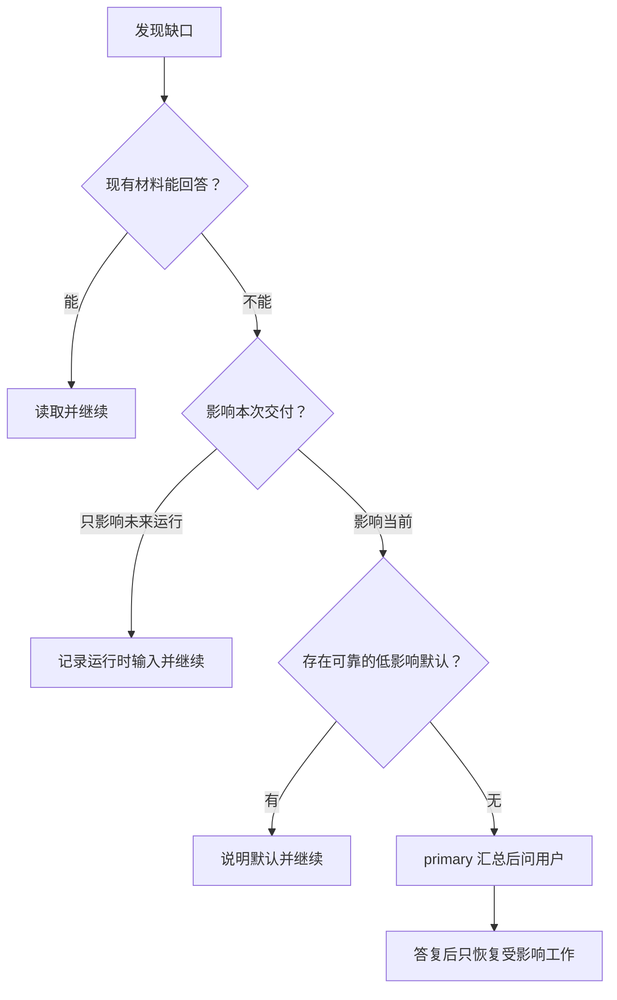

# 多 Skill 输入后的使用审查与优化

日期：2026-10-16。范围：当前四个 Agent、三个方法 Skill 及其交接、默认行为和提问责任。本轮材料是构造的批次分析/报告 Skill，不包含用户真实业务数据。

## 1. 主要结论

当前架构可以保留。最需要改的是决策时机：不能把“未知”一律变成提问，也不能把将来业务执行的输入要求提前变成当前配置设计的阻塞。

默认规则已落实为：**primary 负责用户交互，subagent 只回传问题；先读材料，再判断可默认、可延后或必须问；局部问题只阻塞相关工作。**

另修正了一处演练中实际出现的问题：创建器将“本次只生成配置、不分析数据”的限制写进业务 Agent 正文。该限制属于当前创建会话，未来业务 Agent 收到数据后应按其职责分析。现在创建流程与检查项要求明确分开这两个阶段。

## 2. 输入多份 Skill 后会发生什么

推荐日常使用 `skill-ecosystem-planner`。它持有用户目标，按需采用分析、创建和方法维护三个 Skill。用户通常无需先选择单 Agent 还是多 Agent，也无需自己画 DAG。

| 当前入口 | 适合的请求 | 能力边界 |
| --- | --- | --- |
| skill-ecosystem-planner | 多 Skill 分析、场景组合、整合为业务 Agent | 在同一主体续接方法；必要时委托单份画像 |
| skill-relations-master | 只盘点、比较或研究关系 | 在分析结果处停止；提供可续接交接，不通过 Task 调另一个 primary |
| agents-create-assistant | 目标明确，直接生成或修改配置 | 按需内联分析；自身不派单 |
| skill-profiler | 调用方委托一份材料取证 | 不综合其他 Skill，不问用户，只交画像和缺口 |

开始时先识别输入：Skill 目录、包含多个目录的项目、多个来源、已有画像或尚不可读的压缩包。检查实际布局与范围，再读入口和必要参考。小集合可以在当前主体完成；材料很多且隔离/并发收益明确时再派 worker。

“帮我看看怎么用”默认给简洁能力表和组合候选。“帮我整合成一个 Agent”默认保留 Skill 独立，形成统一入口。只有明确需要资产整理时才物理合并或拆分 Skill。正式画像、批量派单、结构化交付仍使用已有 schema；轻量比较不强制九节报告和多份 YAML。

## 3. 哪些相对确定，哪些需要 question

“可确定”指有材料或用户要求支持；“可默认”是可回改的设计选择；二者都不等于运行效果已经验证。

| 使用情况 | 可直接确定/推进 | 是否问用户、谁来问 |
| --- | --- | --- |
| 给出多份 Skill，问各自能做什么 | 读材料，提取职责、条件、资源、限制 | 通常不问，先完成能力总览 |
| 问怎么组合但没有具体业务任务 | 给有证据的候选路线与适用前提 | 当前可不问；要选定实施目标时由 primary 问一个方向问题 |
| 指定只用 B | 选集固定，不偷偷补 A | 设计时说明 B 的输入；实际业务需要缺失输入时才问 |
| A 输出明确满足 B 必需输入 | 记录候选先后关系与兼容依据 | 无需问用户代替接口分析；真实执行能力仍待验证 |
| A/B 只是领域知识和报告规范 | 可同主体采用，按阶段限定规则 | 无需问是否必须建两个 Agent |
| A/B 独立但共享写一个文件 | 分离输出或采用顺序步骤 | 低影响且符合任务时直接安排；不能承诺未测的真实并发 |
| 两份同名 Skill 来自不同来源 | 分析 ID 以来源消歧，两份都可读 | 仅分析不问；需要加载/改写且无法确定实际目标时由 primary 问 |
| 没有 CSV、阈值，但只要配置草稿 | 将其定义为运行时输入，继续创建 | 通常现在不问 |
| 用户要求固定业务阈值，来源相互冲突 | 保留冲突证据，完成无关配置 | 必须由 primary 问适用口径；不能按最后读取者或平均值决定 |
| 没给输出目录、内部任务编号 | 使用唯一草稿目录，生成内部 ID | 不问用户填写编排字段 |
| 用户说“给结果检查一下” | 默认同主体自检，说明不是独立验收 | 不必问；明确要求独立时检查真实独立验证能力 |
| 多 worker 缺同一个输入 | primary 合并为一项，先判断何时需要 | 当前必须决定才问一次，不逐个转发 |
| worker 缺输出路径/task_id | 回传委托缺口，primary 补齐 | 不问用户 |
| 用户要求全部分析，一份不可读 | 覆盖其他对象，标明缺失项 | primary 精确请求可读材料；只暂停依赖缺失材料的结论 |
| 只有压缩包，环境无法读取或解包 | 检查是否已有可读附件/目录 | 确认无法读取后由 primary 请求解压材料；不凭空扩大工具权限 |
| 普通问题无需领域 Skill | 通用能力足够时直接回答 | 不问、不强制加载领域方法 |
| 当前要求从分析改为仅比较 | 取消尚未开展的创建，保留有效事实 | 已明确的新目标直接执行，不重新确认 |
| 没有可匹配 Skill 或工具缺失 | 区分通用能力足够与真实能力缺口 | 不为了凑齐流程创建空壳 Skill；仅询问影响当前交付的决定 |

## 4. primary 和 subagent 如何处理问题

subagent 发现缺口时先回传给 primary，再由 primary 走上述判断。不能让 subagent 因方法文档写了“询问用户”就绕过 `question: deny`。

回传继续兼容 `missing_inputs`，新增可选 `clarification_requests`，记录问题、依据、影响步骤和可选项。它只是问题候选，不意味着用户必须回答。调用方可以通过补任务包、读材料、记录未知或延后到运行时解决。

primary 通常只问当前阶段最关键的 1–3 项。已经回答过的事项沿交接保留，不重新收集。没有用户回复时，继续无关工作并保留待决项；不把沉默当作同意。问题没有新信息时不反复提问或重新派单。

## 5. 三个具体使用片段

### 场景 A：没有数据，但要业务 Agent 草稿

用户：“用趋势分析、领域指南、报告生成和检查 Skill 组成 Agent，现在只要配置，CSV 以后给。”

合适路径：读接口 → 单 primary 方案 → 定义运行时 CSV/单位/时区及必要阈值 → 生成草稿 → 配置静态检查。无需现在索取数据或让用户选择几个 Agent。

报告检查是将来的业务阶段。配置创建者的自检与未来业务报告的检查分别标注，不能因为生成了 quality-check 导航就说业务报告已验收。

### 场景 B：必须固化冲突规则

构造材料 A 要求温度超过 80°C 判超限，B 要求超过 90°C 判超限，均指设备 X，未提供版本优先级。用户要求把阈值固定进 Agent，运行时不再问。

primary 应问：

> 两份材料对设备 X 的规则冲突：A 是超过 80°C，B 是超过 90°C，材料没有生效顺序。这次 Agent 应固化哪条规则，还是采用你另给的规则？我可以先完成输入、报告和检查导航，判定规则等待这个决定。

不能推荐其中一个为“更正确”；较保守数值也未必代表用户业务口径。若用户只要求画像，则无需现在问，记录冲突即可。**同一个缺口是否需要提问，取决于当前交付。**

### 场景 C：worker 缺委托字段

调用方只给了 Skill 路径和分析目标，没有正式画像的 task_id 与输出路径。

worker：回传 BLOCKED，指出缺少委托字段，不发用户问题、不任意写画像。primary：生成内部 ID 和授权输出路径，补任务包后续接。用户无需处理这些内部字段。

如果缺的是业务 CSV，但任务只是静态画像，worker 可以 PASS + gaps；不能混淆两种缺失。

## 6. 真实演练观察与文档审查发现

| 来源 | 观察/问题 | 已做调整 |
| --- | --- | --- |
| 独立上下文演练：5 份 Skill，含两个同名 report-builder | 首轮能给组合路线，同名问题未阻塞分析；没有执行或安装 | 保留此路径，写成明确默认；同名分析与实际加载分别处理 |
| 独立上下文演练：配置草稿，无 CSV | 能完成配置而未索取当前数据；但生成正文出现“当前配置创建…不运行分析”的创建阶段限制 | 创建与业务运行时约束分开；加入未来用户输入齐备后的可用性检查 |
| 独立上下文演练：单份画像 worker | 能提取上游产物依赖，回传 PASS 与证据，没有问用户 | 保留有效画像与业务输入缺口的区分，明确问题回传责任 |
| 文档审查 | 部分 primary 示例在 `'*': deny` 下遗漏 question allow | 同步修正单 primary、master-worker 和路由示例 |
| 文档审查 | “仅设计不创建文件”容易误伤“生成配置草稿” | 区分只讨论/不改文件与明确的文档生成请求 |
| 文档审查 | 单份画像步骤机械要求内部委托字段，轻量比较过重 | 内联自建标识；轻量比较可直接回复，正式 worker 保持契约 |
| 文档审查 | 不同文件分别说“缺信息就澄清/阻塞”，缺少阶段判断 | 新增 interaction.md，创建器同步最小规则 |
| 文档审查 | 仅说 worker 独立上下文便“保证完整检视” | 改为降低串扰、按目标记录覆盖，真实隔离仍由 runtime 验证 |

三组完成的演练是方法级执行，不是通过 OpenCode 启动这些 Agent 的集成测试。为避免打断真实用户，演练要求将拟提问题写入产物，没有实际调用 question 工具，因此不能据此证明工具权限已生效。演练阶段工作副本仍在编辑，不能当作严格冻结的新旧 A/B 效果对照。

后续三组独立复测（固定口径冲突、缺委托字段、修订后配置生成）因执行额度限制未得到产物，状态记录为基础设施未执行，**没有计作通过或业务失败**。剩余行为由本轮主主体逐例推演和静态检查；尚未证明修订后的模型行为稳定。

## 7. 本次文件变化

核心变更是 `skill-relations-analysis/references/interaction.md`；三份 SKILL.md、四份 Agent 及创建模板/契约/示例接入其决策原则。保留四 Agent、三方法 Skill 的数量及已有业务工具权限范围。

新增 `evals/usage-cases.json` 保存使用场景和实际验证层级；构造材料以 JSON 文本存放，不作为额外可发现的业务 Skill 安装。原有 16 个设计案例继续保留，未被这次演练自动标为运行通过。

正式使用前，优先在内部 OpenCode 测：primary 能否 question、subagent 是否禁止 question、问题回传后是否只重做相关部分、生成 Agent 是否能在业务输入齐备后进入工作。文档格式与权限字段检查不能替代这些运行验证。

## 8. 静态检查结果

本轮已检查 4 份 Agent、3 份 Skill、50 个本地引用及 3 个完整配置示例的交互权限，未发现结构或引用错误；三份 Skill 均通过 quick_validate.py。指纹脚本未改动，沿用上一版本的脚本检查证据。压缩包保持完整分发结构，不包含临时模拟任务目录。
