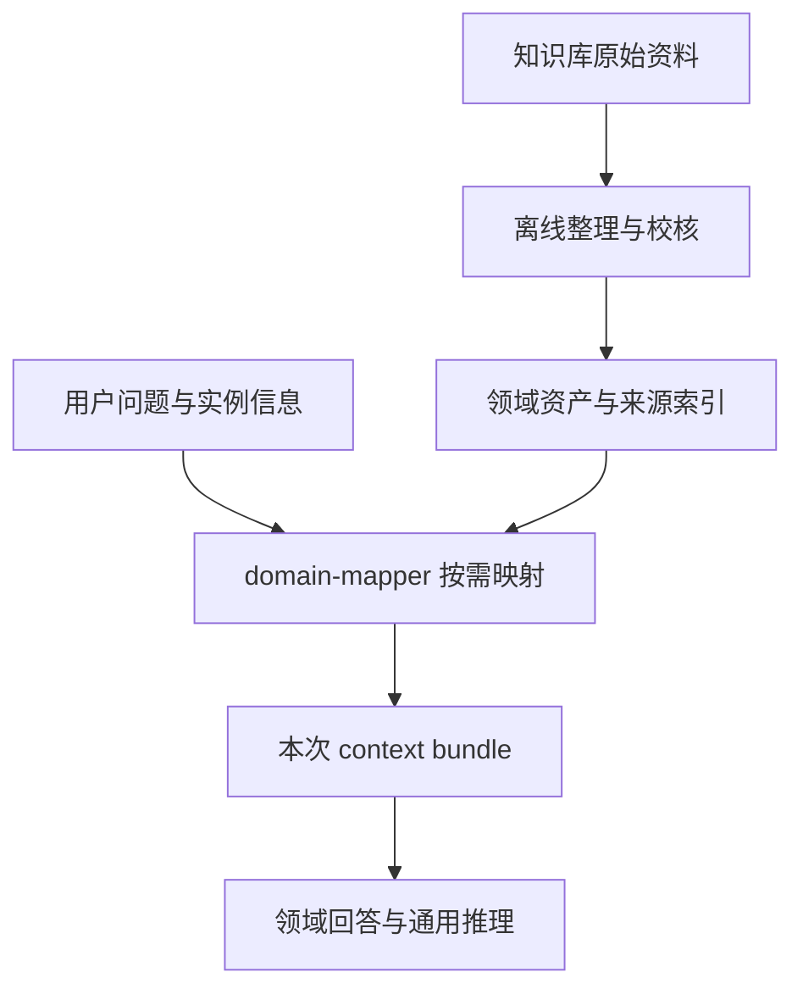
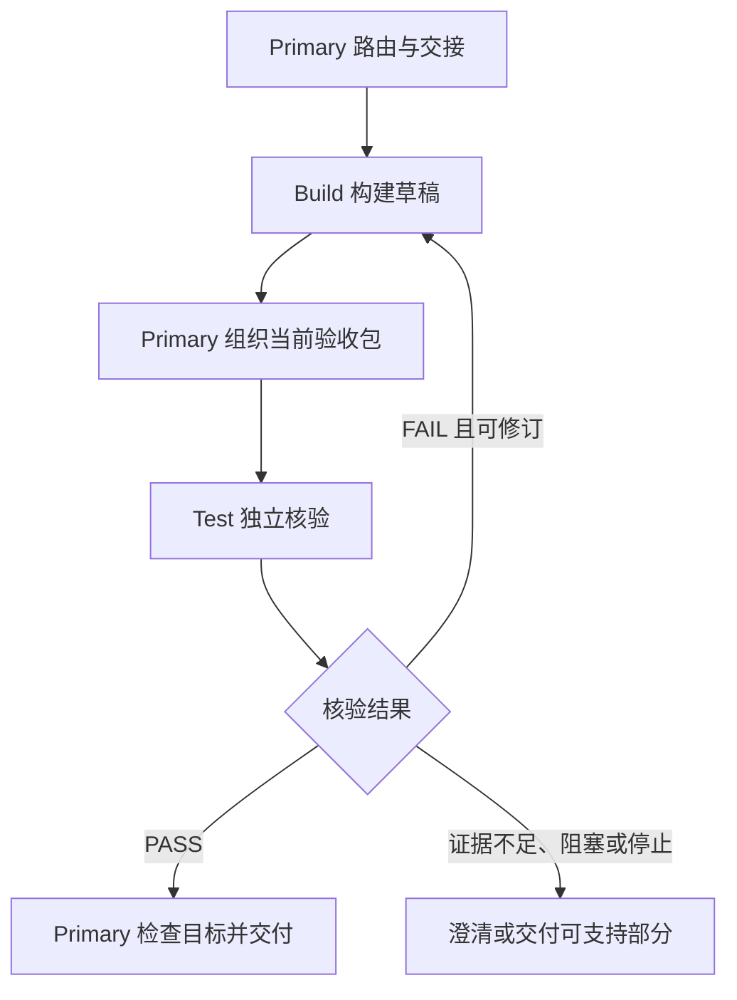

# 领域与业务知识如何融入智能体：从知识问答到领域智能体，再到多智能体

> 本教程以你描述的知识检索 skill、domain-mapper，以及已构建的 `domain-primary.md`、`domain-build.md`、`knowledge-test.md` 为基础。重点是理解演进过程与设计方法，不要求重写现有 skill，也不假设尚未提供的接口、资源路径或业务流程。
>
> 教程中的半导体业务案例、字段与目录均为教学示例，不是企业实际工艺规则。涉及 OKF 的部分沿用你关注的设计思想，不作仓库实现或最新版本行为的断言。

## 1. 先理解：我们希望智能体学会什么？

假设用户问：

> “最近这条线良率掉了，是不是温度漂了？先帮我看看，再给个排查建议。”

通用模型可以解释良率、温度漂移和排查方法，但还不知道“这条线”是哪条线、“良率”使用什么口径、应该比较哪个时间窗口，也不知道本公司允许谁调整哪些参数。

这些缺口并不是同一种知识缺口。

| 类型 | 解决的问题 | 示例 | 使用时的边界 |
|---|---|---|---|
| 领域知识 | 这个专业世界有哪些概念与机制？ | 良率指标、工艺变量、可能的影响路径 | 一般机制不能直接证明本次异常原因 |
| 业务知识 | 在本组织、本流程中如何定义与处理？ | 指标统计口径、产品分类、排查流程、责任分工 | 必须匹配组织、产品、流程与规则版本 |
| 实例信息 | 此时此地究竟发生了什么？ | 本批次数据、设备记录、变更记录 | 不能用领域常识或历史默认值替代 |
| 用户目标与约束 | 本次需要完成什么？ | 只读排查、先给建议、不改参数 | 知识资产不能覆盖用户明确要求 |

**融入知识的目标，是让智能体在正确的问题上，获得正确语境和可追溯依据。** 单纯把更多文档塞入提示词，不能保证这一点。

这里讨论的是通过检索、文件和 skill 在运行时提供知识，不是通过训练改变模型权重。知识融入后，模型仍需要通用解释、计算、推理和方案设计能力。

### 一个循序渐进的演进路径

| 阶段 | 核心能力 | 新解决的问题 | 仍然存在的限制 |
|---|---|---|---|
| 知识库 | 保存、组织与检索资料 | 资料在哪里？ | 找到资料不等于回答问题 |
| 知识问答 | 检索证据并组织回答 | 文档对此怎么说？ | 用户黑话、隐含语境和关联机制可能没理解 |
| 领域智能体 | 解释问题、构建领域上下文、结合 know-how 回答 | 在这个领域与业务中，该如何理解和分析？ | 建模或推理仍可能出错 |
| 多智能体 | 生成与独立核验分工 | 专业回答是否符合证据和适用条件？ | 同源错误、成本增加和交接损失仍需控制 |

这是一条按问题增加能力的路径。简单问答可以长期停留在知识问答阶段，不必让所有问题都走完整流程。

## 2. 第一步：从知识库到知识问答

### 2.1 知识库先提供“可用证据”

知识库里可能包含指标说明、操作规程、故障案例、设备手册、业务制度。开始时不必追求复杂建模，先让检索结果具备基本可用性：能够定位原文，知道版本和适用范围，并保留影响结论的上下文。

例如，一段资料写着“温度变化可能影响工艺稳定性”，它只能支持可能的影响机制。若引用时丢掉“某产品”“某工艺阶段”“在一定条件下”等限定，回答就可能变成错误的普遍规则。

检索结果可以按已有 skill 契约返回；教学上可以理解为包含以下内容：

```yaml
source: 工艺说明文档
location: 章节或段落定位
version: 资料版本或更新时间
scope: 适用产品、设备或流程
excerpt: 包含必要上下文的证据片段
```

这些字段不是必须新增的 API。关键是智能体和后续核验者能够找回依据，辨认它是否适用于本次问题。

### 2.2 知识检索 skill 与 agent 各负责什么？

你已有的知识问答形态可以表达为：

**知识检索智能体 = agent + 知识检索 skill + 可访问知识库。**

| 组件 | 主要责任 |
|---|---|
| 知识库 | 保存事实、定义、规则、案例及其来源 |
| 知识检索 skill | 指导如何查找、筛选、阅读和引用资料 |
| Agent | 理解用户问题，判断需要查什么，组织答案并说明边界 |

具体检索接口、查询方法、引用格式放在 skill 中。Agent 文档只需要说明职责、何时使用 skill、遇到缺口怎样处理，避免重复复制操作细节。

### 2.3 一次问答如何发生？

用户问：

> “我们业务里的良率怎么定义？温度异常可能产生什么影响？”

智能体先拆成指标定义与机制解释两个问题，再加载知识检索 skill，检索对应资料，核对适用范围，最后组织回答。

好的回答至少让读者分清：本业务定义是什么、资料支持什么机制、哪些内容还没有证据。它不会因为检索到温度相关案例，就宣称本次良率下降一定由温度导致。

### 2.4 本阶段的练习与完成标志

选一份指标说明和一份机制说明，提出三个问题：定义是什么、适用范围是什么、资料没讲到的问题是什么。

如果智能体能引用定义、保留适用条件，并对缺失信息明确说明，就已经完成了有价值的第一步。此时优先改善检索与证据质量，而不是急着增加 agent。

## 3. 第二步：从知识问答到领域智能体

### 3.1 为什么“查得到”仍可能“答不对”？

回到原始问题：“最近这条线良率掉了，是不是温度漂了？”

它的难点不只是缺少资料，还包括：

- “良率”可能对应不同指标，必须辨别统计对象与口径。
- “最近”需要比较窗口，不能随意用一个默认时间范围。
- “温度漂了”可能是用户假设，不能自动升级成已发生的事实。
- 用户希望获得分析与排查建议，不只是几段相关文档。

每次都从大量原文重新拼接这些语境，容易重复劳动，也容易在不同问题中使用不一致的解释。你的 domain-mapper 正是在这里增加一层稳定的领域路由与语境能力。

### 3.2 domain-mapper 的作用：把用户语言翻译为可分析的问题

根据你的描述，它会进行术语解码、意图推断、领域上下文构建、细节校验和背景缺口处理，并通过确定性脚本完成部分映射与契约检查。

**它产出的是本次任务需要的 context bundle，而不是直接宣布业务结论。**

例如，可以把问题解释为：

```yaml
原始问题: 最近这条线良率掉了，是不是温度漂了？先帮我看看，再给个排查建议。
意图候选: 异常分析与排查建议
已知信息:
  - 用户报告良率下降，但尚未提供实际数据
待确认:
  - 产线、产品与工艺阶段
  - 良率指标口径与比较时间窗口
待检验假设:
  - 温度变化可能与异常有关
相关知识:
  - 对应指标定义
  - 温度影响机制及其适用条件
  - 本业务允许的排查步骤
回答边界:
  - 当前只能提出条件分析与排查路径
  - 不足以确定根因或建议直接调整参数
```

这是语义示例，实际字段以你的 skill 契约为准。尤其要区分“用户已经确认”“系统推断”“领域默认”和“仍需确认”，否则 context bundle 会把猜测包装成事实。

### 3.3 预先构建的领域资产怎样分工？

你描述的资产由多次知识库检索预先构建，能够作为后续任务按需加载的基础。

| 资产 | 作用 | 何时加载 | 主要风险 |
|---|---|---|---|
| glossary | 术语、别名、黑话与歧义解释 | 用户表达有专业缩写或多义词 | 同词在不同业务中含义不同 |
| business context | 业务对象、流程、角色与适用范围 | 需要判断组织或流程背景 | 旧业务背景被用于新场景 |
| intent patterns | 将表达关联到可能任务 | 用户问题模糊，需要确定分析方向 | 模板强行替代真实意图 |
| metrics specs | 指标定义、公式、单位与统计口径 | 指标解释、计算、比较 | 同名指标口径不一致 |
| mechanism guide | 机制、影响路径与成立条件 | 解释、诊断与方案分析 | 一般机制被当成本次因果证据 |
| sensitivity coefficients | 有来源的敏感性参数及适用条件 | 定量估算且满足适用条件 | 系数跨设备、产品或范围误用 |
| trade-off metrics | 多目标权衡与评价维度 | 提出方案、比较选择 | 业务目标或优先级变化未被发现 |
| 确定性脚本与输出契约 | 映射、提取、单位或格式检查 | 已明确且适合程序处理的步骤 | 格式正确被误认为语义正确 |

不是所有问题都要加载全部资产。问一个缩写，通常只需术语与来源；做定量分析，才需要指标口径、参数和实例数据；做方案比较，才需要权衡维度。

### 3.4 区分离线建模与在线使用

离线建模处理的是“哪些知识值得成为可复用资产”：检索资料、抽取概念与机制、整理关系和适用范围、保留来源、检查冲突，再形成可按需加载的文档或映射。

在线使用处理的是“本次问题需要哪些资产”：解释表达、选择相关知识、结合用户背景、识别缺口，再输出 context bundle。



这种分离使重复出现的领域解释不必每次重建，但并不意味着静态文档永久有效。高影响规则、变化频繁的业务信息、争议内容或缺少来源的参数，仍应回到真源核对。

### 3.5 目录化不是为了文件更多，而是为了容易选对知识

一种教学性的组织方式如下：

| 层级 | 内容 | 加载方式 |
|---|---|---|
| 入口索引 | 资产目录、适用场景、来源说明 | 先看小索引，决定查哪部分 |
| 公共概念 | 共用术语与基础机制 | 需要时加载相关条目 |
| 业务分区 | 各产品、流程或部门的规则 | 明确业务范围后选择 |
| 专题详情 | 指标、机制、参数、权衡 | 按当前问题加载 |
| 来源记录 | 原文定位、版本、冲突与更新记录 | 查证与维护时读取 |

规模小时，几份 Markdown 和一个索引就够了。不要为简单任务先搭复杂知识图谱，也不要把完整领域手册写进 agent 文档。

### 3.6 结合你关注的 OKF 思想理解这一层

“写出来、确认过、仍有效、本次算对了”可以作为四个分别需要回答的问题：

| 问题 | 在本教程中的对应检查 |
|---|---|
| 写出来了吗？ | 术语、规则、机制与适用条件已明确记录 |
| 确认过了吗？ | 有来源与检查记录，抽取内容没有脱离原文 |
| 仍有效吗？ | 当前业务范围、版本与条件仍然匹配 |
| 本次算对了吗？ | 当前回答正确应用了知识、实例输入与推理 |

预先确认一条规则，不代表每次应用都正确。当前回答通过验收，也不代表背后的知识资产永久正确。

“按概念隔离上下文，以文件连接阶段”在你的场景中可以体现为：领域资产按主题分开；本次只加载相关概念；长任务用 context bundle、草稿与验收报告连接阶段。文件保留的是明确的交接结果，而不是把全部探索历史传给下一阶段。

### 3.7 同一个问题，领域智能体怎样回答？

领域智能体使用 context bundle 后，可以形成更贴近用户目标的回答：

> 当前还不能确定温度漂移是根因。先确认良率口径与比较窗口，再检查产品构成、数据统计方式和近期变更是否可比；随后对齐温度记录与异常出现时间，依据适用的机制说明选择排查项。缺少实例数据时，先给出排查路径，不能直接下诊断结论。

相较知识问答，它增加了问题解释、业务条件与分析组织。相较通用模型，它使用了本领域的定义与约束；同时仍依赖通用推理完成比较、拆解和表达。

## 4. 第三步：从领域智能体到多智能体

### 4.1 增加一个 agent 要解决什么问题？

生成者容易沿着自己已选的解释继续推理，也可能相信自己引用的资料足够支持结论。领域知识越完整，回答看起来越专业，这种错误越不容易被发现。

你设计的串行 build→test 分工，是让领域智能体负责构建回答，再由知识检索智能体回到知识库独立核验。

**原来两种能力在这里改变了任务角色：领域能力用于 build，知识检索能力用于 test。** Tester 不是再次自由回答同一个问题，而是检查当前草稿。

### 4.2 三份 agent 文档的职责

| 文档 | 角色 | 输入 | 输出 |
|---|---|---|---|
| domain-primary.md | 路由、编排、澄清与交付 | 用户问题、已确认背景与约束 | 最终回答或明确的部分交付 |
| domain-build.md | 结合 domain-mapper 构建专业回答 | 原始问题、背景、输出要求与修订意见 | 完整草稿、版本、关键依据与缺口 |
| knowledge-test.md | 使用知识检索 skill 独立核验 | 原始问题、必要背景、当前草稿与依据线索 | 对应版本的核验报告及修订依据 |

Agent 文档保持职责与协作层面的抽象。domain-mapper 怎样映射、知识检索怎样查询，继续由实际 skill 指导。

### 4.3 两个子智能体怎样通信？

它们通过 primary 中转，不直接互调。Build 先完成草稿，test 再进行核验；需要修改时，primary 将具体反馈转回 build。



图中的修订回路由 primary 协调。按现有文档，默认最多修订两轮；无新增证据或实质进展时提前停止，停止不等于通过。

### 4.4 交接需要完整，但不需要复杂表单

一个简短问题可以直接文本交接：

```text
给 build：
原始问题：……
已确认背景与约束：……
需要输出：解释现状、给排查建议；不执行参数变更。

给 test：
原始问题与必要背景：……
待验收草稿：v1 的完整文本。
依据线索：相关资料定位、领域条件与假设。
请核验专业断言、适用条件与关键漏答。

给 build 的修订反馈：
v1 的第二段把“可能机制”写成了“确定原因”。
依据：资料只描述一般影响，当前缺少实例数据。
请保留排查建议，修正因果表述，并返回完整 v2。
```

较长内容可以改用本次任务的文件，并明确版本。例如草稿 v2 必须对应验收报告 v2。文件可读性、路径可访问性和版本一致性由实际运行环境保证，不能假设子会话自动知道。

### 4.5 为什么 test 要用独立上下文？

现有 primary 文档要求每次验收使用新的子会话，不传递 build 的探索历史或自评。Test 需要看到完整草稿、原始问题和必要依据，但不需要沿用生成者的思考路径。

这能减少“因为 build 已经相信，所以 test 也相信”的倾向。Build 提供的引用是待查证线索，test 应阅读原文，并检查被遗漏的关键断言和反例。

独立上下文不是 agent 名字不同就自动成立，也不等于独立知识来源。实际平台需要落实新子会话及权限边界；两个 agent 依赖同一错误来源时，仍可能共同出错。

### 4.6 Tester 如何判断？

| 状态 | 含义 | Primary 的处理 |
|---|---|---|
| PASS | 在所述核验范围内，关键内容有充分支持，条件明确 | 检查目标覆盖与表达后交付 |
| FAIL | 有明确错误、条件不匹配或关键漏答 | 转交具体证据和位置，修订后复验 |
| INCONCLUSIVE | 关键证据不足或冲突未解 | 补证、澄清，或保留未确认范围 |
| BLOCKED | 必要输入、工具或知识库不可用 | 处理阻塞，或交付不依赖它的部分 |

“知识库没找到”不等于“内容错误”。一个新建议可能未被记录，但只要没有违反已知约束，且标明前提与验证方法，就不应仅因没有原文同句而被否定。

核验也要按内容类型分别处理：领域事实查来源；用户输入查忠实使用；计算查输入、公式与单位；推断查前提和逻辑；建议查约束、风险与验证办法。不能用同一种“是否在知识库出现”的标准检查整份回答。

### 4.7 在贯穿案例中，test 能发现什么？

假设 build 写道：“温度漂移导致良率下降，建议按历史系数调整温度。”

Test 应检查：当前是否有温度漂移的实测证据；资料是否支持该产品与工艺阶段；历史系数是否适用；建议是否超出了用户的只读排查范围。

若没有实例证据支持因果结论，就应定位该断言并要求修订。修订后的回答可以保留温度这一候选因素，补充数据对齐和验证步骤，而不是为了通过而删除整个分析问题。

## 5. 领域知识会不会降低通用回答能力？

有这种风险，主要来自运行指令与上下文过度约束：把普通词强行解释为领域黑话、把所有建议都要求知识库背书、加载过多专业材料，或者让领域模板覆盖用户真实目标。

三份文档已经通过路由与边界来降低这些风险：

| 用户问题 | 路由方式 | 保留的通用能力 |
|---|---|---|
| “什么是相关性与因果性？” | Primary 直接回答 | 通用概念解释 |
| “我们这里这个指标如何计算？” | Build→test | 数学表达与清晰说明 |
| “解释这个指标，再写一个处理数据的脚本。” | Build 综合回答，仅核验相关领域内容 | 编程、计算与问题拆解 |
| “能否提出一种文档没写过的排查方法？” | 允许探索，检查已知约束与假设 | 方案设计与探索 |
| “这次异常到底是不是温度造成的？” | 领域分析与实例证据核验 | 条件推理与不确定性表达 |

对于混合任务，知识 test 通过不能证明脚本可以正确运行；脚本仍需要与任务相称的执行或输出检查。专业事实核验的范围必须写清。

## 6. 如何用一组练习逐步验证设计？

以下是文档设计验证练习，不是已经完成的运行实验。

| 练习 | 期待行为 | 暴露的问题 |
|---|---|---|
| 普通概念解释 | 不强制领域映射或检索 | 领域过度路由 |
| 同词不同业务含义 | 保留候选解释，结合背景确定 | 术语映射过早确定 |
| 同名指标不同口径 | 先匹配业务范围再计算 | 指标口径混用 |
| 缺少实例数据的诊断 | 给候选原因与排查路径 | 常见机制冒充本次根因 |
| 过期规则与新规则冲突 | 说明版本、范围与未解冲突 | 静态资产被当成永久真理 |
| 知识库没有的新方案 | 检查前提和约束，不机械否定 | 探索能力被压缩 |
| 草稿从 v1 改为 v2 | 实质修改重新验收 | 旧报告被复用 |
| 检索暂不可用 | 交付可支持部分，明确阻塞范围 | 整份任务不必要地停止 |

可以先用同一批问题比较“知识问答”“领域智能体”“build→test”三种方式，并保持模型、任务输入和预算口径尽量一致。观察专业错误、适用条件遗漏、任务覆盖和通用问题表现，同时记录模型调用、检索次数、时延与成本。

不要只比较答案长度或引用数量。真正要看的是：新增领域建模是否提高了问题理解；新增 tester 是否纠正了实质错误；收益是否值得增加的运行成本。通用能力是否实际下降，需要这些运行结果来判断。

## 7. 一套简单的落地顺序

### 第一个里程碑：知识问答可追溯

使用已有知识检索 skill 跑通定义、规则与机制问答。优先保证来源可定位、适用条件完整、未知问题不会被补造。

### 第二个里程碑：领域语境可复用

从重复出现的术语、指标和机制开始，整理你的 domain-mapper 资产。每项重要知识保留来源、版本与适用范围；在线只加载本次相关内容，context bundle 区分事实与假设。

### 第三个里程碑：专业回答可独立核验

接入三份 agent 文档的串行编排。落实新验收会话、完整草稿交接、报告版本对应、可定位反馈和停止条件，再检查真实任务中的成本与收益。

### 第四个里程碑：把问题带回知识维护

如果 test 反复发现同一条规则过期、一个术语歧义或一个指标口径缺失，可以形成维护候选：记录问题、来源、影响范围与建议修改，再进入独立的资产更新流程。

现有三个 agent 只生成和核验本次任务产物，不自动修改 domain-mapper、共享规则或知识库。一次回答通过，不应自动变成新的永久规则；一次失败也应先区分检索问题、资产问题、实例信息不足与推理问题。

## 8. 教程回顾：每一步新增了哪种责任？

知识库承担资料保存责任；知识检索 skill 承担查证方法责任；知识问答 agent 承担证据组织与回答责任。Domain-mapper 增加领域解释与上下文装配责任，使知识可以稳定复用、按需加载。领域 build 结合这些语境和通用推理构建回答；独立 test 检查当前草稿是否符合知识与条件；primary 最后确认用户目标、交接完整性和交付边界。

演进的核心不是 agent 越来越多，而是各阶段责任越来越明确：**资料可追溯、语境可复用、推理有边界、验收对当前版本负责。**

---

## 附录：参考材料与适用范围

本教程依据以下已提供材料编写：

1. 你对 domain-mapper 的描述：术语解码、意图推断、context bundle、领域资产、确定性映射与输出契约。
2. 当前 `domain-primary.md`：通用／领域／混合路由、串行调度、独立验收、修订上限与最终交付。
3. 当前 `domain-build.md`：按需领域映射、通用能力保留、事实与推断区分、完整草稿与修订。
4. 当前 `knowledge-test.md`：独立检索核验、分类型检查、四种状态与版本边界。
5. 你关注的 OKF 设计表述：知识显式化、有效性检查、概念隔离与文件交接。

教程没有新增 skill 或修改三个 agent 文档，没有假设真实业务规则，也没有声称已经验证实际 OpenCode 与知识库运行效果。
