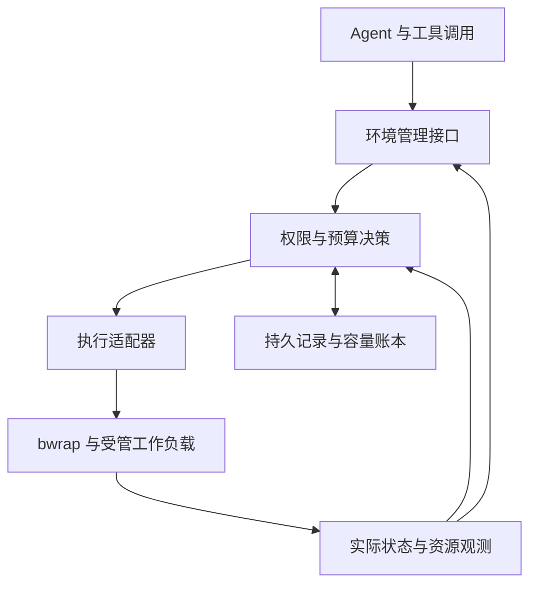

# Agent Runtime 的沙盒、进程生命周期与弹性资源管理

> 原始机制、业界实践与面向企业内部智能体平台的启发性设计
>
> 调研与整理日期：2026-10-21。适用背景：以 OpenCode 为原型、使用 bubblewrap、面向多租户的内部 Agent 平台；优先考虑不依赖 Docker、简单有效、可逐步扩展的方案。
>
> 本文是研究与设计参考，不是经过内网环境验证的部署配置。数值、接口和伪代码凡标为“建议”或“示例”，均为本文提出的设计，不代表来源项目的现成接口。

## 阅读说明：如何区分事实与建议

全文使用四种标识：

| 标识 | 含义 | 使用方式 |
| --- | --- | --- |
| **【原始机制】** | 官方文档或已查看源码明确描述的行为 | 可作为设计依据，但仍需核对本地版本和权限 |
| **【已有实践】** | 项目公开提供的接口或架构 | 可借鉴；“已提供”不等于已完成本平台的可靠性验证 |
| **【启发性建议】** | 根据机制和你的场景进一步推导的设计 | 重点理解动机与适用条件，可裁剪和替换 |
| **【待验证】** | 效果、可行性或收益尚依赖实际任务和环境 | 通过小实验获取证据，不提前做复杂工程 |

资料链接用脚注给出。`latest`、`main` 和在线产品文档是可变来源；本文记录的是调研当日读取的内容，没有将仓库固定到不可变 commit，也没有执行各项目的部署验证。项目名称相同不意味着不同版本行为相同，尤其应核对内核、systemd、Kubernetes、SDK 与实际后端的组合。

建议按以下顺序阅读：

1. 先读第 1、2 节，把握整体判断。
2. 第 3—5 节理解隔离、进程、通信和资源控制的原始机制。
3. 第 6—9 节重点回答“资源能否随着 Agent runtime 按需增长与释放”。
4. 第 10—14 节提供一个简单、可扩展的工程起点。
5. 第 15—18 节通过场景、评测与实施顺序检验方案是否值得做。

## 1. 先给出判断

### 1.1 你的设想是可行的，但需要拆成不同层次

**【综合判断】** Agent 可以在执行过程中，根据下一阶段任务、实际反馈和预算提出资源请求；平台也可以按需放宽限制、授予资源、启动额外 worker，或者将下一阶段任务交给更合适的机器。

但以下五件事不能混成一个“扩容成功”：

1. **允许使用更多**：提高 CPU、内存等限制。
2. **获得可用容量**：宿主或集群确实有资源，且调度器允许使用。
3. **运行环境完成变更**：后端已经落实请求。
4. **应用能利用新增资源**：线程池、batch、算法或分片方式支持扩展。
5. **任务得到收益**：完成更快、成功率更高，或总成本更低。

例如，把一个单线程程序的 CPU 上限从 1 核提高到 8 核，只完成了第一步，未必带来任何加速。把内存上限提高，也不等于提前给进程分配了对应数量的物理内存。

### 1.2 业界基础已经存在，完整的 LLM 资源决策闭环仍需自己定义

**【已有实践】** 可直接参考的基础包括：Linux cgroup、systemd 运行时资源调整、Kubernetes 原地资源调整与 VPA、Ray 按声明需求扩缩集群，以及 Daytona 的运行中升配接口。[^S04][^S14][^S15][^S16][^S17][^S19]

**【综合判断】** 本次资料能证明这些底层能力和产品接口存在；不能据此认定“让 LLM 自主判断并管理所有机器资源”已经形成统一、成熟的行业标准。更稳妥的组合是：

> **LLM 提供任务意图和资源建议；平台根据权限、容量和预算作决定；执行后端落实；观测系统核对实际状态。**

### 1.3 面向你的平台，建议从最小闭环开始

**【启发性建议】** 第一版可以仅支持：

- 保留 bwrap 作为现有隔离后端。
- 为 job / service 建立明确身份、所有者和期限。
- 用 cgroup 或 systemd 管理资源与清理。
- 定义少量资源档位，允许受控升配。
- CPU 可按后端能力调整；内存第一版优先只在线增加，阶段完成后退出释放。
- Agent 能查询状态、申请档位、报告阶段完成；平台自动处理授权范围内的请求。
- 资源不足时允许排队、降级或重试下一阶段，不承诺一定成功扩容。

可扩展性首先来自清晰的接口和状态语义，不需要第一天就建立通用调度平台。

## 2. 第一性原理：环境应该承诺什么

### 2.1 一份执行契约

**【启发性建议】** 将环境看作一份契约，比把它看作“可调用的 shell”更有帮助：

| 契约维度 | 需要回答的问题 |
| --- | --- |
| 权限 | 能读写哪些对象，能调用哪些外部能力？ |
| 资源 | 当前可用多少，最高可申请多少，是否有容量承诺？ |
| 生命周期 | 活多久，由谁停止，断线或重启后如何处理？ |
| 状态 | 什么是启动、就绪、完成、失败、已清理？ |
| 副作用 | 哪些改变可丢弃，哪些需要提交，哪些不可自动撤销？ |
| 证据 | 用什么证明执行结果、资源变更和清理结果？ |

模型可能忘记上下文、误判资源或输出错误命令，因此这些承诺需要由 runtime 执行。模型的理由可以参与决策，但不能代替系统事实。

### 2.2 将探索自由放在边界内

**【启发性建议】** 不必为了可控，把所有工作都限制成少数固定命令。可以允许 Agent 在项目工作区内写代码、装局部依赖、启动受管进程，同时明确限制跨项目写入、宿主服务管理和敏感业务访问。

关键是管理能力入口：可写挂载、凭据、设备、网络代理、FD 和管理 socket。命令名字并不能完整表达它的影响范围。

资源授权与安全权限也要分开：**获得更多 CPU/内存，不应自动获得更多文件、网络或凭据权限。** 两类策略可以在同一工具中返回，但应由不同字段和校验负责。

### 2.3 可撤销性应与授权同时设计

**【启发性建议】** 创建资源时就回答：

- 它属于谁？
- 何时失效？
- 由哪个稳定组件持有？
- 如何终止？
- 如何确认已终止？
- 终止后还有哪些数据或外部影响？

这比任务结束时再扫描“哪些进程可能是我的”可靠，也更容易调试。

### 2.4 控制循环不能依赖模型一直在线

**【启发性建议】** 模型适合处理秒到分钟级的语义决策，例如选择更小样本、改算法、申请下一阶段资源。内存保护、租期到期、异常退出清理和容量核算，应由确定性的控制循环处理。

如果一次内存突增只能靠再调用 LLM 才能阻止，系统的响应链条已经太长。应提前设置边界、预留余量，并将模型放在边界内作选择。

## 3. 原始机制：bubblewrap 与进程管理

### 3.1 bubblewrap 的职责边界

**【原始机制】** bubblewrap 默认建立新的 mount namespace，按参数构造文件系统视图，可组合 PID、网络等 namespace。官方强调它不是带完整策略的成品沙盒，保护程度由调用方决定；暴露 D-Bus 等管理 socket 可能开放额外宿主能力。[^S01]

**【启发性建议】** 平台保存经过审查的环境配置，而不是把 bwrap 的全部参数直接暴露给模型。模型选择“数据分析环境”“代码构建环境”等能力描述，runtime 再映射成挂载、网络和执行配置。第一版配置数量保持少量，并允许按任务传入明确的工作目录与输入文件。

### 3.2 PID namespace 的 init 是生命周期边界

**【原始机制】** namespace 的第一个进程是 PID 1；其退出导致内核终止该 namespace 中其余进程。PID 1 具有特殊信号语义。`setns()` / `unshare(CLONE_NEWPID)` 改变后续子进程的 PID namespace，并不直接移动调用者。新环境还应配套合适的 `/proc` 视图。[^S02]

需要分别理解：

| 状态 | 含义 | 管理动作 |
| --- | --- | --- |
| 孤儿 | 原父进程退出，自己仍可能运行 | 由适当的 init / subreaper 接管 |
| 僵尸 | 已退出，状态尚未领取 | 执行 `wait*()` |
| 正常后台进程 | 仍在执行或提供服务 | 根据工作负载契约决定保留或停止 |

`PR_SET_CHILD_SUBREAPER` 允许祖先进程接管孤儿后代，并领取其退出状态；这个设置不意味着自动终止所有后代。[^S06]

**【启发性建议】** 保留 bwrap 的最小 init；只有明确使用能承担 init 职责的程序时，才考虑 `--as-pid-1`。把“发送信号”“进程退出”“领取退出状态”分开处理。

### 3.3 bwrap 源码中的退出通知和回收

**【原始机制】** 当前 `bubblewrap.c` 的 `do_init()` 用 `wait()` 回收子进程，初始应用退出后通过 `eventfd` 报告状态；`monitor_child()` 使用 `poll()`、`signalfd` 处理通知，并循环 `waitpid(..., WNOHANG)`，因为多个 `SIGCHLD` 可能合并。代码优先处理应用退出通知，避免 init 接近同时退出时覆盖真实应用状态。[^S03]

以下为行为概括，**不是原源码摘录，也不是可直接运行的实现**：

```text
namespace init:
    等待任意可回收子进程
    若退出的是初始应用：向外报告其状态
    继续回收其余子进程
    无子进程可等待时退出

外部 monitor:
    等待状态通道和子进程事件
    优先领取初始应用的退出结果
    排空当前可领取的退出状态
```

**【推导】** 初始应用退出不必等同于沙盒清空；实际结果还与 `--die-with-parent` 等配置有关。任务层不应只看初始命令返回值，就宣告所有资源已释放。

### 3.4 信号、进程组与父进程死亡

**【原始机制】** `kill(pid, sig)` 面向单进程；负的进程组 ID 可以向进程组发信号，没有自动递归遍历后代的语义。[^S07]

`PR_SET_PDEATHSIG` 设置父死亡信号；该设置在子进程 fork 后被清除，且与创建进程的父线程退出有关。它不能被理解为“父进程绑定一次，所有后代永远自动受管”。[^S08]

**【启发性建议】**

- 优雅停止通过服务协议或明确的进程组完成。
- 期限后用工作负载级边界兜底终止。
- 长期 server 交给稳定 supervisor 持有，不依赖临时工具 worker 存活。
- 父死亡机制作为异常退出补充，不作为唯一清理依据。

### 3.5 稳定身份与启动屏障

**【原始机制】** pidfd 提供对具体进程的文件描述符引用，可用于退出监控；它不代表整个进程树。通过 `clone3(CLONE_INTO_CGROUP)` 可以在指定 cgroup 中创建进程，需要内核和权限支持。[^S09][^S10]

**【启发性建议】** 业务 ID 使用 `job_id` / `service_id`，PID 只作为一次执行的属性。先确保资源归属，再放行不可信代码；不支持直接创建到 cgroup 时，可以由可信 launcher 先等待启动屏障，完成放置后再执行应用。

## 4. 原始机制：cgroup 与资源边界

### 4.1 资源归属与进程关系分离

**【原始机制】** cgroup 将进程组织成可控制、可监测的层级；新子进程继承创建者当时的归属，迁移父进程不自动迁移既有后代。domain controller 的普通层级还受到“内部节点不放进程”等结构约束。[^S05]

**【启发性建议】** 以工作负载作为叶子管理单位，以租户作为总预算边界。session 可以作为关联标签，不必强制成为物理 cgroup 的固定层级，因为服务可能跨会话存活或由多个会话共享。

建议先采用浅层结构，避免为了模仿 task/run/step/attempt 的观测层级而建立同样深的 cgroup 树。

### 4.2 必须理解的接口语义

**【原始机制】** 以下是内核接口的简要语义；不能据此推断应用已适配或宿主有充足容量。[^S04]

| 接口 | 含义 |
| --- | --- |
| `cpu.max` | CPU 时间带宽上限 |
| `memory.high` | 回收与节流边界，非硬上限 |
| `memory.max` | 内存硬限制，压力无法缓解时可能触发 OOM |
| `pids.max` | 限制 task 数，包含线程 |
| `cgroup.kill` | 强制终止子树，处理并发 fork |
| `cgroup.events` | 包含活进程存在状态 `populated` |
| `cgroup.freeze` | 冻结执行，完成是异步的 |

降低内存硬限制可能触发回收和 OOM；冻结不意味着释放内存。`populated=0` 表示没有活进程，不代替 `wait*()`。资源限制向下继承；迁移也不搬走所有既有内存记账。[^S04]

### 4.3 用 systemd 作为可选执行适配层

**【已有实践】** systemd 将资源配置映射到 cgroup：如 `CPUQuota`、`CPUWeight`、`MemoryHigh`、`MemoryMax`、`TasksMax`，支持通过 unit 管理工作负载。支持的属性可以使用 `systemctl set-property` 运行时修改；`--runtime` 避免把变更持久到下次启动。[^S13][^S14]

**【启发性建议】** 如果内网宿主已经有合适版本的 systemd，可让宿主侧管理器使用 transient service / scope 或受委托的 cgroup 子树。不要让两个控制者同时修改同一批 cgroup；也不要把可任意管理宿主 unit 的接口交给沙盒。

对应关系是“平台资源请求 → 后端适配器 → systemd / cgroup”，不是“LLM 拼接任意 systemctl 命令”。

### 4.4 压力指标比单一使用率更接近问题

**【原始机制】** PSI 描述 CPU、内存、I/O 竞争造成的停顿时间，支持按时间窗观察和注册阈值事件。它度量的是资源不足对运行的影响，不只是资源占用。[^S12]

**【启发性建议】** 判断升配时结合进度、节流、压力与阶段信息。例如“CPU 使用率高且吞吐稳定”可能只是正常繁忙；“受配额节流且任务可并行”才更支持提高 CPU 预算。PSI 也不是单独的扩容按钮：需要结合宿主是否同样承压。

## 5. 通信与同步：把控制状态和日志分开

### 5.1 FD 和 socket 是显式连接点

**【原始机制】** pipe 写满会阻塞；读端只有在所有写端都关闭后才能看到 EOF。UNIX socket 支持消息通信、传递 FD 和凭据；`SOCK_SEQPACKET` 保留消息边界。[^S11][^S25]

**【启发性建议】** 让 supervisor 显式创建和关闭日志、状态和控制通道；只保留应用确实需要的 FD。传入 FD 同时是在授予访问能力，不能仅因路径在沙盒中不可见，就假定相应资源不可访问。

推荐分别处理：

| 通道 | 用途 | 设计重点 |
| --- | --- | --- |
| stdout / stderr | 人类可读日志 | 异步排空、限量、尾部等待超时 |
| 结构化状态 | 启动、退出、错误原因 | 明确格式、兼容未知字段 |
| 控制接口 | 停止、检查点、调节并发 | 身份校验、请求 ID、超时语义 |
| 业务入口 | HTTP / 数据服务 | readiness、鉴权、租期 |
| 产物存储 | 数据、报告、检查点 | 原子提交、版本、保留期限 |

### 5.2 启动有三个不同的完成点

**【原始机制】** bwrap 提供 `--block-fd` 启动等待、`--sync-fd` 存活期间持有 FD、`--json-status-fd` 结构化状态等接口。`--new-session` 建立新的终端 session。[^S24]

**【启发性建议】** 平台应区分：

1. **环境构造完成**：隔离与资源配置已经落实。
2. **进程开始执行**：命令进入运行状态。
3. **应用就绪**：服务完成初始化，可以处理业务请求。

固定 `sleep` 不能可靠替代第三步。健康检查应关联本次实例，避免探测到同端口上的旧服务。

### 5.3 通知不是事务，超时不是失败证明

**【启发性建议】** 启动、扩容、停止都应支持幂等请求。客户端超时后先查询原请求或工作负载，不能直接再次创建。网络返回成功也不代表后端变更已经生效，应区分接受、应用中和已核验。

同理，收到退出通知后再读取实际状态。后台后代持有 stdout 时，应把“主进程已退出”和“日志通道仍未关闭”分别报告，避免工具永久等待。

## 6. 按需资源的六种含义

**【启发性分类】** 当说“随着 Agent runtime 增长资源”，可以有六种完全不同的实现：

| 类型 | 例子 | 是否必然改变正在运行的进程 |
| --- | --- | --- |
| 内核自动共享 | 空闲 CPU 被其他可运行任务使用 | 否，现有调度已在进行 |
| 调整上限 | CPU 配额由 1 核带宽改为 2 核 | 通常可原地，依赖后端 |
| 应用内部调整 | worker 从 2 增到 4、batch 改大 | 需要应用支持或重启 |
| 增加执行实例 | 增加独立实验或分片 worker | 创建新进程或环境 |
| 更换执行规格 | 保存检查点，转到更大环境继续 | 常涉及新实例 |
| 增加集群容量 | 新增节点 | 需要基础设施支持和等待 |

**【判断】** 第一版应优先选择前五种中的简单组合；内网固定机器不能通过更改资源字段凭空增加物理容量。

还要区分三类“释放”：

- **释放使用量**：应用释放数据、退出 worker。
- **释放平台预留**：调度账本允许其他任务使用预算。
- **降低可用上限**：限制未来最多能使用多少。

三者可能不同步。若仅降低账本预留，却仍允许原进程立即重新占满旧上限，就可能把同一份容量授予两次。

### 6.1 CPU 与内存不能套用同一种弹性策略

**【启发性建议，依据第 4 节机制】**

CPU 更接近可按时间重新分配的资源。降低配额主要影响执行速度，但仍可能影响超时和服务延迟。内存涉及已经存在的数据；降低上限不会让应用自动找到可以安全丢弃的对象。

因此推荐非对称策略：

| 资源 | 增加 | 减少 |
| --- | --- | --- |
| CPU | 容量允许且有收益时增加配额 | 配合并发调整、冷却时间和延迟要求 |
| 内存 | 在容量账本允许时增加上限 | 首版优先在阶段结束、检查点或重建时减少 |
| 线程 / 进程 | 允许更大任务数不等于自动创建 worker | 先让应用停止多余 worker |
| 磁盘 | 依赖存储后端，可能可以扩展 | 不假定可在线缩小 |
| GPU / 专用设备 | 依赖设备、驱动、调度与应用能力 | 首版按独立作业申请和释放 |

表中后几项是保守的接口设计建议，不是所有后端统一支持的功能。

### 6.2 推理资源与执行资源分别管理

**【启发性建议】** LLM 的 token、请求并发、推理服务 GPU，与 Agent 工具使用的 CPU、内存、磁盘属于不同预算。它们可以关联同一 run，但不要因为增加机器 CPU 就自动提高模型调用预算，也不要以更多模型调用代替简单的确定性资源检查。

## 7. 哪些业界做法值得借鉴

### 7.1 概览与证据边界

| 方案 | 已核对能力 | 成熟度应如何理解 | 最值得借鉴的思想 |
| --- | --- | --- | --- |
| Linux cgroup / systemd | 运行时限制、计量、分组管理 | 成熟基础设施；本地支持仍需验证 | 资源边界独立于模型 |
| Kubernetes 原地 resize | 运行中修改容器 CPU/内存 | 官方标注自 v1.35 稳定；不等于所有 resize 无重启 | 期望值、分配值、实际值分离 |
| Kubernetes VPA | 依据使用情况推荐和更新资源 | 独立组件；更新模式的稳定性与中断行为不同 | 建议与执行分离 |
| Ray Autoscaler | 按逻辑任务需求扩缩集群 | 既有任务调度机制 | 声明需求驱动容量 |
| Ray Sandboxes | 用 gVisor 封装受管沙盒 | 文档标为 alpha | 调度代理与隔离后端分开 |
| Daytona | 在线提高 CPU/内存；有明确缩配约束 | 已文档化产品接口；未实测其 SLA | 扩缩不必完全对称 |
| E2B | 保存文件系统与内存状态后恢复 | 已文档化持久化能力 | 区分会话、运行与保留状态 |
| Kubernetes agent-sandbox | Sandbox、模板、Claim、WarmPool | 正在发展的专门编排项目 | 稳定身份与控制器管理 |
| agent-sandbox resize issue | 对运行中 resize 提出窄范围策略 | 调研时仍为开放提案，不能当成已发布能力 | 明确“不允许重启”的契约 |

对应来源与具体限制见下文。本表的“成熟”不代表本文做过压力测试、安全审计或生产验证。

### 7.2 Kubernetes：原地调整已存在，但完成需要状态确认

**【已有实践】** 官方容器资源调整文档将 in-place resize 标为自 Kubernetes v1.35 稳定，允许修改运行中容器 CPU/内存 requests 与 limits。`resizePolicy` 决定是否需要重启；状态区分 `Deferred`、`Infeasible` 和调整中。缩小内存存在限制和竞态。[^S15]

**【启发】** 你的接口也应该区分：申请目标、已经批准的预算、后端实际生效值。`accepted` 不能当作 `applied`。若当前宿主不够，应明确返回等待或当前节点不可满足，而非让 Agent 不断重试相同命令。

**【适用判断】** 如果公司已有 Kubernetes，可以借用；如果当前是普通 Linux 多用户实例，不必为这一项能力引入整个集群。可先复用它的状态设计。

### 7.3 VPA：最值得借鉴的是先建议、后自动化

**【已有实践】** VPA 将资源推荐、更新和准入分离。`Off` 仅生成建议；`Initial` 在创建时应用；`Recreate` 会重建；`InPlaceOrRecreate` 允许回退到重建。文档将纯 `InPlace` 模式标为 VPA 1.7.0 的 alpha，不能与 Kubernetes 底层 resize 的稳定状态混淆。[^S16]

**【启发】** 你的弹性策略可以先只记录“本来建议升到哪个档位、依据是什么”，验证后再自动执行。对不能丢失进程状态的服务，不应启用隐式重建的回退行为。

### 7.4 Ray：资源需求可以来自程序意图，而非只有使用率

**【已有实践】** Ray Autoscaler 根据 task / actor / placement group 的逻辑资源需求增加节点，并回收闲置节点；文档明确，它不直接根据物理利用率做这一判断。[^S17]

**【启发】** LLM 可以提前声明“下一阶段需要 4 个独立实验 worker”，平台不必等 CPU 打满才知道需要资源。对于可切分的数据处理和实验任务，这通常比给一个长寿命 shell 反复升配更容易管理。

不要把 Ray 的逻辑资源声明理解为完整的不可信代码隔离。当前 Ray 另有 `ray.experimental.sandbox`：以 actor 代理沙盒生命周期，底层使用 gVisor；文档明确其 API 为 alpha。[^S18]

**【适用判断】** 已有大量 Python 分布式任务时值得评估；纯 shell / Web server 管理不必为此强行迁移到 Ray。

### 7.5 Daytona：产品选择了非对称的扩缩规则

**【已有实践】** Daytona 文档允许运行中增加 CPU 和内存；降低 CPU/内存或增加磁盘需要先停止沙盒；磁盘只增不减，GPU 分配不可 resize，资源还受组织上限约束。[^S19]

**【启发】** 对上层诚实地暴露限制，比实现一个名义统一但行为不确定的 `resize` 更重要。你的第一版完全可以只承诺某些在线升配，缩配通过阶段退出或受控重启完成。

这证明“资源随 Agent 执行调整”已经有产品接口；它不证明产品默认让 LLM 自己决定资源，也不证明其部署方式适合你的内网。

### 7.6 E2B：保存状态提供另一种弹性

**【已有实践】** E2B persistence 文档说明 pause / resume 可保存并恢复文件系统与内存状态；也提供仅文件系统的模式，后者恢复时重启。[^S20]

**【启发】** 对交互间隔很长的环境，可以把“暂时不用”变成可恢复状态，而不必长期保留运行实例。需要区分完整进程状态、磁盘快照、应用检查点三种恢复能力。

**【待验证】** 外部连接、租约、凭据有效期以及恢复成本仍需要应用层处理；本文不根据该接口推断所有外部依赖都会无缝恢复，也不推断任意硬件能透明热扩缩。

### 7.7 agent-sandbox：稳定资源身份与窄范围变更

**【已有实践】** Kubernetes agent-sandbox 为有状态、单实例工作负载提供 Sandbox CRD / controller，支持模板、Claim 和 WarmPool；低层隔离交给 gVisor、Kata 等 runtime。[^S21]

**【正在讨论】** issue #1054 提议仅对 CPU/内存开放显式 opt-in resize，并要求“不重建、不重启”；不支持时应报告原因，API 接受后还要投射实际调整状态。调研时该 issue 仍为 Open。[^S22]

**【启发】** 不要把“修改资源配置”扩展成“任何环境配置漂移都自动重建”。这条边界尤其适合持有内存状态的 Agent 工作环境。

### 7.8 对“有没有成熟方案”的回答

**【综合判断】** 成熟的是多层基础：资源限制、进程管理、调度、扩缩容、状态恢复。面向 Agent 的沙盒产品和编排项目正在把这些能力组合起来。仍需项目自己确定的是：任务语义如何影响申请、扩容是否有收益、何时允许中断、如何公平分配、如何避免模型重复申请。

因此，建议借用成熟机制，把创新集中在一个很小的接口层：**让 Agent 能表达需求，并理解平台的决定。**

## 8. Agent 应如何参与资源决策

本节均为**【启发性建议】**，借鉴第 7 节实践，但不是任何项目已经提供的统一方案。

### 8.1 三类输入，两种控制节奏

资源决定可以结合三类信息：

| 输入 | 谁更擅长提供 | 示例 |
| --- | --- | --- |
| 任务语义 | Agent / Skill / 用户 | 下一阶段处理全量数据；结果需要在十分钟内得到 |
| 运行证据 | 监控与执行后端 | 当前内存、CPU 节流、进度、队列长度 |
| 可执行约束 | 平台策略 | 租户额度、宿主容量、可用档位、允许中断方式 |

模型的优势是知道“接下来要做什么”；系统的优势是知道“现在实际发生什么、还允许做什么”。

建议将控制节奏分开：

- **快循环**：采集状态、执行资源限制、到期处理、故障清理；不调用模型。
- **慢循环**：模型判断是否减小样本、调整算法、申请额外资源或结束阶段。

不要求模型持续解释每一次资源波动。只有会改变计划的事件进入上下文。

### 8.2 不必让 LLM 学会精确估算每一 MiB

可以提供少量具名档位，由模型选择合适目标并说明预期收益。与任意数值请求相比，档位更容易做容量核算、审计和实验对比。

例如以下仅为说明接口的**假设档位**，不是适用于你的生产推荐值：

| 档位 | CPU 带宽上限 | 内存上限 | 典型意图 |
| --- | --- | --- | --- |
| small | 1 核等效 | 2 GiB | 探索、小样本、轻量命令 |
| medium | 2 核等效 | 4 GiB | 编译、标准数据处理 |
| large | 4 核等效 | 8 GiB | 经验证的并行任务、较大数据阶段 |

档位只是默认组合。若实测表明大量任务仅需要内存增长，再拆成 CPU 与内存两个档位维度。不要一开始就设计几十种资源套餐。

“最高允许 large”不代表启动时预留 large。当前批准档位、未来申请上限和平台实际预留应分别记录。

### 8.3 平台批准资源，不批准模型的自然语言真实性

Agent 可以说“下一阶段需要更多内存”，但平台无需靠另一个 LLM 判断这句话是否足够有说服力。先采用可解释规则：

- 对该工作负载是否有操作权？
- 请求是否在预先授权的上限内？
- 是否存在实际容量或允许的共享空间？
- 是否满足累计预算和请求频率限制？
- 后端是否支持所需变更？
- 是否涉及未经声明的重启、迁移或副作用？

小幅、短期、额度内的请求可以自动执行。超出明确授权或改变运行性质时，才按平台既有流程处理；不应把所有升配都变成人工审批。

### 8.4 模型可以建议释放，但释放必须核验

模型说“这个 server 不用了”，可以触发停止；模型说“已经释放 4 GiB”，不能直接减少调度账本。

平台应根据实际应用状态确认：worker 是否退出、上限是否落实、实例是否停止、后端操作是否完成。若当前证据不足，标记待核验，保守保留预留。

### 8.5 让模型申请资源有价值的前提

如果任务非常短，模型决策成本可能高于资源节省；如果输入规模固定，静态档位可能已经足够。

更适合让模型参与的情况包括：

- 下一阶段规模变化明显，监控尚未看到压力。
- 可以选择多种执行路径，资源和算法存在取舍。
- 用户目标涉及时间、质量和成本权衡。
- 实验存在自然阶段，可以在边界申请和归还。

这是一个需要验证的优化，而不是必须启用的 Agent 特征。

## 9. 弹性控制应该多简单

本节为**【启发性建议】**。

### 9.1 第一版：以阶段为单位，在线只做有限变更

建议首版承诺范围：

1. 创建时从批准的档位启动。
2. 运行中可申请一次或少量次数升配。
3. 额度内且容量足够则自动批准，否则返回具体原因。
4. CPU 可按后端能力在线调整。
5. 内存首版只在线增加；减少通过阶段退出、检查点重启或结束服务。
6. 每次增量授权有期限，期限和到期动作在授予时明确。
7. 所有变更记录请求者、原因、旧值、新值、实际生效状态。

这已经能验证“按需增长”的价值，不需要透明迁移、任意在线缩内存、复杂预测器或学习型调度策略。

### 9.2 CPU：先检查现有共享能力是否足够

如果当前大多数任务受固定 CPU 硬上限约束，即使宿主空闲也无法利用，适当提高允许突发的上限，配合租户权重和总量限制，可能已经获得大部分收益。

因此应先比较两种简单基线：

- 固定较低配额。
- 相对宽松的上限，结合公平权重与并发控制。

只有第二种仍无法满足成本或隔离要求，再增加频繁的显式 CPU 租借。内核本身已经在调度空闲 CPU，不应重复实现一个效果相同却更复杂的控制器。

### 9.3 内存：优先控制同时做多少工作

若一个 Agent 同时启动十个实验，降低实验并发，常比反复在线缩小十个进程的内存更容易。

可以先控制：

- 同时运行的 job 数。
- 每个 job 的输入批量。
- 是否把中间结果落盘。
- 是否在阶段间退出 Python worker。

对于内存缓存、运行时分配器和第三方库，调用释放函数不一定立刻降低进程或 cgroup 观察到的使用量。第一版不承诺强行回收任意应用内部对象，而是利用进程退出作为清晰的阶段边界。

### 9.4 扩容不是所有失败的默认答案

| 观察 | 更优先的检查 | 升配是否可能有用 |
| --- | --- | --- |
| CPU 高，进度正常 | 是否需要更短完成时间、能否并行 | 可能，不必自动执行 |
| CPU 低，I/O 等待高 | 数据读取、磁盘、远端服务 | 单纯加 CPU 通常缺乏依据 |
| 内存持续无界增长 | 泄漏、全量缓存、算法复杂度 | 可能只推迟失败 |
| 小样本正常，全量 OOM | 分块、流式、输入估算 | 可以结合算法调整 |
| 锁等待或死循环 | 并发逻辑、依赖 | 增加资源未必改善 |
| 临近完成但超时 | 剩余进度与累计预算 | 延长期限可能比升配简单 |

### 9.5 保留一点控制系统纪律

首版只需少量规则：

- 升配按档位，不连续追踪每个瞬时峰值。
- 一次调整后等待观察，避免来回变化。
- 每次调整有最大幅度和最大次数。
- 一个资源字段只有一个最终写入者。
- 不能同时让 Agent、自动扩容器、宿主脚本各自修改同一个目标值。

如果未来引入 VPA 或其他自动控制器，Agent 的建议应进入同一个决策入口，或明确只管理不同维度，避免两个循环互相抵消。

## 10. 一个适合现有平台的最小架构

以下为**【启发性建议】**；图中是逻辑职责，可以放在同一个服务进程内。



### 10.1 先做一个管理器，不做一组微服务

单机起点可以是：

- 一个宿主侧环境管理进程。
- 一个持久数据库，单机可用 SQLite。
- 一个执行适配器：systemd 或直接管理受委托的 cgroup。
- 一个定时核对实际状态的循环。
- 一组稳定的 Agent 工具。

多机时再增加节点代理和全局准入。不要让多个节点通过未经设计的共享 SQLite 文件充当分布式协调系统。

### 10.2 四个对象已经足够表达主要问题

| 对象 | 负责什么 | 生命周期 |
| --- | --- | --- |
| environment | 隔离配置、依赖、工作区视图 | 可按项目或工作负载复用 |
| workload | job 或 service 的身份与状态 | 从创建到清理 |
| grant | 当前批准的资源与期限 | 可变更、可到期 |
| artifact | 结果和检查点 | 独立于执行保留 |

第一版可以是少量数据库表或一个清晰的数据模型，不必为每个对象独立建服务。

需要区分逻辑模型和物理实现：一个环境不一定对应常驻进程；一个 workload 也可能有多个 attempt。重试使用新 attempt，保留相同逻辑 job 的关联。

### 10.3 与已有多租户实例的衔接

你已有每用户实例时，可以先在现有实例外增加受控 workload 管理，逐步建立 job 级统计与清理。

但要明确：**同一个 PID namespace 内，不同 cgroup 不自动构成彼此的安全隔离。** 如果任务需要互相防止信号操作、可写状态污染或数据访问，应配置独立隔离边界；不能仅凭 cgroup 分组宣称任务安全隔离。

不需要强制每个短命令新建完整环境。可把一组具有同一权限、生命周期和清理目标的命令放在一个 workload 中；遇到不同信任来源、独立取消需求或独立验收时再拆分。

### 10.4 预留一个后端接口即可

建议后端先只实现：

```text
create_workload(spec)
inspect_workload(id)
apply_resources(id, target)
stop_workload(id, grace_period)
collect_usage(id)
```

不支持的操作返回明确能力说明。未来可以添加 `checkpoint`、`restore` 或集群调度，但不要现在就把接口扩成通用云 API。

## 11. 一个小而完整的资源请求契约

本节接口为**【设计示例】**，不是 OpenCode、bwrap 或调研产品的既有接口。

### 11.1 模型侧只需要少量操作

| 操作 | 作用 |
| --- | --- |
| `environment_status` | 查询现有工作负载、资源、期限与允许动作 |
| `run_job` / `start_service` | 启动有限任务或受管服务 |
| `request_resources` | 请求目标档位、期限和允许的中断方式 |
| `stop_workload` | 结束不再需要的工作负载 |

“释放增量资源”可以作为 `request_resources` 的目标变更，或在后台由阶段结束触发。首版不必再建立复杂的资源交易接口。

### 11.2 请求使用目标值，不使用模糊的增量

```json
{
  "request_id": "req-unique-123",
  "workload_id": "job-456",
  "expected_generation": 3,
  "target_profile": "medium",
  "duration_seconds": 600,
  "disruption": "none",
  "reason": "进入全量数据预处理阶段",
  "expected_benefit": "避免样本实验已观察到的内存不足",
  "evidence_refs": ["metric-window-789"]
}
```

设计要点：

- `request_id` 用于幂等，网络重试不会重复授予。
- `expected_generation` 防止旧请求覆盖新状态。
- 目标档位表达绝对目标，重复请求不会累加。
- 身份、租户和权限从已认证会话获取，不能信任模型填写的 owner。
- 指标引用由平台核对；自然语言理由只用于解释和后续分析。
- `disruption=none` 明确禁止隐式重启回退。

### 11.3 返回值承认异步和不确定性

```json
{
  "request_id": "req-unique-123",
  "status": "applying",
  "generation": 4,
  "requested_profile": "medium",
  "approved_profile": "medium",
  "observed_profile": "small",
  "grant_expires_at": "2026-10-21T16:10:00+08:00",
  "expiry_action": "checkpoint_then_stop",
  "retry_after_seconds": 5
}
```

这里批准只说明预算已经保留，`observed_profile` 才反映当前核验到的配置。实际使用量单独返回，不把“上限已生效”写成“应用已使用这么多资源”。

建议结果状态保持少量：

| 状态 | 含义 |
| --- | --- |
| `applied` | 后端配置已经核验生效 |
| `applying` | 已批准，仍在落实 |
| `deferred` | 当前容量不足或需要等待条件 |
| `denied` | 权限、预算或策略不允许 |
| `unsupported` | 后端不能按所需方式完成 |
| `unknown` | 操作结果尚不能确定，需要核对 |

若支持部分批准，必须返回实际批准值，不能把请求 8 GiB、只授予 4 GiB 写成无条件成功。第一版也可以完全不支持部分批准，以减少分支。

## 12. 容量账本和变更流程

本节为**【启发性建议】**，关注可靠性的最小必要部分。

### 12.1 先区分五个值

| 字段 | 含义 |
| --- | --- |
| policy ceiling | 最高允许申请的边界 |
| requested | 模型希望得到的资源 |
| approved / reserved | 平台已经同意并记账的资源 |
| observed limit | 后端已核验的限制 |
| actual usage | 当前真实使用量 |

预留是平台的调度承诺，不是 cgroup 自动提供的物理内存锁定。若要承诺容量，应在平台范围内核算其他工作负载，并为宿主、缓存和管理开销保留余量。

### 12.2 第一版内存账本可以保守一些

对于由平台统一管理的宿主，可先按当前批准的内存硬上限做保守预留：

```text
可授予增量
  = 宿主可管理预算
  - 已存在的资源预留
  - 已批准但尚未核验完成的变更预留
```

不把所有任务未来可能申请的最高上限都预留，也不只看瞬时空闲内存。对一个工作负载，同一变更在账本中只能记一次：旧预留加增量，或直接替换成目标预留，二选一。

保守策略可能降低利用率，但方便先验证正确性。之后再根据实际数据决定是否允许有界超售；CPU 与内存不必采用相同超售规则。

### 12.3 批准必须避免并发重复分配

同一台宿主上的两个 Agent 不能同时读到“还有 8 GiB”，然后各自得到 8 GiB。单机可由一个决策者配合数据库事务串行完成容量预留。

下面是**流程伪代码**，省略实际数据库、权限和后端实现：

```text
收到 request_resources：
    认证并校验 workload 所有权
    按 request_id 查已有结果；已有则返回
    校验 generation、策略上限、后端能力、期限

    在事务中：
        再次读取当前 grant 和容量账本
        若不足：记录 deferred 或 denied
        若足够：预留增量，记录 target 和 applying 状态

    调用执行适配器落实变更
    查询后端，核对 observed limit

    若已生效：记录 applied
    若明确未生效且没有部分变更：恢复账本
    若部分生效或结果未知：保留保守预留，交给核对循环
```

数据库事务不能把外部后端调用变成原子操作。CPU 成功、内存失败的部分变更必须记录实际状态；不能笼统返回失败后，把所有容量重新分给别人。

### 12.4 取消、停止和升配需要明确先后关系

建议以 workload generation 或单个串行操作队列协调：

- workload 进入 `stopping` 后拒绝新的升配和启动。
- 旧代请求不能把已停止 workload 恢复为运行。
- 停止超时后继续核对，不提前标记已清理。
- 对未完成的操作使用截止时间，避免永远占着预留却没有执行。

### 12.5 避免“大家都等额外内存”的僵局

若每个 job 已占一部分内存，同时都等待升配，平台可能没有一个任务能前进。首版不必做复杂死锁检测，可以约束：

- 大阶段尽量在启动前申请所需档位。
- 等待升配设置期限，不能无限持有旧资源。
- 资源不足时允许保存检查点退出，之后排队重启。
- 对不能释放状态的任务，限制同时启动数量。

这也是“按阶段切任务”比“所有东西都在一个永久进程里生长”更容易管理的原因。

## 13. 释放与到期：最容易被过度简化的部分

本节为**【启发性建议】**。

### 13.1 租期到期不等于立即强行缩内存

每次授予额外资源时，应明确到期动作：

| 策略 | 适用场景 | 到期处理 |
| --- | --- | --- |
| 恢复 CPU 配额 | 可降速任务 | 归还增量 CPU，通知任务 |
| 阶段结束释放 | 批处理 | 任务完成后退出 |
| 检查点后停止 | 可恢复长计算 | 给有限宽限期，保存后退出 |
| 续期或停止 | 受管服务 | 按既有授权自动续期，或撤销入口并停止 |

对内存第一版可明确：额外资源期限到后，需要续期或停止对应 workload，不承诺在保留任意进程状态的同时立即收回内存。

如果应用未按约释放，资源账本应继续反映实际责任，直到后端核验完成；必要时按预先约定的策略终止。不能先减少账本，再等待应用慢慢配合。

### 13.2 不把“用户正在聊天”等同于“机器可以回收”

模型暂停生成时，后台可能仍在运行训练；用户持续发消息时，一个旧 server 也可能早已没有用途。

建议分别观察：

- 会话活动。
- job 进度和完成状态。
- service 请求和用途。
- grant 期限。
- 用户或项目的保留策略。

CPU 低并不代表闲置：服务可能在等待合法请求，任务也可能在等待远端数据。回收需要生命周期语义，不能只靠低使用率。

### 13.3 停止、清理和回滚分别报告

建议停止顺序：拒绝新请求 → 撤销服务入口 → 优雅停止 → 宽限期 → 强制停止 → 核对活进程和可回收子进程 → 收尾日志、临时资源和账本。

强杀信号已发送仍不等于进程立即消失；某些内核等待可能延迟退出。此时保留 `cleanup_pending` 状态，而不是假装完成。清理也不保证所有页缓存立刻消失，宿主余量要考虑这一事实。

远端写入、邮件发送、数据库事务或外部任务不能靠本地杀进程撤回。需要由对应业务接口提供幂等、查询、取消或补偿能力。

### 13.4 管理器重启后的核对

启动时对照持久记录和实际后端：

| 记录与实际情况 | 建议处理 |
| --- | --- |
| 记录运行中，后端仍存活 | 恢复观测并核对期限、generation |
| 记录运行中，后端已消失 | 标记异常结束，补齐可获得的证据 |
| 记录调整中，后端已生效 | 补记 applied |
| 记录调整中，后端状态不确定 | 保守记账，继续核对 |
| 发现平台创建但无有效归属的资源 | 按预设遗留策略处理，避免误伤非平台资源 |

只管理平台创建并有可验证身份的对象，不扫描整台机器后按命令名粗暴杀进程。

## 14. 环境、上下文和 Skill 如何衔接

本节为**【启发性建议】**，适合你已有的按需加载与观测设计。

### 14.1 环境事实留在系统，摘要进入上下文

数据库、进程管理器和后端是环境事实的来源。模型上下文只保留当前决策所需摘要：

```json
{
  "workload_id": "job-456",
  "state": "running",
  "profile": "small",
  "allowed_profiles": ["small", "medium"],
  "online_changes": ["cpu_increase", "memory_increase"],
  "restart_allowed": false,
  "remaining_seconds": 420,
  "latest_event": "memory_pressure",
  "metrics_ref": "metric-window-789"
}
```

压缩上下文后重新查询即可恢复事实，不要求模型凭记忆管理 PID、端口和租期。

### 14.2 Skill 表达方法，runtime 执行约束

Skill 可以提示：

- 先小样本，再全量。
- 进入大阶段前检查资源。
- OOM 后先判断分块或算法问题。
- 完成阶段后释放 worker。
- 长期 server 使用受管接口。

但租户额度、权限、期限和清理不能只写在 SKILL.md 中。Skill 的修改不应使硬限制失效。

### 14.3 错误反馈应给出下一步选择

将 `permission_denied`、`capacity_unavailable`、`memory_limit`、`deadline_exceeded`、`backend_unsupported`、`application_error` 分开，有助于 Agent 选择不同补救路径。

资源归因需要证据。例如退出码 137 本身不足以证明是 cgroup OOM；还应检查相关事件与停止记录。证据不足时返回 `unknown`，不为了结构完整而编造原因。

### 14.4 与可观测和评测体系关联

把资源事件关联到现有 `task / run / step / attempt`，但保留独立的 workload ID。多个步骤可能复用一个服务，一个步骤也可能启动多个 job。

建议记录：请求、批准或拒绝、后端生效、期限变化、CPU 时间、内存峰值、队列等待、重启、检查点、清理结果。敏感日志不必全部注入模型。

多 Agent 场景默认共享只读资料和受控产物；独立预算、临时文件和可写 checkout。生成与验收除上下文隔离外，还应在冻结候选和独立可写环境上验证，避免遗留进程与依赖污染结果。

## 15. 三个贯穿场景

以下为**【假设场景与设计建议】**，用来检验边界，不是性能结果。

### 15.1 Coding Agent：编辑、构建、验收、预览

| 阶段 | 环境和资源策略 | Agent 参与点 |
| --- | --- | --- |
| 阅读和编辑 | 小规格、项目工作区 | 不需要主动申请大资源 |
| 构建 | 独立 job，可申请更高 CPU 档位 | 声明并行构建意图 |
| 验收 | 固定候选、独立可写环境、可复现预算 | 读取验证结果，不能修改判据逃避失败 |
| 预览 | 独立 service，有入口和租期 | 创建、查看、停止 |
| 完成 | 构建 job 退出，保留产物 | 明确是否继续保留预览服务 |

核心思想：不要让一次编译升配变成整段会话永久升配。预览服务与构建 job 分开，取消构建不会意外杀掉用户正在看的服务。

反例：如果项目极小、构建只需一两秒，档位申请和队列成本可能超过收益。此时固定小环境更合适。

### 15.2 数据分析 / AutoML：资源跟随阶段增长

流程可以是：读取 schema 和少量样本 → 估算数据展开后的规模 → 申请全量预处理档位 → 输出中间数据 → 退出预处理 worker → 按独立实验 job 调参 → 汇总结果。

Agent 可用业务知识解释下一阶段，例如“类别编码会使特征维度显著增长”；平台以实际记录、容量和上限决定是否授予。

几个重要取舍：

- 多个实验优先使用并发上限，避免每个实验都争抢最高档位。
- 若内存不足，可选流式、分块或更小特征集，升配只是一个选项。
- 阶段输出持久化，让后续 job 不依赖前一个 Python 进程的内存。
- 若同一进程内状态复用收益很高，再评估保留环境或快照；不预设每一步都必须退出。

核心思想：用数据和检查点连接阶段，使资源能在阶段边界归还。

### 15.3 长期 server：租期、就绪和资源预算独立

服务启动前登记 owner、用途、当前档位、上限和到期动作。只有 readiness 通过后才返回可访问入口。Agent 请求结束后服务可以继续运行。

若服务负载上升：

- 先判断是 CPU、内存、I/O、连接池还是下游瓶颈。
- 可并行的无状态服务考虑增加实例；有进程内状态的服务先核对扩展条件。
- 需要重启才能调整线程池或堆配置时，返回需要中断，不伪装为透明升配。
- 健康检查正常不自动证明仍需保留，租期由用途和授权决定。

核心思想：服务的“存在价值”和“当前健康”是不同判断。平台可以按预授权策略自动续期，也可以在无用途或到期后关闭。

## 16. 哪些原则值得保留，哪些暂时不要工程化

### 16.1 保留几个稳定的不变量

**【启发性建议】** 无论后端如何变化，以下条件尽量成立：

1. 每个工作负载有可验证的身份、所有者和生命周期。
2. 资源授权不能突破平台和租户上限。
3. 模型无法绕过管理器自行修改容量账本或宿主控制面。
4. 执行前已经建立所需隔离和资源边界。
5. 返回“已生效”“已清理”时有实际证据。
6. 控制面不与待强杀的工作负载处在同一清理范围。
7. 未知状态不被当成空闲容量重新分配。

这几条比提前选择复杂架构更重要。

### 16.2 不确定性高时，优先推迟不可逆的抽象

| 暂时不做 | 何时再考虑 |
| --- | --- |
| 任意资源向量的自由交易 | 固定档位已明显限制真实任务 |
| 全自动在线内存缩容 | 已有应用配合协议和充分收益证据 |
| 任意进程透明跨机迁移 | 少数重要任务证明检查点重启不足 |
| 学习型 / 强化学习调度器 | 规则基线已稳定，训练与评测数据足够 |
| 为每种操作建立微服务 | 单进程职责与扩展瓶颈已明确 |
| 所有环境统一快照 | 任务确实需要保留内存状态，收益覆盖成本 |
| 自动给任何失败升配 | 已能可靠区分资源瓶颈与程序问题 |

奥卡姆剃刀并不意味着省掉状态核对、幂等和清理。这些是异步执行本身带来的必要复杂性。真正可以推迟的是尚未被需求证明的功能广度。

### 16.3 更强隔离可以作为后端能力逐步接入

**【原始机制 / 已有实践】** seccomp 缩小系统调用攻击面，本身不是完整沙盒；Landlock 提供可叠加访问限制，具体能力依赖 ABI；gVisor 通过用户态应用内核增加隔离。[^S26][^S27][^S23]

**【启发性建议】** 根据代码来源、租户信任关系和失陷后果选择隔离等级。内部普通分析可以继续优化 bwrap 路线；跨信任执行或更高后果场景再评估应用内核、虚拟机等后端。

不要因为某个执行后端提供 resize，就跳过其安全与兼容性检查；也不要因为使用了更强隔离，就省略资源、服务和副作用管理。

## 17. 如何判断“让 Agent 申请资源”是否真的有效

本节为**【待验证的实验设计】**。

### 17.1 四组对照已经能回答主要问题

| 组别 | 策略 | 要回答的问题 |
| --- | --- | --- |
| A | 固定小档位 | 最简单方案够不够？ |
| B | 固定较大档位 | 单纯多给资源能改善多少？ |
| C | 确定性规则弹性 | 不调用 LLM 能做到什么程度？ |
| D | 规则约束下加入 Agent 申请 | 任务语义能否带来额外收益？ |

保持任务、输入版本、主要依赖、模型版本和验收标准一致。评测中明确每组允许的最高资源、累计预算与超时；既看真实成本，也看相同预算下的成功率，避免把多花资源误认为调度更聪明。

### 17.2 不只看成功率，也不只看利用率

建议分开统计：

- 任务成功率和结果正确性。
- 完成时间与排队时间。
- CPU 实际使用时间。
- 内存峰值、使用量随时间的积分、平台预留量随时间的积分。
- 升配申请次数、获批率、等待时间、获批后的进度变化。
- 模型额外调用和决策延迟。
- OOM、重启、清理超时和遗留资源。
- 同租户及其他租户任务的延迟变化。

实际内存占用与平台预留的 GiB·秒应分开。后者反映被占用的调度机会，前者反映使用；它们都不自动等于云账单费用。

### 17.3 重点检查反例

| 反例 | 应有的处理 |
| --- | --- |
| 单线程任务不断申请 CPU | 可拒绝或提示缺乏收益依据 |
| 内存泄漏任务连续申请升配 | 次数和总预算限制，转向诊断 |
| 请求超时后模型重试 | 幂等返回原结果，不重复授予 |
| 两个 Agent 同时申请最后一份容量 | 原子预留，只允许符合预算的授予 |
| 升配成功响应丢失 | 核对实际值，恢复记录 |
| CPU 已改、内存未改 | 保留部分生效状态，不错误回退账本 |
| 扩容与取消同时发生 | 由 generation / 串行规则决定顺序 |
| 内存租期到期但无法无损缩配 | 按预先约定续期、检查点或停止 |
| 后台进程持有 stdout | 主进程结果与日志关闭分别处理 |
| supervisor 崩溃 | 重启后恢复实际资源管理关系 |

### 17.4 决定是否继续投入

若 D 相比 C 没有稳定收益，保留确定性弹性即可，Agent 仅查询状态。若只有少数阶段受益，只在这些阶段开放申请。若固定较宽松上限已经更简单且足够高效，不必追求频繁调度。

可将经过验证的资源经验沉淀为 Skill 提示或初始档位建议，但应保留输入规模、版本和适用条件；不要把一次成功写成永久的资源定律。

## 18. 面向你项目的实施顺序与最终取舍

### 18.1 第一阶段：让每项资源可管理

**【建议优先完成】** workload 身份、所有权、资源边界、有限生命周期、停止与清理、重启核对。补齐 CPU/内存/任务数与退出原因的观测。

验收目标：即使模型不再回复，平台仍知道资源属于谁，并能按约处理。

### 18.2 第二阶段：增加受控升配

**【建议】** 少量档位、额度内自动批准、幂等、容量账本、申请与实际状态分离。首版在线内存只增不减，阶段结束释放。允许 `deferred` 和 `unsupported` 作为正常结果。

验收目标：并发申请不会重复分配；不确定状态不会错误释放容量；升配不会隐式扩大安全权限。

### 18.3 第三阶段：验证语义参与是否有收益

**【建议】** 先让模型只提出建议，记录但不执行；再在少量可控任务上启用自动申请，与确定性规则比较。

验收目标：任务语义带来的改善能够覆盖额外模型调用、控制复杂性和资源消耗。

### 18.4 第四阶段：只扩展已经出现的需求

**【可选方向】** 多机调度、warm pool、检查点恢复、对接 Kubernetes / Ray、更多隔离后端。每项都应有明确任务、成本和故障场景推动。

尤其是 warm pool，应在冷启动已经成为可见瓶颈后引入；优先复用干净基础环境，避免把上一个任务的秘密、连接和可写状态带给下一个任务。

### 18.5 建议采用的总体路线

> **边界固定，预算可变；所有权明确，状态可核验；模型表达意图，系统决定授予；资源随阶段增长，尽量在自然边界释放。**

这条路线保留了你希望的 runtime 灵活性，也控制了第一版的工程复杂度。最值得先实现的不是“智能体自动操纵整台机器”，而是“智能体可以在一个清楚、可靠、可观察的资源协议里进行选择”。

## 19. 证据与建议对应表

| 文中结论 | 类型 | 来源或推导关系 |
| --- | --- | --- |
| bwrap 策略由调用方决定 | 原始机制 | S01 |
| init 退出影响整个 PID namespace | 原始机制 | S02 |
| 初始应用退出通知与其他进程回收分开 | 源码行为 | S03；具体生命周期受选项影响 |
| cgroup 控制与进程父子关系不同 | 原始机制 | S04、S05 |
| 运行时资源调整有成熟基础 | 已有实践 | S13—S17 |
| CPU/内存在线增加已有产品接口 | 已有实践 | S19；有明确状态与资源类型限制 |
| 保存环境状态后恢复已有实现 | 已有实践 | S20；不扩展成外部世界回滚保证 |
| Agent 专用编排和沙盒仍在发展 | 已有实践与提案 | S18、S21、S22；分别标注 alpha / 项目 / issue |
| LLM 提意图、确定性策略授予 | 启发性建议 | 借鉴 VPA 职责分离、Ray 需求声明，结合本平台约束 |
| 少量档位、阶段式升配与释放 | 启发性建议 | 基于扩缩不对称和实现成本，尚需任务验证 |
| 资源调整有租期、幂等和核对 | 工程建议 | 为异步执行和失败恢复设计，不声称来源项目均如此实现 |
| Agent 参与比规则弹性更有效 | 待验证 | 必须通过第 17 节对照实验判断 |

## 20. 参考资料与继续阅读

以下均为原始项目、官方文档或 Linux 手册。优先阅读 S01—S05 理解基础，再读 S14—S22 理解弹性与当前实践。链接中的章节名、函数名和状态名可帮助定位；在线内容可能更新。

[^S01]: **Bubblewrap 官方仓库 / README**：<https://github.com/containers/bubblewrap>。重点：Sandbox security、Usage、Sandboxing、Limitations。支持其职责边界、namespace 构造和暴露宿主能力的风险说明。

[^S02]: **Linux `pid_namespaces(7)`**：<https://man7.org/linux/man-pages/man7/pid_namespaces.7.html>。重点：The namespace init process、Adoption of orphaned children、setns/unshare semantics、`/proc`。支持 PID 1、孤儿接管和 PID 视图行为。

[^S03]: **Bubblewrap `bubblewrap.c`**：<https://github.com/containers/bubblewrap/blob/main/bubblewrap.c>。定位：`do_init`、`monitor_child`、`block_sigchild`、`handle_die_with_parent`。本文概括所读取函数的行为，没有复制完整源码，也没有执行这些路径的回归测试。

[^S04]: **Linux Kernel: Control Group v2**：<https://www.kernel.org/doc/html/latest/admin-guide/cgroup-v2.html>。重点：core interface、CPU、Memory、PID、Delegation、Organize Once and Control。用于核对 `cpu.max`、`memory.high/max`、`cgroup.kill/freeze/events` 等接口。

[^S05]: **Linux `cgroups(7)`**：<https://man7.org/linux/man-pages/man7/cgroups.7.html>。用于理解 cgroup 层级、进程归属、v2 结构约束及与 namespace 的区别。

[^S06]: **Linux `PR_SET_CHILD_SUBREAPER`**：<https://man7.org/linux/man-pages/man2/PR_SET_CHILD_SUBREAPER.2const.html>。支持孤儿后代由 subreaper 接管及通过 wait 获取退出状态。

[^S07]: **Linux `kill(2)`**：<https://man7.org/linux/man-pages/man2/kill.2.html>。支持单进程和进程组信号目标语义。

[^S08]: **Linux `PR_SET_PDEATHSIG`**：<https://man7.org/linux/man-pages/man2/PR_SET_PDEATHSIG.2const.html>。重点：fork 后设置清除、父线程语义、设置时机与凭据变化。

[^S09]: **Linux `pidfd_open(2)`**：<https://man7.org/linux/man-pages/man2/pidfd_open.2.html>。支持进程稳定引用与退出监控；不能据此把 pidfd 当成进程树句柄。

[^S10]: **Linux `clone(2)` / `clone3()`**：<https://man7.org/linux/man-pages/man2/clone.2.html>。重点：`CLONE_INTO_CGROUP`；用于避免先运行再迁移带来的归属窗口。

[^S11]: **Linux `pipe(7)`**：<https://man7.org/linux/man-pages/man7/pipe.7.html>。重点：阻塞、容量、EOF、FD 关闭；用于解释日志回压与后代持有输出通道。

[^S12]: **Linux Kernel: PSI — Pressure Stall Information**：<https://docs.kernel.org/accounting/psi.html>。支持资源停顿指标、时间窗与事件监控。不是 Agent 自动升配策略的直接来源。

[^S13]: **systemd.resource-control**：<https://www.freedesktop.org/software/systemd/man/latest/systemd.resource-control.html>。重点：CPU、Memory、Tasks、Delegate。需核对本地 systemd 与 controller 支持情况。

[^S14]: **systemctl**：<https://www.freedesktop.org/software/systemd/man/latest/systemctl.html>。重点：`set-property` 和 `--runtime`。证明部分资源属性可运行时修改，不表示所有属性均可热更新。

[^S15]: **Kubernetes: Resize CPU and Memory Resources assigned to Containers**：<https://kubernetes.io/docs/tasks/configure-pod-container/resize-container-resources/>。重点：feature state、resizePolicy、Pod Resize Status、Limitations。本文只引用容器 CPU/内存调整，不把 Pod 级调整或其他扩展特性的成熟度混为一谈。

[^S16]: **Kubernetes: Vertical Pod Autoscaling**：<https://kubernetes.io/docs/concepts/workloads/autoscaling/vertical-pod-autoscale/>。重点：recommender/updater/admission、Off/Initial/Recreate/InPlaceOrRecreate/InPlace。纯 InPlace 的 alpha 标注来自调研当日文档。

[^S17]: **Ray: Configuring Autoscaling**：<https://docs.ray.io/en/latest/cluster/vms/user-guides/configuring-autoscaling.html>。支持按逻辑资源需求扩缩节点，而非直接根据物理利用率；不等同于任意正在运行进程的热扩容。

[^S18]: **Ray Sandboxes**：<https://docs.ray.io/en/latest/ray-core/sandboxes.html>。重点：alpha 警告、Sandbox actor、SandboxRuntime、gVisor backend。引用其架构分工，不把实验 API 推荐为默认生产依赖。

[^S19]: **Daytona: Scale**：<https://www.daytona.io/docs/en/scale/>。重点：Sandbox scaling / Resize。支持运行中 CPU/内存升配及停止后缩配等产品约束；不代表本文验证其产品稳定性或私有部署条件。

[^S20]: **E2B: Sandbox persistence**：<https://docs.e2b.dev/sandbox/persistence>。支持文件系统与内存状态保存/恢复及 filesystem-only 模式。不据此承诺外部连接或业务副作用回滚。

[^S21]: **Kubernetes SIGs: agent-sandbox**：<https://github.com/kubernetes-sigs/agent-sandbox>。重点：Core Sandbox、Extensions、RuntimeClass、SandboxTemplate/Claim/WarmPool。它是编排层，低层隔离交给 runtime。

[^S22]: **agent-sandbox issue #1054: opt-in resource resize policy for running Sandboxes**：<https://github.com/kubernetes-sigs/agent-sandbox/issues/1054>。2026-10-21 查阅时为 Open。本文仅作为设计讨论引用，不能当作已经发布的功能承诺。

[^S23]: **gVisor 官方说明**：<https://gvisor.dev/docs/>。用于理解用户态应用内核及其隔离定位；是否适配具体工作负载需要兼容性和性能验证。

[^S24]: **Bubblewrap `bwrap.xml`**：<https://github.com/containers/bubblewrap/blob/main/bwrap.xml>。重点：`--block-fd`、`--sync-fd`、`--json-status-fd`、`--new-session`、`--as-pid-1`、`--die-with-parent`。

[^S25]: **Linux `unix(7)`**：<https://man7.org/linux/man-pages/man7/unix.7.html>。用于 UNIX socket 消息边界、FD 和凭据传递。

[^S26]: **Linux Kernel: Seccomp BPF**：<https://docs.kernel.org/userspace-api/seccomp_filter.html>。重点：What it isn't。支持系统调用过滤与完整沙盒边界的区别。

[^S27]: **Linux Kernel: Landlock**：<https://www.kernel.org/doc/html/latest/userspace-api/landlock.html>。支持叠加访问控制和运行时 ABI 能力检测；不把最新文档中的能力假定为内网旧内核已经具备。
