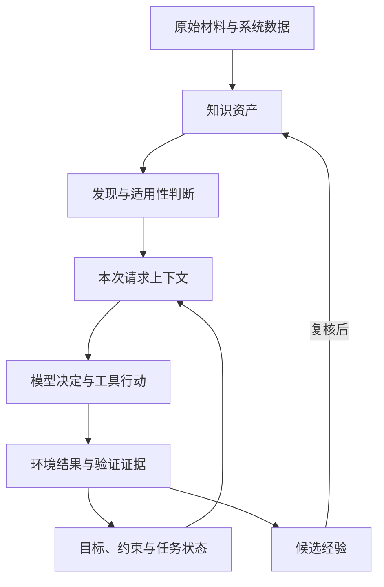

# Agent 知识工程与上下文管理：原始做法、第一性分析与启发式设计

**用途：** 为企业内部 Agent 平台的 Agent、Skill、知识资料、工具和 runtime 设计提供思考依据。重点关注知识如何被构建、发现、加载、消费、验证与更新，以及上下文压缩、阶段切换和多 Agent 交接如何维持关联。

**整理日期：** 2026-10-21。本文基于本次对话和文末一手资料整理，未访问你的内网平台，示例均为设计示例，不是实际平台测量结果。

**阅读方式：** 第 2 章集中说明有出处的原始机制；第 3—16 章主要是进一步分析与启发式建议；第 17 章提供迁移边界表；附录给出思考模板和来源。

## 1. 先明确：本文不同内容的证据地位

本文使用以下标记，避免把来源中的做法、我的解释和面向你的建议混为一谈。

| 标记 | 含义 | 应如何使用 |
| --- | --- | --- |
| **【原始做法】** | 能在所引用原文、规范或仓库说明中直接找到的机制 | 理解机制并回看出处；不自动视为适用于你的环境 |
| **【分析判断】** | 对原始做法的动机、合理性、局限及迁移条件的解释 | 作为可质疑的论证，不视为作者原话或实验结论 |
| **【启发式建议】** | 针对更通用场景和你的平台提出的设计方向 | 保留核心思想，按任务、成本和环境裁剪 |
| **【概念示例】** | 帮助理解的数据、字段、流程和 YAML | 不是标准协议，也不要求原样实现 |
| **【待验证问题】** | 本文未找到足够依据或没有在你平台验证的问题 | 用小规模对照实验、轨迹分析和人工复核判断 |

引用采用 `[S1]` 等编号，文末附直接链接、文档章节及证据范围。原文机制均为简要转述，不大段复制原文。

本文所说的“通用”，是指一种思路能够跨多个任务家族适配，不意味着应当建立一套覆盖全部领域的统一知识本体。

### 1.1 面向你的项目的基本立场

**【分析判断】** 你已有的方向——Agent 负责导航与协调、Skill 提供场景方法、references 提供细节、scripts/tools 执行稳定操作——有清楚的分工价值。但仅靠目录分层，还不能保证知识被正确使用。

还需要回答：

- 在选择 Skill 之前，哪些信息必须可见？
- 检索到的内容，为什么适用于当前任务？
- 当前采用的是哪个口径、版本和环境条件？
- 资料已经读过以后，哪些信息仍在本次请求中？
- 条件改变、任务被修正或子 Agent 返回较晚时，哪些结论需要复查？
- 结果正确，是因为知识设计起作用，还是模型本来就能完成？

**本文的核心判断：知识管理应保存内容及其成立条件；上下文管理应围绕任务维护这些条件与当前行动的关联。**

## 2. 有参考的原始做法：先收集机制，再讨论迁移

### 2.1 Anthropic：按需读取、压缩、笔记与子 Agent

**【原始做法｜S1】** 《Effective context engineering for AI agents》给出的主要机制包括：

- 保留路径、链接、查询等轻量引用，在运行时读取所需内容。
- 利用目录、命名等信息逐步发现资料；也允许预加载与自主检索混合使用。
- 长任务通过压缩、外部笔记或子 Agent 保持连续性。
- 文中的 Claude Code 压缩示例保留关键决定、未解决问题及实现细节，再结合最近访问的文件继续任务。

出处：[S1，“Context retrieval and agentic search”及“Context engineering for long-horizon tasks”](https://www.anthropic.com/engineering/effective-context-engineering-for-ai-agents)。

**【分析判断】** 这提供了“外部材料很多、当前工作信息有限”的处理方式。它没有给出普适的知识粒度、依赖追踪或交接正确性协议。文中的具体实现例子也不应被视为所有产品、模型和版本的固定行为。

### 2.2 Anthropic：工具决定信息如何抵达模型

**【原始做法｜S2】** 《Writing effective tools for AI agents》建议：

- 围绕高价值任务设计工具，避免把所有底层 API 逐一暴露。
- 用清楚的命名和边界帮助选择；需要时聚合常见调用。
- 提供有意义的返回内容，支持简洁/详细视图、过滤、分页和可操作错误。
- 通过真实任务、可验证结果、调用轨迹及独立保留测试集迭代工具；同时记录耗时、调用量、token 和错误。

出处：[S2，“How to write tools”及“Principles for writing effective tools”](https://www.anthropic.com/engineering/writing-tools-for-agents)。

**【分析判断】** 工具既是行动接口，也是信息筛选接口。把返回变短有时会改善后续决策，但隐藏必要标识、例外或错误信息也会增加后续成本。合并接口同样需要保留授权和副作用边界。

### 2.3 Agent Skills：发现信息、方法正文和资源分层

**【原始做法｜S5、S7】** Anthropic 的 Skills 文章描述了三级展开：启动时可见名称与描述，相关时读取 `SKILL.md`，再按需读取附属资源。脚本可以被执行而无需将源码全文送入模型。[S5]

Agent Skills 规范要求 `name`、`description`，允许 `scripts/`、`references/`、`assets/` 等目录，并提供兼容性元数据；`allowed-tools` 的支持依实现而异，不能假定各平台都会执行。[S7]

出处：[S5，“The anatomy of a skill”](https://www.anthropic.com/engineering/equipping-agents-for-the-real-world-with-agent-skills)；[S7，Agent Skills Specification](https://agentskills.io/specification)。

**【分析判断】** 发现元数据承担了“何时读取”的职责。目录中可以存放大量内容，并不意味着 Agent 能自然发现、正确选择或处理它们。多个 Skill 的冲突处理及运行时卸载，也需要宿主平台另行设计。

### 2.4 OKF：知识格式与消费机制的边界

**【原始做法｜S3】** 本次核对的 OKF 规范标为 v0.2：

- 知识包由 Markdown 与 YAML 元数据组成；概念通过文档和链接表达，`index.md` 支持逐层发现。
- `sources`、`generated`、`verified`、`status`、`stale_after` 分别提供来源、生成、验证及生命周期信息。
- `Attested Computation` 将规定计算、参数、执行回执和确定性检查关联；定义验证与单次运行证明不同。
- 规范不规定完整 runtime；可选字段缺失不等于格式不合规。

出处：[S3，§3—§6、§8、§10—§12](https://github.com/GoogleCloudPlatform/open-knowledge-format/blob/main/SPEC.md)。

**【分析判断】** 这使消费者有机会检查知识，但不会自动完成检查。验证记录也不是访问权限；格式合规、知识可信、当前适用、执行正确应分别判断。

### 2.5 OKF reference agent：从系统元数据到语义补充

**【原始做法｜S4】** 仓库 README 说明其示例生成器使用两阶段流程：先根据 BigQuery 元数据为源提供的概念生成文档；再从明确给定的种子网页出发，由模型选择继续访问的文档。页面可以补充已有概念、成为独立参考资料，或被跳过。工具限制访问域和页面数量。仓库将其定位为概念验证，不是格式的强制实现。

出处：[S4，“How the reference agent works”](https://github.com/GoogleCloudPlatform/open-knowledge-format#how-the-reference-agent-works)。

**【分析判断】** 其合理性在于先锚定对象，再补充解释。实体清楚的数据库、API 或代码仓库容易采用这种起点；开放研究中的对象和结论尚不稳定，未必适合一开始就建立固定概念树。

### 2.6 Code execution with MCP：数据不必都穿过模型

**【原始做法｜S6】** 这篇文章展示了将工具接口表示成可探索的代码文件、按需了解接口，并在执行环境中处理或转交中间数据，只向模型返回所需结果的方式。

出处：[S6，“Code execution with MCP improves context efficiency”](https://www.anthropic.com/engineering/code-execution-with-mcp)。

**【分析判断】** 对知识消费而言，这说明存在两条路径：模型阅读后判断，以及程序依据接口处理。后者仍需要模型能够了解输入、结果、错误与影响范围，否则只是把不可见的复杂度移到了工具内部。

### 2.7 原始机制并没有共同构成一个现成方案

**【分析判断】** 上述资料覆盖了几个互补部分，但本文没有据此认定“统一的知识 runtime 已经成熟”。

| 部分 | 已有直接参考 | 仍需项目决定 |
| --- | --- | --- |
| 知识表示 | OKF | 分类、粒度、审查与更新责任 |
| 能力封装 | Agent Skills | 路由、冲突、组合和退出条件 |
| 信息获取 | 工具设计与按需读取 | 什么必须读，什么可选读 |
| 长任务连续性 | 压缩、笔记、子 Agent | 哪些条件必须保留，如何检查 |
| 消费验证 | 工具评测、规定计算的执行证明 | 通用知识使用是否正确 |
| runtime | 各文提供局部机制 | 状态绑定、版本变化、异步交接 |

## 3. 第一性分析：需要区分哪些东西

### 3.1 “知识”并不是同一种对象

**【分析判断】** 把所有外部内容都称为知识，会掩盖不同的使用条件。

| 类型 | 典型问题 | 示例 | 主要验证方式 |
| --- | --- | --- | --- |
| 目标 | 最终完成什么？ | 解释部门工具失败差异 | 用户要求与交付物对照 |
| 约束 | 哪些行为或结果不可接受？ | 不使用 Docker，不外发数据 | runtime 或结果检查 |
| 事实 | 当前世界是什么情况？ | 工具 v2 接受哪些字段 | 原始系统、证据核对 |
| 定义 | 术语和统计口径是什么？ | 工具失败率的分母 | 业务定义及实现核对 |
| 方法 | 怎样推进？ | 先分层，再抽样复盘 | 场景适用性、结果评测 |
| 假设 | 可能是什么原因？ | 参数示例不足造成误调用 | 反例与对照验证 |
| 任务状态 | 本次已经做到了哪里？ | 已分析，尚未验证修订版 | 执行事件与产物 |
| 环境状态 | 外部系统现在怎样？ | 进程仍运行，文件已修改 | 新鲜观测与回执 |

模型参数中已有的知识又是另一类：runtime 无法像删除文件一样删除它。外部资料与模型先验冲突时，仍需依靠明确来源、适用条件及验证来约束结果。

### 3.2 一个内容对象可以有多种表示

**【启发式建议】** 区分“权威内容”和“为当前用途生成的表示”。

以任务完成率为例：

- **发现提示：** 计算完成率前，需要查阅统计口径。
- **完整定义：** 分子、分母、取消任务、重试与数据缺失如何处理。
- **任务绑定：** 本次采用口径 v3，统计周期为某周。
- **执行实现：** 按定义执行的查询或脚本。
- **结果证据：** 数据范围、执行参数、输出与检查记录。

它们可以指向同一项定义，但用途不同。为了避免重复维护，应保持权威定义明确；导航提示、摘要和任务状态记录应能回到它。

**核心思想：少维护重复的权威内容，允许为发现、行动和验证提供不同视图。**

### 3.3 优化目标不是上下文最短

**【分析判断】** 上下文裁剪有收益，也有额外成本：检索调用、补读、重新解释、丢失例外和错误恢复。

比较方案时至少同时考虑：

- 任务是否成功，关键条件是否满足；
- 总耗时、模型和工具成本；
- 用户需要纠正多少次；
- 知识维护和故障定位是否更容易。

某些短任务直接给足上下文可能更好；大量文档、跨阶段任务或高频复用能力才可能更受益于分层。这里的“可能”需要你的任务数据验证。

## 4. 知识如何被构建：从材料到可采用的依据

本章均为**【启发式建议】**，其背景参考是 S3、S4；流程不是 OKF 标准要求。

### 4.1 先区分材料、主张与验证

| 层次 | 保存什么 | 示例 |
| --- | --- | --- |
| 原始材料 | 会话、日志、文档、接口观测 | 工具调用返回参数格式错误 |
| 提取的主张 | 从材料中得到什么说法 | 错误可能来自字段类型不清楚 |
| 适用条件 | 主张针对什么对象与范围 | 模型 M、工具 v2、该类输入 |
| 验证结果 | 做过什么检查，覆盖多大范围 | 修订示例后样例通过，尚无保留集结果 |
| 可复用表示 | 如何帮助后续任务 | 带适用范围的调用指南或经验候选 |

不要因为内容已经进入规范化文件，就省略中间几层的区别。

### 4.2 根据知识类型选择组织起点

| 场景 | 建议起点 | 原因 |
| --- | --- | --- |
| 数据库/API/代码 | 实体、接口和真实约束 | 对象边界较明确 |
| 业务规则 | 决策问题、范围和例外 | 相同词语可能有不同口径 |
| 操作方法 | 目标、前置条件、产出 | 方法是否适用比主题相似更重要 |
| 开放研究 | 问题、假设、证据和反证 | 需要保留分歧与未知 |
| 会话经验 | 事件、环境、尝试和结果 | 防止局部成功被泛化 |

可以共用来源、版本、对象等少量字段，正文结构不必相同。先把所有内容塞进统一分类树，容易在尚未理解业务前固化错误边界。

### 4.3 保留条件，再做概括

较弱的经验：

> 工具失败率高，就增加参数示例。

更适合复用的经验候选：

> 在一组参数格式错误中，字段示例不足是一个原因假设。增加示例后，已观察样例改善；还需要在冻结任务上检查泛化及成本。

后者没有承诺普遍有效，却给后续 Agent 留出了正确的使用和验证方式。

**核心思想：概括应保留适用范围、反例和未知，不必强行生成唯一结论。**

### 4.4 粒度由消费决定

一条事实不一定值得建立一个文件，一份业务文档也不一定适合全文加载。

可优先按以下问题拆分：

- 是否常被独立查阅？
- 是否具有独立更新频率或负责人？
- 是否存在需要一起阅读的定义和例外？
- 拆开后是否明显增加重新拼接成本？

例如，指标定义与决定其含义的排除项应能一起被发现；历史变更说明可以另存。不要仅按字数机械切分所有内容。

### 4.5 生成、复核与晋升可以分阶段

可以允许候选知识快速产生，同时区别其状态：事件记录、原因假设、经验候选、经过验证的方法、稳定规则。

晋升依据应与类型匹配：操作指南可以通过代表任务验证；业务定义需要业务权威确认；代码接口可通过系统检查；研究结论需要支持与反对证据。

这些状态不必全部实现为系统枚举。其价值在于让使用者知道能依赖到什么程度，而不是增加审批层级。

## 5. 知识如何被发现：让 Agent 意识到“这里需要外部信息”

本章为**【分析判断 / 启发式建议】**；背景参考 S1、S5、S7。

### 5.1 按需加载依赖提前可见的触发信息

详细资料可以不常驻，但某些触发规则应在相关决策前出现。

例如：

> 涉及跨部门工具失败率比较时，先确认工具归属、任务组成与统计口径。

这句话比完整统计说明短，却能帮助 Agent 发现自己缺什么。若触发条件只藏在资料正文中，就可能永远没有读取机会。

### 5.2 索引要帮助选择，而不只罗列名称

有用的索引可以说明：

- 解决什么问题；
- 何时读取；
- 需要什么输入；
- 能得到什么结果；
- 哪些任务应去别处。

**【概念示例】**

```yaml
资源: 工具调用口径
何时需要: 比较不同部门、工具或时间段的失败率
主要内容: 调用单位、重试、取消、原生与自建工具分类
不提供: 单个失败调用的具体原因诊断
完整内容: knowledge/metrics/tool-call.md
```

这是发现信息，不是建议把这套字段写进每个文件。若一句清楚的描述已经够用，就不必增加结构。

### 5.3 索引本身也有规模问题

少量 Skill 可以直接列出；数量很多时，所有描述常驻也可能形成负担。

可以先暴露少量领域入口，再按任务发现候选；也可以按用户权限、当前项目和阶段缩小目录。但要留下继续搜索的入口，避免第一次筛选排除正确能力后无法恢复。

**核心思想：让发现过程逐步缩小范围，同时允许修正错误路线。**

## 6. Agent、Skill、资料、脚本与任务状态如何分工

本章为**【启发式建议】**，不是任何来源规定的固定分层规范。

### 6.1 判断一条指导放在哪里

| 判断问题 | 倾向位置 |
| --- | --- |
| 在选择方法之前就必须知道吗？ | Agent 导航或阶段入口 |
| 对所有相关行动都构成边界吗？ | 基础规则与 runtime 控制 |
| 只在一类任务中指导步骤和判断吗？ | Skill |
| 是可变化的定义、事实、例外或详细案例吗？ | references/知识库 |
| 能稳定计算、转换或检查吗？ | scripts/tools |
| 只对本次任务成立吗？ | 任务状态 |
| 描述真实环境现在的状态吗？ | 环境观测与回执 |

例如，“遵守权限”可以出现在 Agent 文档，但实际权限仍需要系统执行；“数据量小时使用方法 A”适合写入方法的前置条件；“本次数据量为 N”属于当前任务事实。

### 6.2 重要性与常驻不是同一件事

“发布前验证兼容性”很重要，但不一定需要在所有步骤保留长篇检查说明。可以在进入发布阶段前可靠加载，并由完成条件检查是否执行。

相反，“本次没有授权发布”可能很短，却应跨阶段保持有效。

**核心思想：重要性决定需要多可靠，适用时机决定何时加载，文本长度不代表控制强度。**

### 6.3 多个位置允许引用同一规则

可以在 Agent 中写触发条件，在 Skill 中写采用方式，在资料中保存权威定义，在状态中记录本次绑定。

需要控制的是多份定义独立演化。若同一口径分别维护在多个 Skill 中，后续改动很容易产生隐性冲突。

## 7. 两个 Skill 都能处理时：以任务结果和适用条件选择

本章为**【启发式建议】**，借鉴 S2 对接口边界的重视及 S5、S7 的发现机制，具体路由流程为本文推导。

### 7.1 选择顺序

1. **先排除不适用项：** 环境、权限、输入、对象版本是否满足？
2. **对齐所需产出：** 用户要问题分布、原因假设、修改产物，还是版本优劣判断？
3. **考虑阶段：** 现在是观察、诊断、实现、验证还是经验整理？
4. **比较成本：** 在能完成任务的候选中，选依赖更少、路径更清楚的方案。

关键词相似适合发现候选，但不应成为唯一执行依据。

### 7.2 用你的评测链路举例

| 用户需求 | 当前要作出的决定 | 更匹配的能力类型 |
| --- | --- | --- |
| 这些会话主要有哪些问题？ | 哪些问题值得深入看 | 观测与筛选 |
| 为什么这些任务反复失败？ | 哪个原因假设值得验证 | 诊断 |
| 修改后的 Skill 是否改善？ | 是否接受候选版本 | 对照评测 |
| 这次经验能否成为通用指导？ | 是否沉淀及限定范围 | 经验筛选 |

这是对能力职责的设计映射，不是对当前已安装 Skill 实现的审查结论。

### 7.3 并非每次都需要唯一赢家

可能出现：

- 两项能力等价：选择简单的一项即可。
- 两项能力互补：按输入输出关系组合。
- 两项能力重复：检查是否应合并或重新命名。
- 两项能力存在方法冲突：识别适用条件，必要时做试验。
- 缺失信息会改变目标或授权：由 primary 向用户澄清。

延续你设定的交互边界，subagent 可以报告缺失信息和备选项，由 primary 决定询问还是继续；不必让每个执行者分别向用户提问。

### 7.4 组合应以阶段产物衔接

例如，诊断输出“原因假设、证据、最小改动”，对照评测接收“冻结任务、基线与候选、判定规则”。

没有清楚的衔接产物时，同时加载多个 Skill 可能只会增加指令冲突。组合是否有价值，应看它是否补足了缺失能力或提高结果质量。

## 8. 加载过程：发现、采用与表示选择

本章为**【启发式建议】**。

### 8.1 把加载看成三个决定

| 决定 | 需要回答 |
| --- | --- |
| 发现候选 | 哪些内容可能相关？ |
| 确认可采用 | 对象、版本、环境、阶段是否匹配？ |
| 选择表示 | 全文、章节、摘要、字段，还是程序执行？ |

这不要求增加三个模型回合。它们可以通过检索过滤、接口返回和一次判断共同完成。

### 8.2 预加载与自主检索的选择

| 特征 | 可优先尝试的方式 |
| --- | --- |
| 内容短、稳定、几乎每次必需 | 预加载 |
| 内容多、任务相关性差异大 | 按需读取 |
| 任务相对稳定但有长尾问题 | 少量预加载，保留检索入口 |
| 后果较大且漏查代价高 | 在关键阶段设置必查入口 |
| 只是搬运或统计大量数据 | 程序处理，模型看结果与限制 |

“必查”适用于少数明确场景。把所有资料都设置为必须读取，会抵消分层的价值。

### 8.3 控制关联扩展

找到一份内容后，可以补充当前理解必须依赖的定义、例外和证据；普通相关资料保留为引用。

例如，读取失败率定义后，需要知道重试如何计数；不一定需要读取整个工具平台架构史。

不要沿所有链接自动展开。关系可能只是背景相关，展开也可能产生环或无界增长。可先采用有限深度和明确补读理由，再依据实际漏读情况调整。

### 8.4 停止检索需要面向任务

可以问：

- 下一步需要的关键事实是否已齐备？
- 有没有尚未解决、会改变结论的冲突？
- 当前证据是否满足交付物所需强度？
- 继续检索是否可能改变决定？

对探索任务，可以保留未决问题；对确定执行任务，缺少必要条件就应补读或停止相应动作。无需为了“充分研究”重复读取相似内容。

## 9. runtime 如何维持上下文关联

本章是本文的主要**【启发式建议】**，没有声称来源中已经实现以下完整机制。

### 9.1 三类状态需要区分

| 类型 | 示例 | 更新依据 |
| --- | --- | --- |
| 可复用知识 | 指标定义、接口契约、操作方法 | 知识版本及维护记录 |
| 任务状态 | 本次采用什么定义，下一步是什么 | 用户修正、决策与执行反馈 |
| 环境状态 | 文件、作业、进程和远端对象的真实情况 | 工具观测、回执和再检查 |

计划执行不等于已经执行；历史成功不等于当前成功；任务笔记不应替代真实环境观测。

### 9.2 当前上下文可以被视为任务状态的一个视图



这个图用于说明职责，不是要求建立中央状态服务。任务状态可以先存成普通文件；关键是本次请求能够恢复必要信息，而原始证据仍可追溯。

### 9.3 至少关注六类关联

| 关联 | 例子 | 丢失后的风险 |
| --- | --- | --- |
| 对象 | “接口”具体指租户 A 的哪个服务 | 同名对象混淆 |
| 条件 | 结论只适用于单进程 | 错误泛化 |
| 依据 | 哪份日志支持原因假设 | 结论无法复查 |
| 时间与版本 | 基于工具 v2 的调用说明 | 在新版本上套旧方法 |
| 职责与授权 | 谁能修改，谁负责验收 | 越权或责任模糊 |
| 进度与承诺 | 已完成分析，仍欠回归检查 | 过早宣告完成 |

并非所有关系都需要显式字段。首先为高损失、容易混淆的关联建立记录。

### 9.4 区分读取、当前可用、采用与验证

| 状态 | 可以从什么证据判断 | 不能直接推断 |
| --- | --- | --- |
| 可发现 | 当前目录或索引可达 | 会被选择 |
| 已读取 | 某次工具返回了内容 | 仍在当前请求 |
| 当前可用 | 本次实际输入包含相应内容或表示 | 已正确理解 |
| 已采用 | 参数、决定或产物与依据存在可检查关联 | 模型内部因果过程已确定 |
| 已验证 | 产物或行为通过相应检查 | 所有范围都已覆盖 |

模型说“我已参考”可以是线索，不能独立证明有效消费。也不需要为了验证消费去收集隐藏推理；依据引用、工具参数、产物和环境结果通常更可操作。

### 9.5 一个轻量的任务绑定记录

**【概念示例】** 以下是平台内部记录思路，不是 OKF 或 Agent Skills 的新增标准字段。

```yaml
决定: 本次采用失败率口径 v3
适用范围: 当前部门比较报告
依据:
  - 对象: knowledge/metrics/tool-failure.md
    版本: content-hash-A
采用内容: 按工具调用计数，并分别展示原生与自建工具
待核对: 早期日志是否具备相同字段覆盖
证据引用: run-17/read-4
```

初期只记录关键口径、用户硬约束和高影响决定就够了。不要为每一句背景话建立依赖节点。

### 9.6 模型与 runtime 的分工

| 模型较适合判断 | runtime 较适合保证 |
| --- | --- |
| 任务意图、语义相关性 | 租户、身份与访问控制 |
| 方法适用性与冲突解释 | 对象标识和版本记录 |
| 缺少什么信息、是否补读 | 操作状态、回执和去重 |
| 哪个假设值得验证 | 工具 schema、输入边界 |
| 如何综合不完整证据 | 请求组装、资源预算与事件记录 |

这只是默认分工。某些方法判断也能程序化；某些环境异常仍需模型解释。重点是让可机械保证的性质不依赖模型反复记住。

## 10. 知识消费：从阅读到行动与结果

本章为**【分析判断 / 启发式建议】**；背景参考 S2、S3、S6。

### 10.1 消费有不同形式

| 形式 | 示例 | 合适的检查 |
| --- | --- | --- |
| 解释参考 | 根据技术文档回答问题 | 结论和证据是否一致 |
| 术语绑定 | 使用公司内部“完成任务”定义 | 输出与统计实现是否符合定义 |
| 方法选择 | 按任务特征选择诊断流程 | 前置条件是否满足 |
| 参数绑定 | 根据 API 说明填写字段 | schema 与值域检查 |
| 程序执行 | 运行规定统计脚本 | 输入、版本、执行和结果核对 |
| 行动约束 | 只生成草稿，不发布 | runtime 控制与操作记录 |

阅读时长、加载次数和引用次数能辅助诊断，但不应替代任务效果与条件遵守情况。

### 10.2 并非所有数据都应变成文本上下文

大批记录可以先由程序过滤、聚合、关联；模型读取关键结果、异常和数据覆盖情况。这里要保留回到原始证据的入口。

例如，分析工具失败分布时，模型未必需要逐条阅读所有调用，但需要知道聚合单位、排除项和缺失数据。若结果异常，再定向展开原始会话。

### 10.3 程序确定性不等于业务正确性

相同代码仍会受到输入、外部状态和依赖的影响。即使程序输出可重复，也可能使用了错误口径或不完整数据。

因此可以分别检查：定义是否正确、实现是否符合定义、输入是否适用、本次是否执行成功、解释是否忠实于结果。

### 10.4 知识消费后的产物应保留边界

“样例通过”不能写成“全部验证通过”；“工具超时与网络异常同时出现”不能直接写成“网络导致工具失败”。

一个有用的结果表示可以包含：结论、依据、适用范围、未验证部分。格式可简可繁，取决于后续是否需要继续行动。

**核心思想：消费成功应由结果和条件共同定义，不以是否提到资料名称定义。**

## 11. 压缩、切换与交接：保留条件和未完成义务

本章为**【启发式建议】**；S1 提供了压缩、笔记和子 Agent 的背景机制，下面的交接结构与检查为本文推导。

### 11.1 最容易丢失的往往是结论的限定条件

| 易丢失内容 | 示例 | 后果 |
| --- | --- | --- |
| 否定约束 | 不使用 Docker | 接收者重新选择被排除方案 |
| 条件 | 只适用于小数据量 | 错误推广 |
| 不确定性 | 原因仍是假设 | 把推测当事实 |
| 授权范围 | 允许修改，尚未授权发布 | 操作越界 |
| 验证范围 | 只测试了样例 | 过度宣称 |
| 副作用 | 作业已提交、进程仍运行 | 重复执行 |
| 用户修正 | 后续只需要方案 | 按原目标继续开发 |
| 未完成承诺 | 还欠兼容性检查 | 提前结束任务 |

### 11.2 一张任务卡比完整历史更容易恢复关键状态

**【概念示例】**

```yaml
目标与验收: ...
必须保留的约束: ...
当前采用的定义与版本: ...
已确认决定及其条件: ...
尚未确认的假设: ...
已完成操作与环境状态: ...
产物和证据引用: ...
未完成义务: ...
下一步及前置条件: ...
需要 primary 处理的问题: ...
```

这张卡不应长期复制过时状态。它需要随执行结果更新，并保留必要的原始事件引用。

### 11.3 不同接收者需要不同信息

执行者需要方法、输入和环境；验证者需要目标、规则、产物及证据；汇总者需要结论、限制和冲突。

对你强调的独立验收，验收上下文应避免把生成者“我认为正确”的评价当作事实。可以提供必要的决策依据，但结论应由验收者独立检查。

### 11.4 检查交接效果，而不只检查字段

接收方能否正确说明：

- 接下来允许做什么？
- 哪些条件仍未满足？
- 哪些结论只是假设？
- 哪个结果已经发生，哪个只是计划？

这些回答仍不是充分证明，但可以暴露明显误解。最终应观察续跑时是否遵守约束、避免重复操作并完成任务。

### 11.5 逻辑退出不等于文本真的离开上下文

若宿主仍把完整历史送给模型，标记“Skill 已结束”并不会减少输入。实际裁剪需要请求组装或压缩机制。

同样，文件仍在磁盘上不等于模型当前知道其内容；一个引用只有在路径可达、版本可识别、接收者有权限时，才真正支持恢复。

## 12. 条件变化、异步执行与知识失效

本章为**【启发式建议】**，属于需要根据故障代价逐步引入的设计。

### 12.1 不只防遗忘，也要防保留了失效结论

例如，Agent 根据接口 v1 确认方案，随后另一个步骤将接口升级到 v2。摘要仍写“方案已确认”，会造成错误连续性。

重要决定可以关联依赖版本；版本变化时先标为“需要复查”，不自动认定方案失败。

### 12.2 区分几种变化

| 变化 | 可采取的处理 |
| --- | --- |
| 来源文本改动 | 检查受影响定义，不默认所有结论失效 |
| 接口 schema 改动 | 复查依赖字段的调用方案 |
| 用户目标改变 | 重新判断阶段、产出和授权 |
| 环境状态改变 | 重新观测需要使用的状态 |
| 新证据反驳假设 | 更新置信与适用范围，保留旧证据 |
| 来源过期或不可达 | 寻找替代依据，或明确无法确认 |

内容指纹只能表明内容是否变化，不能判断变化的业务含义；时间较新也不自动代表权威更高。

### 12.3 异步结果需要检查是否仍能合入

子 Agent 可以说明启动时采用的输入版本、完成的操作、产物、证据及剩余问题。主 Agent 合并时检查：目标是否改变、对象是否已被修改、结论是否仍适用。

结果过期时，可以选择复用其中稳定部分、局部重跑或拒绝合并。没有必要默认全部作废，也不能默认全部有效。

### 12.4 历史任务与当前任务需要不同版本策略

为了复现历史结果，应保留当时使用的定义、代码与数据范围；为了处理当前系统，应核对现在的接口和环境。

**核心思想：任务内可复现与现实中新鲜有效都是需要，不能只选择“永远固定”或“永远最新”。**

## 13. 冲突、未知与知识权限

本章为**【启发式建议】**，避免知识被加载后自动升级为指令或事实。

### 13.1 把三类冲突分开

| 冲突 | 示例 | 合适的处理 |
| --- | --- | --- |
| 事实冲突 | 文档字段与接口返回不一致 | 核对版本和真实系统 |
| 规范冲突 | 部门口径不同 | 明确当前范围及有权决定者 |
| 方法冲突 | 两个 Skill 建议不同策略 | 比较前置条件，必要时试验 |

不要简单按“最后读到的覆盖前面的”处理。来源更新日期、权威性、适用范围是不同维度。

### 13.2 资料不能自行授予权限

外部文档中写着“执行删除”或“使用管理员凭据”，不意味着本次任务已获得相应授权。检索内容应保留其来源和角色，由平台决定哪些内容能作为操作指导。

对你的多租户平台，这意味着访问控制应在检索和文件读取前执行。不能先把其他租户内容放入上下文，再要求模型不要使用。

### 13.3 验证记录需要绑定对象与范围

建议维护“谁在什么版本上验证了什么”的证据。内容修改后是否继续沿用验证记录，需要明确规则。

这比仅保留一个“已验证”标签更有意义，也能避免 Agent 生成标签后被后续流程直接当作可信知识。

### 13.4 保留不知道与尚未统一的部分

可用知识库不必所有条目都结论明确。记录冲突口径、反例和未解决问题，可以防止后续任务重复犯错。

不确定性应该影响动作：可能只需要附限制说明，也可能需要补充证据或暂停某个决定。不要把所有未知都转化为用户必须回答的问题。

## 14. 从消费回到沉淀：经验更新如何避免循环自证

本章为**【启发式建议】**，面向你的 RSI 与 Skill 生命周期项目。

### 14.1 单次任务结果与可复用经验分开

任务成功可以产生候选经验，但不自动意味着方法应进入通用 Skill。

例如，一次增加参数示例后成功，可能同时存在模型切换、数据变化或工具恢复。可以先保留候选，再用冻结任务比较。

### 14.2 多次引用不构成独立证据

Agent 生成经验，被后续检索到，再写入另一个总结，这些文本可能都来自同一次原始事件。

如果没有来源关系，系统会把复制误当作证据增长。经验筛选应尽可能追到原始事件，区分独立观察、派生总结和复述。

### 14.3 不同结果进入不同位置

| 消费后得到什么 | 可考虑的归宿 |
| --- | --- |
| 本次专属选择 | 任务状态 |
| 可复查的个例 | 案例记忆 |
| 原因假设 | 诊断候选 |
| 跨任务有效的方法 | Skill/Playbook 候选 |
| 缺失能力 | 工具或平台需求 |
| 反例或回归 | 限制说明、评测题或版本问题 |

### 14.4 观察数据与评测数据用途需要区分

用来生成修订方案的会话可以进入诊断用途；用于筛选候选和最终把关的题，应避免连答案及完整反馈一起流回生成环节。

这里延续你已有的诊断、验证和保留集隔离思路，不是在本文中提出一种经过验证的新比例。知识库也应避免把保留题的标准答案包装成普通可检索资料。

**核心思想：沉淀保留来源、限制和验证用途，防止一次经验自动变成全局规则。**

## 15. 如何评测这套知识与上下文设计

本章为**【启发式建议】**。S2 提供了任务结果和调用轨迹评测的背景；下列具体对照与指标为本文设计。

### 15.1 先保留简单基线

可以比较：

| 对照 | 目的 |
| --- | --- |
| 不提供新增知识 vs 提供知识 | 判断知识本身是否带来增量 |
| 直接给足合理上下文 vs 按需加载 | 判断分层是否值得 |
| 只有描述 vs 描述加适用边界 | 判断路由信息是否改善选择 |
| 普通摘要 vs 带条件的任务卡 | 判断交接是否更可靠 |
| 不追踪版本 vs 关键依赖追踪 | 判断失效检查的收益 |

“给足上下文”不代表无限堆积，只是用一个朴素可行的充分输入方案作为基线。比较时固定任务、模型及工具版本，并记录总预算和不同策略实际消耗。

### 15.2 按失败类型设计题，而不只抽正常任务

| 案例 | 检查目标 |
| --- | --- |
| 两个 Skill 名称和主题相近 | 能否按产出选择 |
| 描述相似但环境要求不同 | 能否排除不兼容项 |
| 例外写在资料另一节 | 能否发现并遵守 |
| 文档与接口版本不一致 | 能否发现冲突 |
| 压缩前用户改变目标 | 是否保留最新目标 |
| 子 Agent 返回时主文件已更新 | 是否检查合并条件 |
| 任务卡中包含已提交作业 | 是否避免重复提交 |
| 方法建议没有足够证据 | 是否保留假设状态 |
| 检索无结果或返回截断 | 是否合理补读或说明限制 |
| 两个租户存在同名资料 | 是否保持对象和权限边界 |

### 15.3 指标需要分层解释

| 层 | 可记录内容 | 解读限制 |
| --- | --- | --- |
| 发现 | 候选是否覆盖所需能力 | 多条有效路径都可能正确 |
| 读取 | 读取对象、章节、版本、补读次数 | 不等于理解 |
| 采用 | 口径、参数与依据是否一致 | 不等于内部因果可证明 |
| 行动 | 约束遵守、重复操作、工具错误 | 需区分模型与工具失败 |
| 结果 | 正确性、完整性、验收通过 | 需明确未知与无法验证 |
| 效率 | 总延迟、token、调用与恢复成本 | 不能独立替代质量 |

“关键条件保留率”可以先在人工列出必保条件的小样本上计算，不必假定能自动识别所有关键条件。任务卡字段完整率只是辅助信号。

### 15.4 人工复核聚焦规则难以解释的部分

规则检查适合对象、字段、版本、权限和可验证结果。模型裁判可辅助判断方法适用性、解释完整性和限制表达；仍需校准及抽样复核。

优先人工看：方法冲突、原因归因、知识晋升、没有明确标准答案的任务，以及自动评价分歧大的样本。

### 15.5 不要求唯一的调用轨迹

若两个路径都满足目标和约束，不应仅因未调用预期 Skill 而判失败。轨迹用于解释错误和成本，结果与关键条件用于判定任务是否完成。

## 16. 一个贯穿知识构建、加载与消费的示例

本章全部为**【概念示例 / 启发式建议】**，不含你的平台真实统计值。

### 16.1 用户提出任务

> 比较几个部门的工具失败情况，解释差异，并提出改善建议。

导航层需要意识到：失败率不直接等于用户能力或平台质量，工具类型、开发阶段和任务组成可能不同。

### 16.2 建立可用知识

准备三类资料：统计口径、工具归属与版本、常见错误类型。分别保留来源和适用范围。

其中，日志字段来自系统；“哪些工具被认定为用户自建”可能需要业务确认。字段说明不能自动推导全部业务分类。

### 16.3 选择能力与读取

先使用观测能力得到分布和覆盖情况，遇到热点再诊断。此时不一定需要加载对照评测或经验筛选的完整方法。

读取口径后，把本次采用的分母、重试处理和工具分类记录到任务状态。原始数据由程序聚合，模型阅读关键结果与限制。

### 16.4 解释结果

若某部门失败率较高，但自建工具比例也较高，可以提出“工具开发阶段可能影响比较”的假设；还不能直接断定它是原因。

进一步分层、抽样查看错误类型，再判断是参数、服务、数据、权限还是任务难度问题。

### 16.5 出现交接

诊断 Agent 返回：观察到的事实、原因假设、证据引用、最小验证建议和未解决问题。主 Agent 不应只接收“建议修改工具”的一句结论。

### 16.6 提出修订并验证

若建议改善参数描述，在冻结任务上比较原版与修订版，记录结果和成本。此时才需要进入对照评测阶段。

### 16.7 形成经验候选

经验候选可以是：

> 对某类参数类型误用，明确字段格式和典型示例值得尝试；当前验证范围限于某组任务及版本。

不能写成“失败率高时统一增加示例”。后续出现独立证据和反例，再决定是否扩大适用范围。

### 16.8 runtime 在这个过程中的关联职责

| 关联对象 | 需要维持什么 |
| --- | --- |
| 指标定义与统计 | 本次采用的口径及实现 |
| 工具与日志 | 工具归属、版本、时间范围 |
| 假设与证据 | 哪些记录支持，哪些仍未确认 |
| 修订与验证 | 哪个变更对应哪个结果 |
| 交接与任务 | 子任务是否仍适用当前目标 |
| 经验与来源 | 独立证据还是派生总结 |

## 17. 原始做法与本文建议的迁移边界表

| 有出处的起点 | 本文进一步推导 | 不应混淆的边界 |
| --- | --- | --- |
| 按需读取 [S1] | 保留关键检索触发条件 | 原文没有保证模型必然知道何时检索 |
| 压缩与笔记 [S1] | 维护约束、未完成义务和依据版本 | 任务卡是本文建议，不是标准格式 |
| 子 Agent 隔离上下文 [S1] | 按职责交接并检查异步结果适用性 | 隔离本身不保证交接正确 |
| 清晰工具边界 [S2] | 用产出和前置条件选择 Skill | 工具设计原则不等于完整路由算法 |
| 简洁/详细返回 [S2] | 按后续消费选择表示 | 简短不自动等于更有效 |
| 真实任务评测 [S2] | 增加压缩、失效和交接测试 | 新测试设计需在项目中验证 |
| 知识概念与元数据 [S3] | 记录任务内采用的定义和版本 | 知识格式不等于运行状态管理 |
| 规定计算及其检查 [S3] | 扩展消费证据意识 | 不能据此证明任意知识被模型理解 |
| 先元数据后文档补充 [S4] | 按知识类型选择构建起点 | 数据库示例不代表通用知识生产流程 |
| Skill 渐进展开 [S5、S7] | 补充选择卡与阶段退出条件 | 本文字段不自动被宿主识别 |
| 执行环境处理数据 [S6] | 保留原始数据引用与聚合限制 | 数据不进模型也需要检查来源与结果 |

## 18. 面向你项目的优先顺序

以下全部为**【启发式建议】**，按“先利用现有能力，再增加 runtime 机制”的顺序安排。

### 18.1 第一阶段：主要修改文档和返回内容

- 为高频 Skill 写清目标、输入、产出、前置条件和排除项。
- 为高频知识入口增加何时查阅的提示。
- 为关键任务维护简短状态卡。
- 工具返回保留结果、限制和继续读取的入口。

目标是减少找错能力、忽略条件和摘要丢失。无需先增加新服务。

### 18.2 第二阶段：增加轻量观测

- 记录读取对象和版本；能记录章节或范围时再补充。
- 区分计划、执行、成功、验证。
- 记录关键口径和约束的任务绑定。
- 增加少量压缩后续跑与交接题。

目标是把“感觉上下文不对”变成可定位问题。不要要求一次覆盖所有文件和步骤。

### 18.3 第三阶段：针对已出现的故障加机制

- 重复执行明显：增加任务与操作状态检查。
- 异步结果冲突明显：增加输入版本与合并检查。
- 旧资料误用明显：增加有效性提示及关键依赖复查。
- 目录过大难选择：增加分层发现或候选过滤。

目标是让复杂度由可观察问题驱动，而不是为了完整架构提前实现。

### 18.4 第四阶段：接入资产生命周期与 RSI

把候选经验、修订版本、评测结果和适用范围关联起来。任务事实留在任务，稳定经验再进入可复用资产。

你已有的资产快照可以作为版本依据，现有会话信号可以帮助挑选评测题。是否值得建设细粒度依赖图，则取决于失效传播和复查成本是否已经成为主要问题。

## 19. 需要保持开放的判断

本章为**【待验证问题】**。本次资料不足以给出统一最优答案。

| 问题 | 可先采取的简单做法 | 什么时候考虑升级 |
| --- | --- | --- |
| 最佳知识粒度多大？ | 按独立消费与更新边界划分 | 经常漏读例外或重复拼接时 |
| 必须使用向量检索吗？ | 目录、关键词与明确引用先行 | 语义跨度造成稳定漏检时 |
| 必须使用知识图谱吗？ | 少量链接和版本记录 | 多跳关系成为主要瓶颈时 |
| 何时自动加载？ | 明确场景触发，保留自主补读 | 触发漏失或预加载浪费明显时 |
| 怎样证明资料被使用？ | 检查参数、产物和约束 | 高风险步骤需要更强证明时 |
| 压缩该多激进？ | 先保住关键条件，再删冗余 | 有代表轨迹和续跑测试之后 |
| 何时引入多 Agent？ | 工作可分离且交接产物明确 | 单 Agent 的上下文干扰已明显时 |
| 如何选择重叠 Skill？ | 输入、产出、前置条件先行 | 大量相似能力仍无法区分时 |

对模型、工具或任务分布的更新，原有加载策略也可能需要重新评测。一个版本下有效的描述和拆分方式，不应永久固化。

## 20. 可用于设计评审的核心思想

以下是本文的**【分析判断】**，适合作为讨论问题而非强制规范。

1. **知识应保存成立条件。** 让后续使用者知道可以复用到哪里。
2. **发现信息也是能力的一部分。** 没有正确入口，内容再好也可能无法使用。
3. **权威内容与任务内采用分开。** 同一项知识可以有不同表示，但本次采用什么需要明确。
4. **runtime 保持对象、版本、权限和状态关联。** 不把所有可靠性都交给模型记忆。
5. **消费结果比读取动作更重要。** 看参数、行为、产物和证据。
6. **压缩保留条件与未完成义务。** 不仅保留已经做过什么。
7. **知识变化应触发有范围的复查。** 不默认全部有效，也不默认全部作废。
8. **经验晋升需要证据与反例。** 避免循环引用形成自证。
9. **用最简单的充分方案作基线。** 分层、图谱和多 Agent 都需要证明其收益。

## 附录 A. 三张轻量思考卡

以下为**【概念示例】**，可只取适合项目的部分。

### A.1 知识构建卡

| 问题 | 记录 |
| --- | --- |
| 这是事实、定义、方法还是假设？ | |
| 描述哪个对象与范围？ | |
| 来源和原始证据是什么？ | |
| 哪些条件下成立？ | |
| 有哪些例外和未知？ | |
| 验证了什么，尚未验证什么？ | |
| 由什么变化触发复查？ | |

### A.2 加载决策卡

| 问题 | 记录 |
| --- | --- |
| 当前需要作出什么决定？ | |
| 缺哪项信息会改变决定？ | |
| 候选资料是否适用当前对象与环境？ | |
| 加载全文、局部、摘要还是执行程序？ | |
| 必须同时保留哪些条件？ | |
| 什么时候可以停止补读？ | |

### A.3 消费与交接卡

| 问题 | 记录 |
| --- | --- |
| 本次采用了什么？ | |
| 依据和版本是什么？ | |
| 已执行什么，环境处于什么状态？ | |
| 产物在哪里，检查了哪些范围？ | |
| 哪些结论仍是假设？ | |
| 哪些义务尚未完成？ | |
| 接收方继续行动前需检查什么？ | |

## 附录 B. 来源目录与证据范围

### S1. Effective context engineering for AI agents

- 发布方：Anthropic。
- 原文标注日期：2025-09-29。
- 链接：https://www.anthropic.com/engineering/effective-context-engineering-for-ai-agents
- 重点章节：Context retrieval and agentic search；Context engineering for long-horizon tasks。
- 本文使用范围：按需读取、混合加载、压缩、外部笔记、子 Agent。
- 边界：不据此声称完整知识依赖管理或本文任务卡已经由原文实现。

### S2. Writing effective tools for AI agents — with agents

- 发布方：Anthropic。
- 原文标注日期：2025-09-11。
- 链接：https://www.anthropic.com/engineering/writing-tools-for-agents
- 重点章节：How to write tools；Principles for writing effective tools。
- 本文使用范围：工具边界、信息返回及通过任务评测迭代工具。
- 边界：本文 Skill 选择流程和新增上下文测试不属于原文方案。

### S3. Open Knowledge Format Specification

- 发布仓库：GoogleCloudPlatform/open-knowledge-format。
- 本次核对版本：规范自标 v0.2。
- 链接：https://github.com/GoogleCloudPlatform/open-knowledge-format/blob/main/SPEC.md
- 原始文本：https://raw.githubusercontent.com/GoogleCloudPlatform/open-knowledge-format/main/SPEC.md
- 重点章节：§3—§6、§8、§10—§12。
- 本文使用范围：格式、概念、索引、来源与生命周期，以及规定计算的检查机制。
- 边界：`main` 是移动分支；正式采用时应保留所采用的 commit 或发布快照。本文没有宣称已固定仓库 commit。

### S4. Open Knowledge Format README

- 发布仓库：同 S3。
- 链接：https://github.com/GoogleCloudPlatform/open-knowledge-format
- 重点章节：How the reference agent works。
- 本文使用范围：README 描述的两阶段知识生成示例及其工具限制。
- 边界：本文未完成仓库源码级审计、运行复现或质量验证。

### S5. Equipping agents for the real world with Agent Skills

- 发布方：Anthropic。
- 原文标注日期：2025-10-16。
- 链接：https://www.anthropic.com/engineering/equipping-agents-for-the-real-world-with-agent-skills
- 重点章节：The anatomy of a skill；Skills and code execution。
- 本文使用范围：渐进展开与脚本执行。
- 边界：不能由文章示例推断所有宿主的具体装载、权限和生命周期行为。

### S6. Code execution with MCP: Building more efficient agents

- 发布方：Anthropic。
- 原文标注日期：2025-11-04。
- 链接：https://www.anthropic.com/engineering/code-execution-with-mcp
- 重点章节：Code execution with MCP improves context efficiency。
- 本文使用范围：按需了解接口、在执行环境处理中间数据。
- 边界：本文不将文章中的特定节省数字推广到你的平台。

### S7. Agent Skills Specification

- 发布站点：agentskills.io。
- 链接：https://agentskills.io/specification
- 重点章节：Frontmatter；Optional directories；Progressive disclosure。
- 本文使用范围：标准封装、元数据及资源组织。
- 边界：标准字段不等于宿主自动实现所有行为；本文概念 YAML 不属于该规范。

### 来源识别说明

用户提供的 Google 跳转链接未能直接解析；本文依据核对到的 GoogleCloudPlatform 官方 OKF 仓库展开。网络上存在同名项目，本文没有将其混为同一规范。

本次阅读时，部分 Anthropic `/engineering/` 链接重定向至 `/research/`。上文保留用户提供或补读使用的入口链接。

## 附录 C. 哪些结论还需要你自己的项目证据

- 你的任务规模是否足以让分层加载优于直接提供充分上下文。
- 哪些 Skill 重叠是必要替代方案，哪些只是职责不清。
- 关键条件由模型提取的可靠程度，以及人工复核成本。
- 哪些版本变化值得自动触发复查。
- 多 Agent 是否提高质量，还是主要增加交接负担。
- 任务卡是否改善续跑，是否引入过期状态和维护成本。
- 候选经验经过何种证据后，值得进入公共 Skill 或业务规则。

这些问题可以逐批验证。本文提供的是可追溯的机制与设计方向，不将未实施的设想表述为你的平台已有能力。
