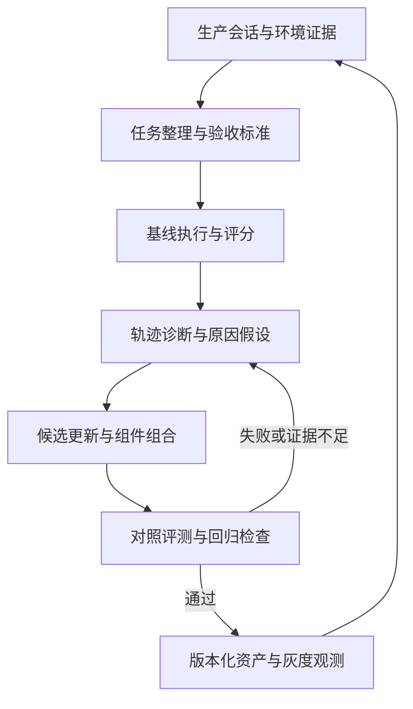

# 会话驱动的 Agent 评测与 GEPA 优化实践

> 整理日期：2026-10-19  
> 面向场景：基于 OpenCode 的企业智能体平台，重点关注 Agents、Skills、工具与执行环境的持续改进。  
> 本文是资料提炼与设计建议，不是已经运行的评测结果，也不代表已在你的内网平台完成验证。

## 0. 阅读标记与来源

全文使用以下标记，避免把作者的方法与针对你的建议混为一谈：

| 标记 | 含义 |
| --- | --- |
| **【原文做法】** | 文章或论文明确提出的方法，以转述形式概括，并注明来源 |
| **【仓库实现】** | 本次通过 GitHub 插件读取的实现及其接口行为；不保证与论文版本完全相同 |
| **【启发式建议】** | 针对你平台提出的工程化方案，需要通过实际数据验证 |
| **【示意案例】** | 为说明设计构造的例子，不是你平台已观测到的事实 |

主要来源：

- **[A]** Anthropic：[Demystifying evals for AI agents](https://www.anthropic.com/engineering/demystifying-evals-for-ai-agents)，2026-01-09。重点对应评测结构、评分器、可靠性、评测维护与生产反馈。
- **[B]** GEPA 论文：[GEPA: Reflective Prompt Evolution Can Outperform Reinforcement Learning](https://arxiv.org/abs/2507.19457)，本文依据 v2，2026-02-14；重点对应第 3 节、3.1 节及附录 D.1。[PDF](https://arxiv.org/pdf/2507.19457)
- **[C]** [gepa-ai/gepa](https://github.com/gepa-ai/gepa)，本次读取 main 分支的 README 和部分核心代码。main 是可变引用，生产接入时应固定提交。

本次重点查看的实现：

| 文件 | 本文用途 |
| --- | --- |
| [core/adapter.py](https://github.com/gepa-ai/gepa/blob/main/src/gepa/core/adapter.py) | 执行、分数、轨迹和反思数据的接入契约 |
| [proposer/reflective_mutation/reflective_mutation.py](https://github.com/gepa-ai/gepa/blob/main/src/gepa/proposer/reflective_mutation/reflective_mutation.py) | 反思候选的生成与评估组织 |
| [proposer/merge.py](https://github.com/gepa-ai/gepa/blob/main/src/gepa/proposer/merge.py) | 按组件组合候选及其验证 |
| [strategies/candidate_selector.py](https://github.com/gepa-ai/gepa/blob/main/src/gepa/strategies/candidate_selector.py) | 候选选择策略 |

## 1. 对你最有价值的两项原始方法

### 1.1 先定义评测对象，再讨论分数

**【原文做法｜A】** 将任务、单次尝试、执行轨迹、评分器与环境最终状态分开；组合代码、模型和人工评分，并用生产反馈补充离线评测。回复声称完成，不等于环境状态验证成功。

**【启发式建议】** 你的首要建设对象应是“证据到任务”的转换层。工具调用统计、文件指纹和 Skill 加载记录先用于定位问题；只有补齐验收条件与结果证据，才能进入质量判断。不要直接让一个模型读整段会话，输出一个笼统成功分数。

### 1.2 用轨迹反馈生成候选，用新执行筛选候选

**【原文做法｜B】** GEPA 固定模型权重，从执行轨迹、分数和文字反馈中反思并更新提示词；先小批次比较，再扩大评估。它保留在不同任务上有优势的候选，支持组合互补模块，最终依选择集表现选取候选。

**【启发式建议】** 将“模型提出了合理解释”视为待检验假设，将“更新后在独立任务上改善且未引入明显回归”视为保留更新的依据。原始失败、原因解释、候选补丁和验证结果应分别存储。

两项方法在你的场景中可连接为：



该图是**【启发式建议】**，不是任一来源的原始架构图。

## 2. 从会话中识别任务、轨迹、评分器和最终状态

### 2.1 在你的平台中建立对象映射

**【启发式建议】** 采用以下对象关系；术语承接 [A]，具体字段与操作规则由本文建议。

| 对象 | 在你平台中的含义 | 最小记录 | 常见误判 |
| --- | --- | --- | --- |
| Session | 原始证据容器 | 消息、调用、文件接触、父子会话关联 | 一段会话必然只有一个任务 |
| Task | 一个目标版本及其验收条件 | 目标、输入截止点、约束、初始状态、来源范围 | 把 Agent 的计划当作用户要求 |
| Trial | 某个系统版本对任务的一次尝试 | 模型、Agent、Skill、工具版本和起始环境 | 将用户追加需求当作同题重跑 |
| Trajectory | 尝试中的可观测执行过程 | 消息、工具参数及返回、文件操作、交接 | 将模型自述的原因当作客观事实 |
| Grader | 针对某个维度的判断逻辑 | 检查项、版本、输入证据、判定及理由 | 把用户满意度等同于正确性 |
| Outcome | 运行结束后的产物或业务状态 | 文件内容、查询结果、测试结果、状态差异 | 文件存在或接口成功就算完成 |

评分器可以评价轨迹，也可以评价最终状态；两种评价应分别保留。过程不够优雅但结果正确，与过程合规但结果错误，属于不同问题。

### 2.2 任务切分依据：目标与验收条件的变化

**【示意案例】** 用户连续提出：生成统计脚本、修复运行错误、改为按部门统计、导出 Excel。

**【启发式建议】** 不按每条消息机械切分，而是判断：

1. 是否仍在修复同一交付目标；
2. 输入数据或验收条件是否改变；
3. 是否出现可独立验收的新交付物；
4. 新目标是否依赖前一阶段产物。

保留 `task_id`、`task_version`、`parent_task_id` 和来源消息范围。修错可能属于同一尝试；目标变化则形成新任务版本。对仍在探索的会话，可先记录“需求形成阶段”，待目标稳定后再产生执行评测题。

### 2.3 用会话特点选择证据与评分器

**【启发式建议】**

| 会话特点 | 可利用信号 | 补充证据与评价方法 | 不能直接推出什么 |
| --- | --- | --- | --- |
| 文件交付 | 写入记录、路径、指纹 | 读取内容、结构检查、运行或渲染 | 存在即正确 |
| 数据库或 API 写入 | 参数、响应、资源 ID | 查询最终记录及必要状态差异 | 请求成功即业务成功 |
| 代码修改 | diff、命令、测试输出 | 在固定环境运行独立验收检查 | 自选测试通过即充分 |
| 用户纠错 | 被纠正要求、对应执行 | 检查约束何时可知，构造变体题 | 一次纠错即可证明根因 |
| 连续工具失败 | 错误码、参数变化、重试 | 区分契约错误、服务故障、无效重试 | 工具失败率等于任务失败率 |
| 多 Skill 或 Agent 交接 | 加载、调用、输入输出 | 检查信息传递与职责边界 | 已加载即有效使用 |
| 自然语言问答 | 回答、引用、用户反馈 | 事实核验、领域 rubric、专家复核 | 沉默或致谢代表正确 |
| 探索性任务 | 目标变化、方案选择 | 检查证据、取舍与决策是否推进 | 必须有唯一固定答案 |

文件指纹适合追踪身份、变化和跨会话复用，不能单独证明业务质量。没有可用推理记录时，使用工具与产物证据；不要要求系统补写所谓真实内部思考。

## 3. 先管理可观测性，再计算成功率

**【启发式建议】** 将证据状态和质量结论分开记录：

```yaml
observability: verified  # verified / partial / unobserved
verdict: pass           # pass / fail / unknown / blocked
evidence_refs:
  - artifact:output.xlsx
  - check:required_columns
blocking_reason: null
```

这些取值不是所有组合都合理，应由记录中的证据解释。例如，文件内容可读取但缺少业务核验，可以是 `partial + unknown`；权限阻塞则记录 `blocked` 和阻塞原因。

至少分别展示：

- **可判定覆盖率**：具备既定验收条件所需证据的任务占比。
- **已判定任务通过率**：pass / (pass + fail)，注明样本范围。
- **未知与阻塞占比**：分别报告，避免从分母消失。
- **全部任务中的已验证成功占比**：可作为保守口径，但不能称为真实总体成功率。

工具错误可以被恢复，最终任务仍成功；工具全部返回正常，业务结果也可能错误。因此工具运行指标与任务结果指标必须关联分析，但不能相互替代。

## 4. 将历史会话加工成可复跑评测

### 4.1 冻结输入、环境、验收与版本

**【启发式建议】** 推荐案例结构：

```yaml
task_id: reporting_001
task_family_id: department_reporting
source:
  session_id: source_session
  message_range: [1, 8]
  input_cutoff: 4
task:
  goal: 按用户要求生成部门统计文件
  constraints: [使用给定数据, 保留指定字段]
  initial_state_ref: fixtures/reporting_001
  replay_mode: isolated_execution
grading:
  required_checks: [required_fields, totals_match]
  rubric_version: reporting_v1
  expected_state_ref: grading/reporting_001
execution_manifest:
  model_version: pinned_model
  agent_version: pinned_agent
  skill_versions: [pinned_skill]
  tool_version: pinned_tool
  environment_version: pinned_environment
  budget: fixed_budget
```

这是设计模板，不是 GEPA 的直接输入格式；实际字段应按你的数据接口裁剪。标准答案、评分器私有检查和来源会话的后续解决方案，不应混入被测 Agent 可见输入。

### 4.2 防止把后来的知识倒灌到过去

**【示意案例】** 用户到第十轮才说明内网不支持 Docker。

**【启发式建议】** 可以构造两类不同任务：

- 输入包含该约束，测试收到限制后的适配能力；
- 输入停在约束前，测试环境假设与必要澄清能力。

不能用第十轮才出现的限制，直接判定第一轮违反明确要求。后续消息可以用于构题，但验收标准应与输入时点一致。

### 4.3 区分审查、续跑与重新执行

**【启发式建议】**

| 模式 | 可以回答 | 不能单独证明 |
| --- | --- | --- |
| 重新评分历史轨迹 | 原来哪些地方有问题、原评分是否合理 | 新提示词有效 |
| 从冻结检查点续跑 | 局部决策或后续步骤是否改善 | 端到端全部改善 |
| 从初始状态重新执行 | 候选版本对同任务的实际表现 | 生产总体已改善 |

涉及外部写操作时使用隔离状态或受控替身，执行后重置。若只回放固定工具返回，要注明它只能覆盖回放允许的行为分支；候选改变查询参数后，旧返回未必仍然适用。无法重建的任务先作为诊断材料，不必强行纳入端到端自动评测。

## 5. 自动评测、生产监控与人工复核的协作

**【启发式建议】** 将职责固定在三类问题上：

| 机制 | 核心问题 | 产出 |
| --- | --- | --- |
| 生产监控 | 真实用户正在遇到什么，分布是否变化？ | 任务分布、异常队列、版本与部门切片 |
| 自动评测 | 某项改动在固定条件下是否有效？ | 候选比较、回归、成本与结果证据 |
| 人工复核 | 需求、原因解释和裁判标准是否合理？ | 修正标签、验收标准、校准样本 |

人工队列同时覆盖随机样本、定向异常和疑似成功样本。随机样本用于发现监控盲区与估计总体；定向样本用于高效诊断。两类结果分开报告，避免把异常队列失败率当作生产失败率。

模型裁判应输出 `verdict`、`evidence_refs`、`reason` 和 `unknown_reason` 等结构化字段；使用独立调用及固定提示词，按你的 v1 兼容端点运行。temperature=0 有助于控制波动，但不保证完全确定。

对 A/B 主观比较可交换顺序、隐藏候选身份。人工复核应包含“自动判通过”的样本，以检查假阳性；裁判分歧、领域争议和证据不足应单独进入队列。

### 5.1 质量门槛与效率分开

**【启发式建议】** 至少分别记录：

| 维度 | 示例 |
| --- | --- |
| 结果正确性 | 汇总值是否正确，记录是否真正写入 |
| 约束遵循 | 环境限制、指定字段、禁止扩大查询范围 |
| 过程质量 | 异常恢复、必要澄清、交接信息完整性 |
| 效率 | 时间、token、工具调用、用户介入 |
| 证据充分性 | 哪些判断已有可追溯证据 |

关键要求作为门槛，其余维度分别展示。不要让“更快失败”因低成本得到高分，也不要要求所有任务遵循同一工具调用顺序。只有业务规则确实要求的步骤，才应成为硬性过程检查。

## 6. 从轨迹反思到最小提示词更新

### 6.1 反思前先区分故障类型

**【启发式建议】**

| 类型 | 优先动作 |
| --- | --- |
| 缺少证据 | 补日志、产物或状态查询 |
| 任务或评分器错误 | 修订案例并重新建立基线 |
| 工具或环境故障 | 修复接口、依赖、权限或替身 |
| 指引不足或冲突 | 提出 Agent / Skill 文本候选 |
| 单个特殊案例 | 保留案例与反例，暂不推广为全局规则 |

这一步防止把所有失败都转化为提示词越来越长。一次实验中保持评分器固定；如果必须修裁判，应对基线与候选全部重评。

### 6.2 面向组件组织反思材料

**【仓库实现｜C：adapter.py】** `evaluate()` 返回输出、分数和可选轨迹；`make_reflective_dataset()` 把执行结果整理为面向待更新组件的材料。候选是具名文本组件映射。轨迹的解释与材料提取由适配层负责，GEPA 不会自动识别你的平台语义。

**【启发式建议】** 对每个问题提供“最小但充分”的证据窗口：组件当时可见输入、相关输出、工具反馈、最终状态及少量上下游关联。保留原始轨迹引用，避免压缩反馈时丢失关键反证。

建议反思输出契约：

```yaml
observed_facts: []
evidence_refs: []
cause_hypothesis: ...
alternative_explanations: []
target_component: ...
proposed_patch: ...
expected_behavior_change: ...
applicability: ...
counterexamples: []
regression_risks: []
validation_tasks: []
```

该契约是本文建议，不是 GEPA 强制格式。反思器提出原因假设，后续对照实验才负责检验。生成、裁判和反思即使使用同一基础模型，也应采用独立调用、不同系统模板及受控输入。

### 6.3 从失败中提炼有边界的规则

**【示意案例】** 查询工具返回成功但结果为空，Agent 直接交付“分析完成”。

**【启发式建议】** 先检查参数错误、源数据缺失、业务确实无记录、工具返回含义不清等解释。若证据支持 Skill 缺少空结果指引，可提出：

> 查询成功但结果为空时，检查筛选范围与数据覆盖；不能确认原因时明确报告证据不足。是否放宽范围，遵循用户约束。

测试应同时覆盖真实空结果、错误参数、数据源缺失、用户禁止扩大范围。不要形成“空结果就换参数直到查到”的全局规则。

成功轨迹也可贡献恢复策略，但不能将其中每一步都视为必要；需要通过删减实验或变体案例验证其可迁移性。

## 7. 候选搜索、测试和组合

### 7.1 在你的资产结构中定义候选

**【启发式建议】** Agent 文档保留场景导航、职责与协作边界；Skill 承担具体执行指导。优先一次修改一个职责明确的组件：

```python
candidate = {
    "agent_routing": "...",
    "skill_query": "...",
    "skill_empty_result": "...",
    "skill_delivery_check": "...",
}
```

这只表示可替换文本。多文件 Skill 要额外管理目录快照、脚本与引用依赖，避免只保存 SKILL.md 而遗漏实际运行资产。若主要问题在脚本实现，应进入代码修复与验证流程。

### 7.2 保留不同任务上的优势候选

**【示意案例】** 下表数值仅用于解释候选互补性。

| 候选 | 查询任务 | 空结果任务 | 交付检查 | 平均分 |
| --- | ---: | ---: | ---: | ---: |
| 基线 | 70 | 30 | 70 | 57 |
| A：更新查询指引 | 90 | 30 | 70 | 63 |
| B：更新空结果处理 | 70 | 80 | 70 | 73 |
| C：组合 A 与 B | 待测 | 待测 | 待测 | 待测 |

**【启发式建议】** 不仅记录总分，还记录逐任务结果和场景切片；避免因平均分较低而过早丢弃有局部优势的候选。GEPA 的逐题候选保留思想，不应简单等同为“质量—延迟—成本”业务多目标前沿；后者需要额外定义指标和选择规则。

### 7.3 组合必须作为新候选验证

**【仓库实现｜C：merge.py】** 当前组合逻辑查看共同祖先与组件变化，从父候选中选择组件，并对组合结果进行评估。它不是将两份文档直接拼接，也不是保证两份候选收益相加。

**【启发式建议】** 组合前检查职责边界、共享假设和输入输出契约。组合后至少覆盖：

1. A 原来占优的任务；
2. B 原来占优的任务；
3. 同时触发两段规则的交互任务；
4. 原有回归任务。

同一组件存在冲突规则时，先做显式修订，再作为新候选测试。只有两个不同组件有效，并不意味着它们可以无条件组合。

### 7.4 区分 GEPA 接入与工程门控

**【启发式建议】** 以下是平台侧流程示意，不是可直接运行的 GEPA API 示例：

```python
baseline = run_and_grade(seed, frozen_tasks)
pool = [seed]

while budget_remaining():
    parent = select_candidate(pool)
    batch = sample_diagnostic_tasks()
    evidence = run_and_grade(parent, batch, capture_traces=True)
    proposal = reflect_and_propose(parent, evidence)

    comparison = paired_run(parent, proposal, batch)
    if passes_screening(comparison):
        selected_results = run_and_grade(proposal, selection_tasks)
        record_candidate(proposal, selected_results, parents=[parent])
        update_pool(pool, proposal, selected_results)

winner = select_for_release(pool)
final_results = paired_run(seed, winner, heldout_tasks)
```

真正使用 GEPA 时，由其搜索引擎管理候选流程；你的适配层提供执行、评分、反馈，外围提供独立最终验收和资产版本管理。不要同时维护两套相互冲突的候选接受逻辑。

## 8. 防止优化收益被泄漏、预算或随机性夸大

### 8.1 按用途隔离数据

**【启发式建议】**

| 数据用途 | 反思器是否可见 | 作用 |
| --- | --- | --- |
| 训练／诊断集 | 可以看到详细轨迹与反馈 | 形成更新假设 |
| 候选选择集 | 尽量只向生成侧反馈必要选择信息 | 选变体、保留候选 |
| 最终保留集 | 不向生成与搜索暴露 | 阶段性独立验收 |

GEPA 的选择数据参与搜索，不能当成最终独立测试数据。按任务家族、同源文件和模板派生关系分组，而非随机拆消息。保留集一旦频繁用于指导更新，应重新界定其用途。

### 8.2 固定条件与预算，记录收益来源

**【启发式建议】** 对照实验固定模型、工具、环境、评分器与执行上限；配对比较同一批任务，记录修复与回归，而不是只比较两个平均数。

区分三类成本：

- 候选生成与反思成本；
- 筛选与验收成本；
- 更新后每次生产任务的运行成本。

搜索中的全部调用都应计入总投入；rollout 数少不等于总费用必然低。论文中某组实验的收益不能直接外推为你平台的预期收益。

对波动明显的任务重复运行。若采用独立同分布的单次成功率 p 作为简化假设，则“k 次至少成功一次”为 1-(1-p)^k，“k 次全成功”为 p^k；实际任务难度异质，应按任务统计，不宜将总体平均 p 直接代入当作实测结论。

上线主要关注单次可用性与重复可靠性；增加重试带来的成功率变化，应与提示词改进分开报告。数据量小时报告逐题差异与不确定性，不凭一次小幅均值提升宣称稳定改善。

## 9. 结合现有分析 Skills 的职责划分

**【启发式建议】** 下表是建议的协作分工，未在本次逐份审查现有 Skill 文件，不代表其当前实现已满足这些契约。

| 能力 | 建议职责 | 交付给下游 |
| --- | --- | --- |
| session-observe | 识别任务分布、异常和观测缺口 | 证据索引、随机与定向队列 |
| harness-diagnose | 区分事实、原因假设和系统故障 | 组件级反思材料、最小改动建议 |
| eval-curate | 冻结任务与输入，管理划分及泄漏 | 可复跑案例、评分契约 |
| harness-compare | 执行基线与候选，检查回归和成本 | 对照结果与保留建议 |
| experience-screen | 检查适用边界、反例和验证状态 | 候选经验、资产更新依据 |
| GEPA 或等价搜索层 | 生成、测试、保留与组合候选 | 候选谱系和选择结果 |

先按职责隔离，不必为每个职责新增一个 Agent。是否拆成独立 Agent，取决于上下文隔离、权限与实际执行需求；验收与生成应有独立上下文和明确证据边界。

## 10. 最小落地方案与验收

**【启发式建议】** 先从“工具查询 → 分析 → 文件交付”这一类任务开始，原因是工具反馈和产物证据较容易获取。

### 第一阶段：建立证据闭环

- 整理一小批真实任务，覆盖成功、失败与不可判断案例。
- 标明输入截止点、任务家族、约束来源与初始状态。
- 补齐产物内容或状态验证，建立人工复核过的验收标准。

验收：另一名复核者能够沿证据判断结论；不能重跑的任务有明确原因。

### 第二阶段：做一次单组件实验

- 选一个反复出现、疑似由指引造成的问题。
- 保留其他组件，仅提出小范围文本更新。
- 在诊断任务、选择任务和回归任务上比较，最终使用保留任务验收。

验收：能够说明修复了什么、破坏了什么、成本如何变化，以及适用边界。

### 第三阶段：尝试候选组合与生产反馈

- 有两个经验证的互补候选后，再测试组合。
- 保存父候选、差异、评测配置与证据。
- 小范围上线，监控新失败与任务分布；必要时回到原版本。

验收：生产发现的问题可以重新进入任务整理流程；资产改动具有可追溯验证记录。

## 11. 实践中应长期保留的判断原则

**【启发式建议】**

1. 会话是证据来源，评测案例需要额外整理。
2. 缺少结果证据，应先补观测；不要强判成败。
3. 反思给出原因假设，实验检验更新是否有效。
4. 工具与环境问题优先修实现，避免用提示词掩盖。
5. 评分器需要版本和校准，也可能是回归来源。
6. 候选组合必须重新执行；文本兼容不等于行为兼容。
7. 持久化的核心资产是经过验证的改动及其边界、反例和证据。

本文没有修改你的 Agents、Skills 或平台代码。字段、队列、门控与接入步骤均为启发式方案，应按可达数据与实际维护成本逐步裁剪。
